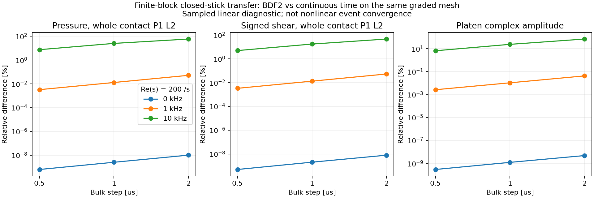

# 固定細網格的 bulk 時間符號誤差

這項診斷將先前的[解析單模態檢查](modal_time_resolution.md)推進到實際兩個有限 block。
固定 h10、contact h2、end／corner 0.015625 mm、Q12，直接重新組裝原 Galerkin
算子，分開計算連續時間與 BDF2-CQ 的 closed-stick actuator response。
不使用正在建立的插值頻譜、時間權重或非線性事件結果。

依 [Melenk、Nick 的 CQ 定義 §2.1](https://arxiv.org/html/2410.15079v1#S2.SS1)，
本程式的 bulk transfer 在 z-transform 平面為 `Z(delta(z)/dt)`，
其中 `delta(z)=3/2-2*z+z*z/2`。本診斷取 `z=exp(-s*dt)`，比較

```text
q_continuous = [Z(s) + Dcontact + Dspring]^-1 * bspring
q_BDF2       = [Z(delta(exp(-s*dt))/dt) + Dcontact + Dspring]^-1 * bspring.
```

接觸 penalty、彈簧及單位 actuator 擾動在兩式完全相同。
這是 sampled transfer comparison；它不宣稱有限時間從零開始的指數載入已達到穩態，
也不包含 CQ 啟動、頻譜內插／反轉誤差或接觸分支切換。
所選 closed-stick 分支亦不是實際 healed preload 的所有 active sets。

評估點為 `Re(s)=200 /s`、頻率 0／1／10 kHz，時間步 2／1／0.5 µs。
全部壓力及帶正負號剪力使用複數振幅的全接觸面 P1 L2 差；
platen 使用複數相對差，不只比較振幅大小。
每個算子另外驗證原 supported-body 平衡、jump identity 與接觸／彈簧根的殘差。
通過這些取樣不能替代完整非線性時間收斂或與 FEM 的事件比較。

## 2026-10-28 的實際細網格結果

1 kHz、2 µs 的 pressure／signed shear／platen 差為
0.05257%／0.05365%／0.04219%；時間步依序減半時，三者約各縮小四倍。
但 10 kHz 的相同測試揭露明顯的 bulk 時間誤差：

|Bulk step [µs]|Pressure P1 L2|Signed shear P1 L2|Platen|
|---:|---:|---:|---:|
|2|59.1631%|46.5904%|68.5451%|
|1|25.5072%|17.6801%|23.7211%|
|0.5|7.5707%|5.0096%|6.5392%|

以上全部相對同一空間網格的連續時間 transfer，不能將數字直接當成非線性事件誤差。
它顯示 2 µs BDF2 對這個取樣頻率的響應尚未解析，
增加局部 constitutive substeps 不會改變該 bulk 時間符號。
尚未量測實際 graded rupture 對各頻率的激發／敏感度，
因此既有 2 µs 完整事件保留為對照，下一步另檢查同網格的 Radau IIA 響應，
再選擇完整事件的時間加密方式；不由 A-stability 或局部殘差推論時間精度。

新的 continuous-time responses 與先前原 compliance-condensation 路徑的三個保存結果，
pressure／shear／platen 最大相對差為 1.54e-11。
全部 12 個 supported-body 平衡最大相對殘差為 9.78e-15，
接觸／spring 根殘差為 1.28e-15。
這支持時間符號差異的判讀，仍不是全頻率或非線性誤差證明。
程式相關 21 項測試及 Python 3.11／3.12 CI 已通過。
[完整數字、來源與計時範圍](bulk_time_symbol_results.json)保存原始記錄。



為限制記憶體，每次只準備一個 body's quadrature geometry，
所有頻率的 supported matrices 暫存在磁碟；完成另一個 body 後才凝縮及求根。
輸出保留小型 response NPZ、各點殘差、輸入／程式指紋及 mesh arguments，
已處理的 supported 暫存檔會釋放。
這改變組裝排程，沒有改積分點、原始算子或時間符號。

```sh
PYTHONPATH=bem/src OPENBLAS_NUM_THREADS=1 FDBEM_CORES=1 python -B \
  bem/tools/audit_bulk_time_symbol.py MESH_SUMMARY_JSON \
  --dt 2e-6 1e-6 0.5e-6 --frequencies 0 1000 10000 \
  --max-memory-mb 4096 --output FRESH_DIAGNOSTIC
```

`MESH_SUMMARY_JSON` 只提供 `source_mesh_arguments` 和相符的 package／case 指紋，
可以是已完成的靜態控制，無須假裝它是完成的動態 kernel。
測試另外以真實兩有限體的原 compliance-condensation 路徑，
核對串流組裝所得的全部 responses；單模態控制檢查二階誤差與符號，
複數內部相位錯誤即使端點及振幅相同仍會被 profile metric 捕捉。

2026-10-28 的細網格量測以一個 worker 執行，與兩-worker fresh kernel 重疊，
已知 numerical worker 合計三個；這份時間不能用作受控 FEM／BEM 速度比較。
診斷 wall time 為 909.67 s，包含 geometry、24 次 body assembly、磁碟暫存及求解。
原 kernel 的付費 wall time 包含這段重疊，沒有扣除。
完整新 kernel、45 ms 事件、graded FEM 及初始化 AD 仍沿既有排程接續。
