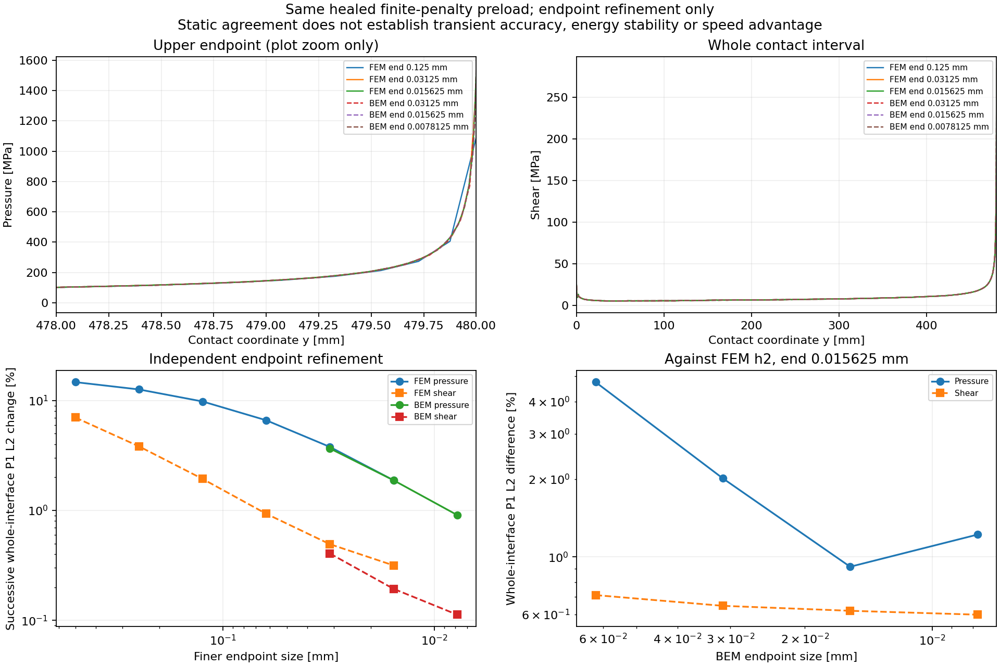

# 保留原 chamfer 的 FEM 端點加密控制

相同 241 contact nodes 的 BEM 靜態解相對 FEM h2 仍有約 9.53% 壓力、11.94%
剪力 P1 L2 差；outer h10／h5 的差僅約 0.0224%／0.0596%。
因此大型 CQ 建核已停在原篩選門檻，沒有把較小的 root residual 當成精度通過。
後續先分開檢查 FEM／BEM 的 contact-end 空間誤差，而非以 mesh 調參擬合 endpoint peak。

原 FEM source `933ae1f` 的 `create_structured_quad_block` 明確不支援同時使用
chamfer 與 fault-end refinement。直接改成 fillet 會改變本事件幾何，不能沿用。
`tools/chamfer_mesh_refinement.py` 新增明確的 mesh-only adapter：

- 使用原 graded axis、quad connectivity 與 chamfer polygon mapping。
- 在兩個 body 共用的 y refinement points 加入真實接觸終點 `500-20=480 mm`。
- 複製 function globals 以選擇新的 mesh generator，不修改原 function bindings 或 source files。
- 保留原材料、Coulomb active set、penalties、支承與 loading kernels。
  原 RunConfig 的 graded pair-mass time-step estimate 仍由原 model builder 計算。

沒有 refinement 時，adapter 直接呼叫原 builder。三項測試使用從 pinned source
原樣擷取的 geometry functions，核對該路徑的 bitwise mesh identity、兩側接觸節點、
chamfer 面積、所有 Gauss-point Jacobians 為正，以及原函式仍保留原有拒絕條件。
test fixture 保存 source file／各函式 AST 指紋與 MIT 來源標示；不依賴 CI 中的本機 FEM cache。

`fem_graded_static.py` 使用這個 adapter 和原 static solver，從相同 captured float64
restart 的 P1 場重新解每個網格，容許原 healed Coulomb preload 更新 plastic offset。
其輸出明確在 shear-start 將 weakening memory 設回零；不把 static helper 回傳的
absolute plastic offset 當成動態累積弱化。

小型真實 FEM 控制已完成：outer h40、end h10，原／加密模型為 318／946 DOFs，
平衡 residual 約 1.11e-12／1.80e-12。這只驗證介面能接回真實 source；不是原事件的精度結果。
原 bulk h2 的控制已完成，保留 unrefined baseline，將 end size 從 1 mm
連續減半到 0.015625 mm。原 h2 baseline 的 pressure peak 為 344.6162 MPa；
最細控制為 1519.7601 MPa。最後兩級的全接觸面 pressure／shear P1 L2 變化為
1.8834%／0.3161%，仍不能視為連續體或完整動態已收斂。

```sh
PYTHONPATH=bem/src FDBEM_CORES=4 OPENBLAS_NUM_THREADS=1 JAX_ENABLE_X64=true \
  python -B bem/tools/fem_graded_static.py --restart-seed ORIGINAL_FLOAT64_SEED \
  --mesh-size 2 --end-sizes 1 .5 .25 .125 --include-unrefined --output FRESH_STATIC_STUDY
```

使用與既有研究相同的完整四核心 thread environment；上例只列主要變數。
工具保存輸入／adapter 指紋、effective RunConfig、DOFs、接觸 spacing、真實 float64
static snapshots、原方程 residual、active set、推估的 model dt、RSS 與計時。
自動 dt 是 model setup 資料；本工具沒有時間推進，也沒有驗證這個新 mesh adapter 的動態結果。
目前尚未將 adapter 接入正式 FEM transient runner；原 h2／h1 完整動態 reference 均保留。
原 `/Volumes/Gauss-T7/tatva` 全程只讀，同精度 BEM 優勢仍未達標。

## BEM 靜態比較與初始化的數值修正

BEM 使用 contact scale 2 mm、outer scale 10 mm，獨立減小端點與角落面板。
最初的 condensed backend 在 end 0.015625 mm 觸發既有 full-body balance 門檻：
重建位移 `u = loaded_u + response_u @ q` 的原始方程殘差為
1.9315e-7 MPa，超過 1e-7；trace error 約 1.12e-13 mm。
原始失敗、已完成的前六級控制及其 source commit `050bf1d` 均保留。

新增的 `tools/uncondensed_static_contact.py` 在原支承／platen 消去後的完整
boundary displacement coordinates 聯立求解 healed active set，保留原 penalty、
摩擦係數、source restart、weakening memory 及全部接受門檻。
它直接量測 `Kr*u - F`，以原 work-conjugate trace 的轉置投影取得 bulk port force，
並各自檢查 full balance、非 port 投影殘差及 port equilibrium；沒有把 bulk force
設成負的 contact force 來製造零殘差。

在完全相同的失敗矩陣上，直接 full-body root 的殘差為 1.17e-8 MPa；
與舊 trace 解的位移差約 1.21e-12 mm、完整位移差約 6.54e-12 mm。
這是原方程的數值初始化改善，不是整段動態穩定性證明。
三項新增測試包含原／refined quadrature 的場與功共軛平衡、受擾重建矩陣的拒絕，
以及直接求解不依賴受擾重建的檢查。

新的 BEM end sizes 0.0625、0.03125、0.015625、0.0078125 mm 全部通過原門檻；
最後兩級 pressure／shear 的全接觸面 P1 L2 變化為 0.9087%／0.1125%。
end 同為 0.015625 mm 時，對 FEM h2 的 pressure／shear 差為 0.9165%／0.6189%；
BEM 再細一級而 FEM 不變時，差為 1.2206%／0.5979%。全部指標包含端點，
不能挑較接近的一級作為收斂證書。

兩方法都從同一 float64 P1 source 取樣，但新網格沒有保留全部 source knots。
BEM 的固定 jump trial-shear projection bound 約 3.26–3.73 MPa，已列入
[完整數據](graded_static_results.json)；它是輸入場近似的界，不是解場誤差估計。
完整事件仍需檢查其影響。

FEM background h1 的 end 0.03125 mm 嘗試未通過原 1e-8 static relative residual
門檻，未接受其場，也未完成第二級。該次失敗沒有捕捉殘差的具體數值；
工具已補上失敗 snapshot／診斷保存，後續須先定位再修正數值求解。
BEM Q12／Q24 積分控制及 graded linear dynamic responses 亦是進入完整事件前的控制。
目前只證實上面的靜態差異與數值初始化改善，沒有同精度 FEM 速度或動態穩定性優勢。



```sh
PYTHONPATH=bem/src FDBEM_CORES=4 OPENBLAS_NUM_THREADS=1 JAX_ENABLE_X64=true \
  python -B bem/tools/bem_graded_static.py SOURCE_KERNEL \
  --restart-seed ORIGINAL_FLOAT64_SEED --outer-h 10 --contact-h 2 \
  --end-sizes .0625 .03125 .015625 .0078125 --static-backend uncondensed \
  --fem-studies FEM_H2_STATIC FEM_H2_FINE_STATIC --output FRESH_BEM_STATIC
```

這個 backend 目前由 static driver 明確選用；既有 transient／AD backend 沒有改變。
