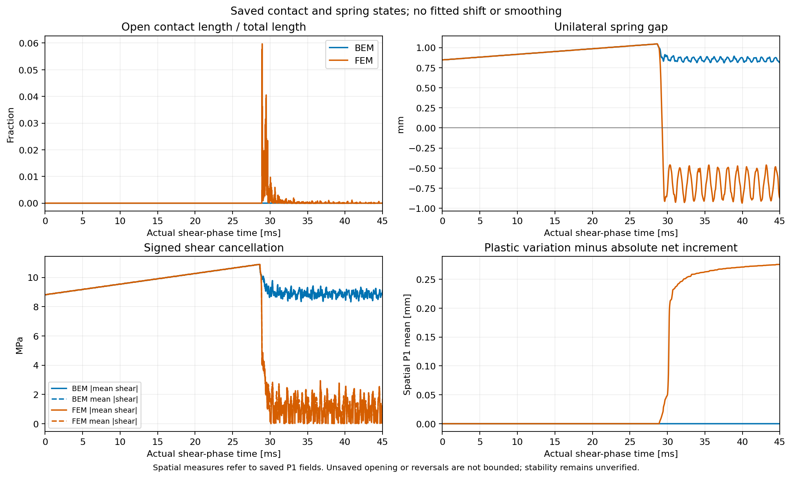

# 破裂後的接觸狀態分歧

2026-11-04。對[首組完整 45 ms 比較](recovered_full_event.md)的同一批資料，
新增接觸張開、單向彈簧分離、帶符號剪力與塑性路徑診斷。
FEM 是 h=2 mm／端點 0.015625 mm 的同 case 重播，尚未時間收斂；
本頁不更換參考解、不改原六場的 5% 接受門檻。
[完整記錄](contact_state_divergence_results.json)與[繪圖數據](diagnostics/contact_state_divergence/contact_modes.npz)保存來源與計算範圍。

## 已觀測到的分歧

| 保存場的診斷 | BEM `(64,128)` | FEM |
|---|---:|---:|
| 首次觀測到接觸張開 | 未觀測到 | 28.888211 ms |
| 最大張開長度／完整接觸長度 | 0 | 5.96945% |
| 最小法向 jump，負值代表張開 | +0.000112562 mm | −0.003768063 mm |
| 首次明確觀測到彈簧分離 | 未觀測到 | 29.308258 ms |
| 最小彈簧間隙 | +0.810255 mm | −0.935569 mm |
| 共同 45 ms 的負剪力長度比例 | 0 | 33.1895% |
| 共同 45 ms 的平均帶符號剪力 | 9.12270 MPa | 0.650114 MPa |
| 共同 45 ms 的剪力絕對值平均 | 9.12270 MPa | 1.70394 MPa |
| 累積變化量減去絕對淨塑性增量的空間平均 | 約 `2e-14 mm` | 0.275785 mm |

FEM 首次張開的已保存節點位於接觸座標約 0.257798 mm，靠近載入端。
這只是首個已保存觀測，不是精確事件起始時間。
末端的負剪力不能單獨用來判定瞬間滑動方向；剪力大小下降與正負抵銷亦需分開看。

## 計算與適用範圍

接觸欄位皆來自真正 float64 狀態。時間使用原整數步數與實際 dt，
沒有平移或平滑；兩側全部端點保留。
張開長度由法向 jump 的空間 P1 插值計算，逐區間解析定位零點，
不是負值節點數比例。剪力絕對值的空間積分亦在所有變號點分段積分。
這些是保存插值場的精確量，不能界定未保存時間步的張開與振盪。

FEM 的彈簧座標來自原 scalar output，其儲存精度為 float32；
只在間隙小於負的儲存 roundoff bound 時列為明確分離。
最大 bound 約 `5.65e-6 mm`，遠小於觀測到的負間隙。
BEM 彈簧座標使用原 float64 輸出。
共同 45 ms 的欄位先插值到同一時刻，再計算非線性空間量。

塑性路徑診斷使用各自首筆原生觀測作基準，計算
`mean(C-C0) - mean(abs(z-z0))`。
`C` 已由原微步 return map 累積塑性增量的絕對值，
所以此差保留路徑回返造成的變化量；它不是摩擦功、速度或能量。
FEM 首筆位於剪切後 1.91258 ns，沒有把法向載入末筆重標成剪切 t=0。

## 能量與後續判斷

另以同一完整 FEM 的 9000 筆原 scalar histories，核對外功減儲能變化。
actuator work 約 2737.130、normal work 約 164.402，
摩擦加數值餘額約 **7795.980 MPa·mm²／單位厚度**。
將保存資料每 16 筆取一筆，餘額改變約 0.102；這只檢查輸出積分敏感度，
不證明原時間步已收斂。餘額合併摩擦與數值／積分誤差，不能辨識各自大小。

接觸張開在 BEM 局部求根失敗附近出現，彈簧分離則在稍後發生。
這個時序有助於定位檢查，但尚未證明因果。
完整原因果 RK 稽核、較細接觸積分與獨立 bulk／時間／空間控制仍需完成；
不能將尚未出現張開的 BEM 解直接稱為更穩定。

工具為 `tools/diagnose_contact_modes.py`。
四項測試涵蓋不規則節點內的變號、零區間與孤立零點，
以及原 writer 的 flat normal／tangent jump 格式。
第一輪診斷讀取格式錯誤已保留失敗與成本；修正後對同一資料完成重算，
不影響原求解或場比較。
