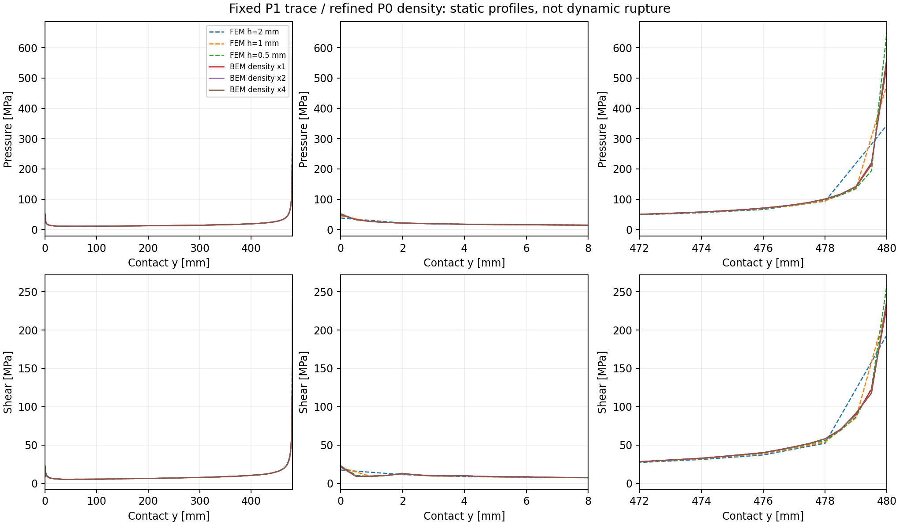

# 固定位移與接觸網格的輔助密度加密

2026-10-25。這是靜態誤差研究，不是完整dynamic BEM驗證。
固定端點0.5mm與seed8/sub4時，中段接觸h由5降至2mm，
靜態首次yield只由26.3689變到26.3805ms，位置皆為y=2mm。
[同設定的FEM靜態加密](static_float64_mesh_results.json)仍有更大的局部差異。
接著已完成P0輔助密度在角落附近的解析度控制，檢查其對初始牽引場的影響。

補讀Aimi、Di Credico、Gimperlein（2024）的
[§5.2 mixed boundary integral formulation](https://arxiv.org/html/2405.08566v1#S5.SS2)：
文中分開配置dummy density與位移空間，並明確指出density可使用P0。
本專案由此提出固定trace、單獨加密density的誤差控制實驗；
這不是將該文的Tresca分析直接套用到目前非單調slip weakening。

`galerkin_density.py`細分角落附近的density panels，
將refined P1 traces以固定插值P限制回原本的P1 trace空間。
對refined算子V、H、D計算

```text
Hc = H P
Dc = P.T D P
Kc = Hc.T solve(V, Hc) + Dc.
```

因此原接觸節點、位移座標與摩擦律保持不變，Galerkin輔助空間則確實改變。
每一組都核對Dc與factor=1的差小於原1e-7相對門檻；
超出即拒絕，不把積分規則改變混稱為純density加密。
獨立affine traction及rigid-mode回歸測試檢查所保留的物理trace。
這個方法不保證改善成核時間；既有另一個網格上的靜態結果不能替代目前案例。

從repository根目錄執行，使用新輸出目錄：

```sh
FDBEM_CORES=4 PYTHONPATH=bem/src python -B bem/tools/galerkin_density.py \
  --h 20 --contact-h 5 --contact-end-h .5 --corner-h .5 \
  --restart-knot-window 8 --restart-knot-subdivisions 4 \
  --quadrature 16 --factors 1 2 4 --radius 16 --max-memory-mb 8192 \
  --output bem/outputs/density-current-trace-study
```

工具保存實際參數、retained history維度、case／seed／程式指紋及各body的
組裝陣列估計。`--max-memory-mb`在準備積分geometry前檢查body組裝估計，
不宣稱是整個Python程序的RSS硬上限。禁止覆寫已有研究資料。
`construction_and_static_seconds`包含每組density組裝與靜態求解；
既有`seconds`只計靜態lift／tangent solve，不能拿它當完整加密成本。

## 相同trace的實際結果

目前完整動態案例所用trace保持250+254 panels、137個接觸節點、275個history DOFs；
Q16、角落radius=16mm，原摩擦律與塑性seed均不變。

|Density factor|Density panels|首次靜態yield [ms]|對FEM h2壓力／剪力L2|對FEM h0.5壓力／剪力L2|組裝＋靜態 [s]|
|---|---|---:|---|---|---:|
|1|250+254|26.3689|19.52%／12.83%|7.93%／4.43%|19.72|
|2|356+332|25.7537|20.80%／13.39%|6.55%／3.87%|36.20|
|4|568+488|25.6733|20.95%／13.48%|6.39%／3.78%|85.02|

三組首次yield皆在y=2mm。FEM h2的靜態預測為25.8039ms、y=0；
FEM h0.5為23.2265ms、y=2mm。FEM自身的首次yield仍未單調收斂。
接近h2的時間並不代表牽引場也更接近h2；加密density在此控制中更接近細FEM的
靜態壓力／剪力場。這尚未證明任何一組就是收斂真值或完整事件的最佳離散。

表中L2以兩個P1函數的共同knots精確積分，涵蓋完整0–480mm；
與舊表在BEM節點作lumped quadrature的數字不能直接混比。
另保留兩端各8mm與中段的平方誤差貢獻，沒有從全域指標刪除角落。
例如factor=4對h0.5的全域壓力差為6.39%，中段壓力局部相對差約0.19%；
誤差主要集中在端點。完整指紋、各區貢獻及實測成本見
[density_refinement_results.json](density_refinement_results.json)。



可用`tools/report_density_refinement.py STUDY --fem-static FEM_STUDY --output NEW_FOLDER`
重建表格與圖；數值norm只需核心依賴，繪圖需`.[plot]`。

即使retained history維度沒有增加，
新的density近似也會改變dynamic operator；不能直接沿用舊CQ權重。
只有靜態證據充分後，才進一步評估新核心、完整事件、AD與建核成本。
