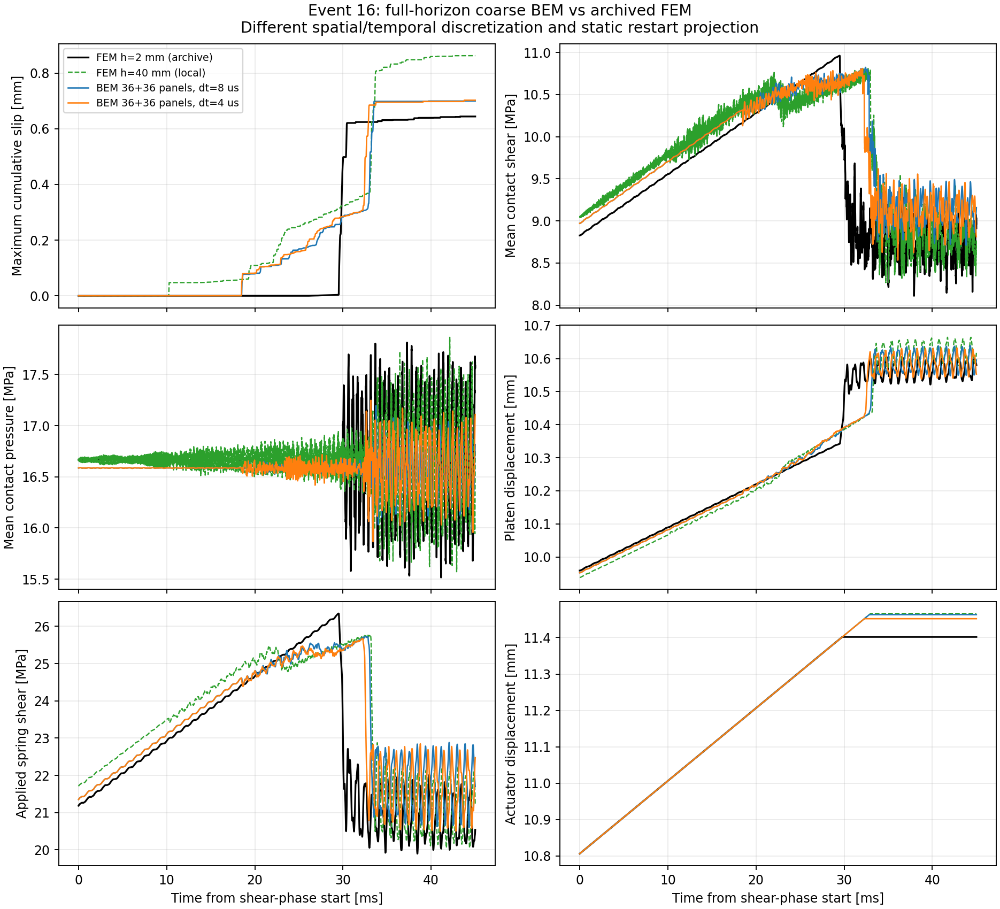
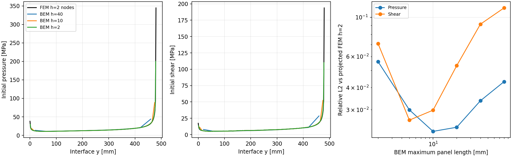

# Event 16：4 核心對照，2026-10-22

**已完成 45 ms 粗網格 fully dynamic BEM，尚未達到可驗證原 2 mm FEM 的收斂精度。**
兩個有限 block、chamfer、支承、剛性 platen、彈簧、LSW 及停止載入條件都已納入。
原始 `/Volumes/Gauss-T7/tatva` 僅讀取；所有新 source、快取和輸出在本 checkout。

比較來源為 `local-mus08-muk06-gap0-v2-ev16`，FEM revision
`933ae1f3fe1c634391bdbd316e4efa5dbf0e6d5d`。
新 FEM 執行使用該 revision 的本機 Git snapshot，避開目前已更改的 FEM runner。
時間原點統一為剪切階段起點，FEM 絕對時間扣除 2 ms。

## 解的穩定性

40 mm BEM 的 8 us／5625 步、4 us／11250 步都完成 45 ms。
所有保存場皆有限，接觸壓力非負、累積滑移不減，摩擦界限最大比值為 1。
最大邊界／接觸殘差分別約 1.47e-11、1.45e-11 MPa。
摩擦耗散功分別約 2941、2953 MPa mm²／單位厚度，均為正。

長時間測試曾在 29.600 ms 開閉切換時失敗：原本的 infinity-norm line search
拒絕可行 Newton 步。改用 L2 merit 後，原失敗步以兩次更新收斂；方程、摩擦律與
1e-7 MPa 收斂容許值都未變。失敗狀態已成為解析／AD 後端共同的回歸測試。

這是本次離散設定的數值穩健性證據，尚非 nonlinear P0 collocation 的能量／passivity
證明。也尚未建立動態空間收斂，不能只憑小殘差宣稱物理解已正確。

## 模擬花費時間

本機使用 4 個核心組裝 worker；各 worker 的 BLAS 限為 1 thread，避免相乘超額使用。
時間推進另以環境變數設定 4 thread。macOS 未強制硬 CPU affinity。

|工作|本機量測|
|---|---:|
|BEM 40 mm／8 us，冷核心組裝|316.7 s|
|BEM 40 mm／4 us，冷核心組裝|554.7 s|
|BEM 40 mm／8 us，重用核心的完整 45 ms 計算|5.45 s|
|BEM 40 mm／4 us，重用核心的完整 45 ms 計算|10.60 s|
|FEM 40 mm，自動穩定步長約 0.06785 us，2+45 ms|28.91 s|
|FEM 原 2 mm 網格，短程 0.05 ms，含初始化／編譯|19.91 s|

BEM 重用數字包含本次 JIT，但不含靜態 lift 及結果寫檔；冷核心組裝是開發時獨立量測，
對應相同核心的程式指紋，並非額外宣稱另一個同版冷啟動完整 run。
FEM 時間包含初始化、編譯與 HDF5，40 mm case 保存 9000 個剪切 frames。
數字為本機單次量測，非控制所有系統負載的 benchmark。

原 2 mm／45 ms FEM 的封存 wall time 為 6969.1 s，剪切穩態 chunks 為 6630.3 s，
但沒有核心數記錄。本次只在其原網格／步長做短程 4 thread 計時，縮短法向 hold；
不能把原紀錄或外推時間當成本次完整 4 核心重跑。

**目前冷啟動的粗網格 BEM 比粗網格 FEM 慢。** 核心快取對同幾何、同材料、同 dt
的摩擦參數掃描有價值，但這些設定尚無相同誤差容許值，不能宣稱公平的整體加速比。
線上 FFT 已去除逐步平方歷史加總，dense 權重儲存和頻率核心組裝仍是主要瓶頸。

## 解的差異

首次滑移以保存的 `max cumulative slip > 1e-7 mm` 定義；FEM 保存間隔約 5 us。

|量|原 FEM 2 mm（封存）|BEM 40 mm／8 us|BEM 40 mm／4 us|新 FEM 40 mm|
|---|---:|---:|---:|---:|
|首次保存滑移 [ms]|25.733|18.440|18.428|9.376|
|停止 actuator 載入 [ms]|29.788|32.848|32.284|33.009|
|末最大累積滑移 [mm]|0.644123|0.699661|0.702528|0.862521|

4 us BEM 的末最大滑移高約 9.1%，但整段最大滑移曲線相對 L2 差達 31.7%，
所以不能只看最後一個值。平均剪應力、平均法向應力與 spring reaction 的整段
相對 L2 差分別約 5.15%、1.41%、5.01%；platen 位移約 0.374%。
振盪中的單一末幀應力還會受相位影響，完整數字另列於 JSON。



把 dt 從 8 us 減至 4 us，末最大滑移只改約 0.41%，但停止載入時間仍改 0.564 ms。
兩個時間步的首次滑移都太早，尚不足以認定時間收斂。
同尺寸 FEM 也偏離細網格結果，顯示此問題對離散敏感；尚不能把差異全歸因於某一因素。
40 mm 面板未解析約 13.9 mm 的 process-zone 尺度。

靜態 BEM 加密至 2 mm 後，平均剪應力為 8.826403 MPa，接近原 FEM 的 8.826535 MPa；
平均壓力為 16.664827 vs 16.666666 MPa。但接觸端點的局部投影 L2 誤差不單調：
2 mm 壓力約 5.60%、剪應力約 7.09%。FEM 節點場先線性插值並積分成 BEM panel 平均，
避免把節點峰值直接與常值面板比較。這仍未消除端點離散與奇異行為的差異。



BEM 從原塑性滑移重新建立自身靜態平衡，沒有新增塑性滑移；並非完整匯入 FEM 體積場。
新粗 FEM 也使用投影後塑性滑移重建初始平衡。比較目前限於載入、接觸與邊界量，
BEM 內部應力、速度、能量及 rupture speed 的驗證仍待完成。

## AD 與後續優先順序

JAX 已用於局部接觸切線、JIT Newton、隱式根微分及有界短程軌跡梯度。
32 步五參數梯度對中央差分最大相對差約 1.8e-6。
原材料／幾何核心、初始 lift 的參數導數與 45 ms 完整事件 adjoint 尚未接通，見
[AD 設計與效率](autodiff.md)。不能把目前的局部梯度宣稱為完整事件反演功能。

下一步應先處理接觸端點與動態空間加密、驗證初始場，搭配空間／時間壓縮降低 dense
核心成本；再做 production adjoint 與一致精度的效能比較。
逐項數字、版本、程式指紋及執行設定見 [event16_results.json](event16_results.json)。

## 重跑

BEM 指令見 [README](../README.md)。FEM 比較另需 root Tatva 的依賴與外接磁碟唯讀資料：

```sh
python -B bem/tools/run_fem_reference.py
python -B bem/tools/run_fem_reference.py --mesh-size 40 --time-step 0 \
  --shear-duration .045 --normal-duration .002 --shear-frames 9000 \
  --output bem/outputs/fem-4c-h40-full
bem/run.sh compare bem/outputs/event16-4c-h40-dt8-fixed bem/outputs/event16-4c-h40-dt4 \
  --coarse-fem bem/outputs/fem-4c-h40-full
```

33 個測試通過，包含獨立波傳／反射、完整歷史 FFT 對直接算法、非線性滑動軌跡、
接觸切換回歸、自訂接觸律 AD 切線與隱式／軌跡梯度。Ruff 檢查與格式檢查通過。
