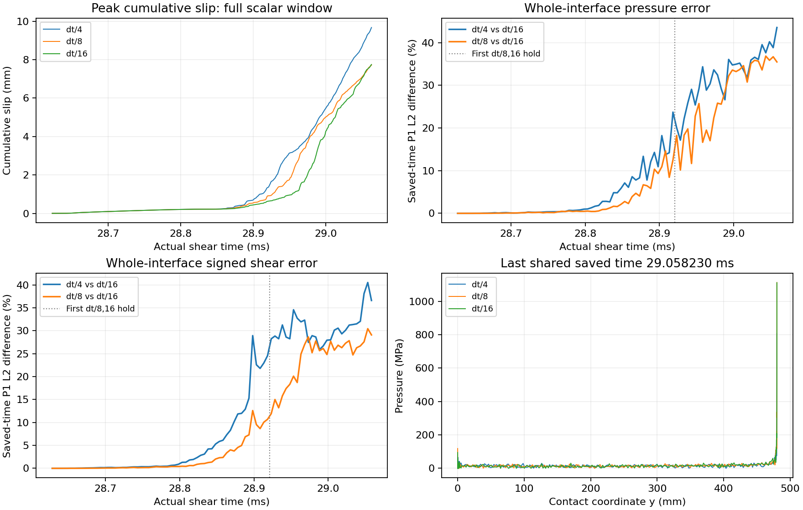

# dt/16 完成，FEM 參考解仍未通過時間收斂

相同 checkpoint、共同接受步與 230000 個原步長區間的 dt/8、dt/16 均已完成，
分別為 1840000、3680000 fine steps，各 88 個 durable chunks。
本次重新核對兩支完整 export、receipts、所有 chunk hashes 與原 context 身分。
原 BEM 已由控制程式恢復相同 PID／start-time 程序，沒有重建已付費 kernel。

## 完整保存場的比較

dt/8 對 dt/16，保留全部 **87 個原共用保存時刻、285 個原界面節點**：

|場|時空 P1 L2 相對差|最後共用時刻 P1 L2 相對差|
|---|---:|---:|
|pressure|12.86%|35.47%|
|signed elastic shear|9.94%|29.09%|
|plastic slip|0.718%|1.383%|
|cumulative slip|17.51%|13.18%|
|friction coefficient|0.263%|0%|
|friction strength|10.76%|35.47%|

**未通過原 1% 局部診斷。** 前一組 dt/4 對 dt/8 pressure／shear 為
17.21%／11.74%；本次有所下降，仍遠超門檻，不能做可靠的 Richardson 外插。
這是 28.628181884–29.058229606 ms 內已保存 P1 interpolants 的確切積分，
沒有未保存時刻的全場誤差上界，也不是完整 45 ms 的時間或空間收斂證明。
數值方程、材料、penalty、LSW、停止政策、全部空間端點與原時鐘均保留。

完整 scalar 窗口為 28.623182397–29.063076087 ms。全部原生列均保留，
比較在兩支時鐘的共同涵蓋區間使用原生 knots，沒有降採樣、外插或 fitted shift。
dt/8 對 dt/16 的 max-cumulative-slip 波形差為 **20.95%**，
mean pressure 為 **0.973%**，mean signed shear 為 **7.52%**。
依已知 `t_n+h/2` 速度時鐘比較的 kinetic-energy 波形差仍為 **44.57%**。
這個 scalar 診斷不構成完整離散能量平衡或穩定性證明。

窗口末端最大累積滑移為 **7.72264／7.74960 mm**，只差約 0.35%，
但其波形與全界面場仍差很多，因此末端最大值接近不能作為重現成功的判據。
此量是累積絕對滑移，並非 net displacement。

圖中 scalar 約每支 5000 點用於顯示；定量指標不降採樣。
場誤差使用全部 87 個保存時刻，右下圖為最後共用保存時刻，並非物理窗口末端。

## 差異與載入停止的時間關係

dt/8、dt/16 首個載入停止 endpoint 為 **28.920842／28.924584 ms**。
將同一份完整已保存場，在較早的停止時間 28.920842 ms 分成兩個診斷區間：

|dt/8 對 dt/16|停止前相對差|停止後相對差|停止前占完整平方誤差|
|---|---:|---:|---:|
|pressure|3.34%|23.64%|4.85%|
|signed elastic shear|3.01%|20.52%|7.18%|

分割點只在原保存時間格內做 P1 插值，兩段平方誤差之和已核對等於原完整積分；
全部空間端點保留，完整窗口的接受門檻不改。
**停止前已有差異**；誤差主要集中於停止後，仍不能據此證明停止判據是原因。
接觸分支與載入回饋的敏感性需另外分離，尚不能診斷 continuum ill-posedness 或能量發散。

## 成本與下一個驗證環節

dt/8 分支耗時 **8254.74 s**，dt/16 分支 **16840.43 s**；
完整 numerical invocation 為 **25230.67 s**，外層 numerical stage 為 **25239.04 s**，
完整比較另花 **10.03 s**。這些數字包含開發控制造成的暫停，沒有扣除。
owner 從等待 CI／pilot 起算為 **26124.41 s**，與 numerical stage 的範圍不同。
目前沒有同精度、隔離執行的 FEM／BEM 總時間比較。

本次唯讀分析用 15.07 s；與短程換核／AD 控制串行的外層共 82.96 s，
均保留在原 BEM 的 wall cost。已核對 229 個 frozen inputs，
原 1,154,912,256-byte prefix 前後 SHA 相同，結束後恢復同一組 BEM 程序。
[原比較、完整來源／receipts／hashes、分段與動能時鐘分析、所有成本](fem_dt16_window_results.json)
可供核對。

這次結果更新了參考解的不確定性。完整原事件重現、初始化梯度、時間／空間收斂，
以及同精度的速度或穩定性優勢仍是未完成的要求；尚未直接追加 dt/32。
後續[原生接觸路徑控制](fem_native_contact_paths.md)已完成兩段逐位元重播，
並以最佳時間投影分離目前分段線性路徑的表示限制；它沒有取代本頁的原完整窗口門檻。
