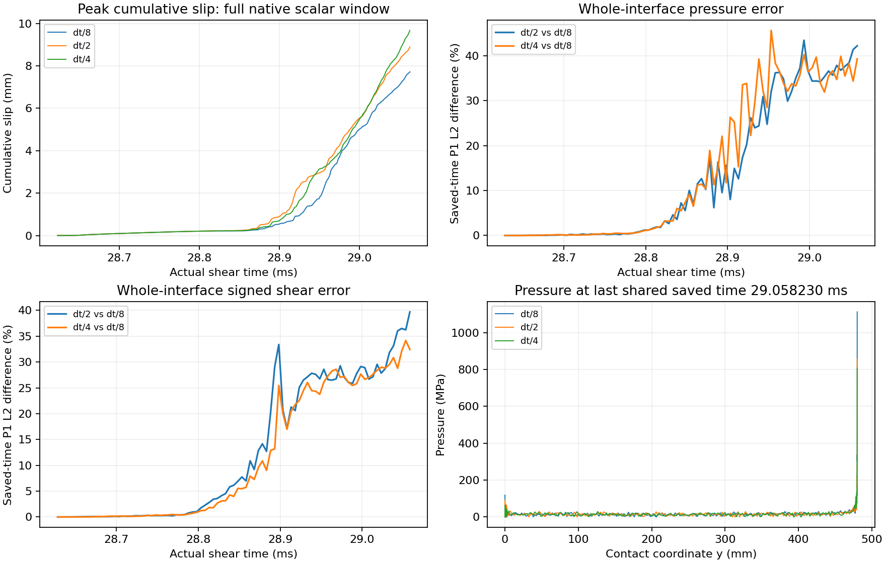

# dt/8 完成，破裂後時間步長差異仍大

同一個原 checkpoint、共同接受步與 230000 個原步長區間的 dt/8 分支已完成，
共 1840000 fine steps、88 個 durable chunks。本頁保留當時 dt/8 的分析；
後續 [dt/16 完整結果](fem_dt16_window.md)亦未通過原收斂診斷。
dt/8 的完整 export、全部 88 個 chunk hashes 與 receipt 已逐一核對；
其 context SHA 與原 dt/4 窗口完全一致。原數值方程、材料、penalty、LSW、停止政策均未改。

## 全窗口場差異

dt/4 對 dt/8，在相同 **87 個原共用保存時刻、285 個原界面節點**的 P1 interpolants 上：

|場|時空 P1 L2 相對差|最後共用時刻 P1 L2 相對差|
|---|---:|---:|
|pressure|17.21%|39.27%|
|signed elastic shear|11.74%|32.42%|
|plastic slip|0.820%|1.410%|
|cumulative slip|16.97%|12.05%|
|friction coefficient|0.696%|0%|
|friction strength|14.41%|39.27%|

這一組沒有通過 1% 局部診斷。原 dt/2 對 dt/4 的 pressure／shear 差為
17.68%／10.05%；進一步加密後並未顯示全面下降的趨勢。
這不等於模型 ill-posed 或能量發散的證明，也不支持直接做 Richardson 外插。
後續 dt/16 的全場差異已另行公布，仍需分離接觸分支、載入回饋與解析度的影響。

原 source 並未漏算 penalty 時間尺度：它明確使用 `min(dt_bulk, dt_contact)`。
原記錄的 `dt_bulk=1.958005065e-9 s`、`dt_contact=1.912581260e-9 s`，
limiter 為 contact，contact safety factor 為 0.25。
這排除了「沒有納入接觸時間步估計」這個解釋；
估計值本身仍不是完整非線性系統的譜穩定性或時間精度證明。
數值與 archived source／設定 SHA 亦保存在結果 JSON。

所有原端點、共用保存時刻均保留；沒有 fitted time shift、濾波或端點裁切。
場比較時間為 28.628181884–29.058229606 ms。
這是已保存 P1 interpolants 的確切積分，**不是未保存時刻的全場誤差上界**。

## 每步 scalar 診斷

完整物理窗口為 28.623182397–29.063076087 ms。
所有原生 fine scalar rows 均保留；比較使用兩支時鐘的共同涵蓋區間，
區間內的原生 knots 沒有降採樣。這不表示物理窗口中每一列都在積分區間內：
dt/4 對 dt/8 的原記錄時鐘下，dt/8 最初一列早於共同區間；
dt/2 對 dt/8 則有最初三列早於共同區間。積分邊界使用原 P1 插值，不外插。
dt/4 對 dt/8 的 max-cumulative-slip 波形相對 L2 差為 **20.65%**，
kinetic-energy 波形為 **34.42%**，mean signed shear 為 **7.92%**。
mean pressure 只有 **1.20%** 差，顯示平均量接近不能代替全界面 pressure 場的相符。

另核對原 leapfrog 的時鐘：位移與接觸場在整步 `t_n`，
儲存的動能則由更新後 `v_(n+1/2)` 計算，因此其物理標籤為 `t_n + h/2`。
依這個已知半步重新標記動能，dt/4 對 dt/8 的波形相對 L2 差由
34.42025% 變為 **34.42011%**；dt/2 對 dt/8 由 43.75328% 變為 **43.75285%**。
這個時鐘差無法解釋目前的大幅差異。此處沒有擬合時間平移；
接觸場的時鐘與 1% 門檻均未改。兩種動能比較各自在其共同時間區間積分，
屬已保存 scalar 的診斷，仍不是完整離散能量平衡或穩定性證明。

完整窗口末端的最大累積滑移：

|時間步|最大累積滑移|
|---|---:|
|dt/2|8.89445 mm|
|dt/4|9.67620 mm|
|dt/8|7.72264 mm|

此最大值是累積絕對滑移，不是 net displacement。
三支 loading-hold 首個 fine endpoint 分別為 28.907781／28.913292／28.920842 ms，
亦尚未顯示穩定的步長趨勢。

圖中的 scalar 曲線約以每支 5000 點顯示；定量指標在共同涵蓋區間使用原生 fine knots，沒有降採樣。
pressure／shear 誤差曲線使用全部 87 個共用保存時刻。
右下角是最後共用保存時刻的 pressure，不是完整窗口末端。

## 成本與目前狀態

dt/8 分支包含其準備／持久輸出共 **8254.74 s**；共同 context setup 與前置 dt/4
replay 的成本仍在整個 invocation 中另行保留。完整 dt/8＋dt/16 工作的後續成本
已另行公布，不能用單一分支成本代表整體，也不是隔離後的 FEM／BEM 速度比較。

本次唯讀分析先核對並暫停 owner／quota／numerical process，分析後恢復相同三個程序；
84 個 frozen inputs 未改。額外 12.184 s 暫停仍計入目前 dt/16 的 wall cost。
半步時鐘的另一次唯讀稽核使用 2.927 s，亦已核對 84 個 frozen inputs 並恢復相同程序；
此成本同樣保留在完整工作的 wall cost 中。
原 BEM 在此控制期間依四核心串行流程暫停，完整 dt/16 控制與比較結束後已恢復相同程序。
[完整場／scalar 指標、時鐘、hash、來源與分析成本](fem_dt8_window_results.json)保留所有結果。

完整 45 ms FEM／BEM 重現、完整初始化 AD 與同精度的效能／穩定性優勢仍未完成。
本結果只更新參考解的不確定性，沒有放寬 BEM 的接受門檻。
