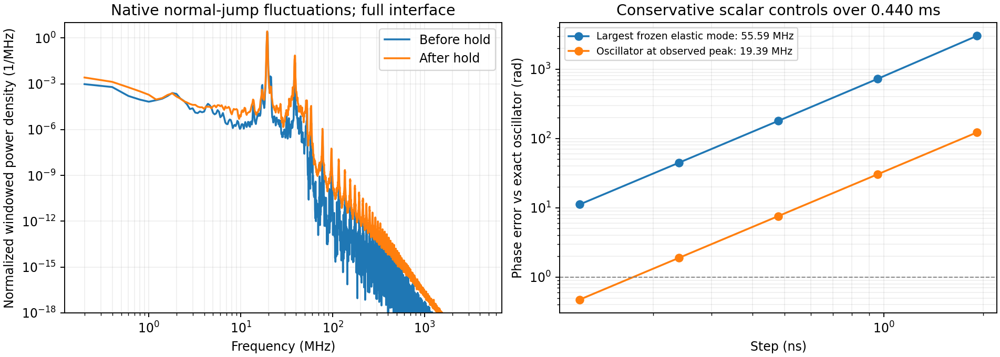

# FEM 高頻波形與時間解析度診斷

在相同精度下證明完整 BEM 的速度或穩定性優勢，仍是未完成目標。
原 FEM 的 dt/8、dt/16 在條件式 0.439894 ms window 中仍有
**12.86% pressure、9.94% signed shear** 的全場差，不能將單一路徑當成已收斂標準。
本輪以原模型的質量、剛度及已保存的原生波形，檢查時間解析度這個可能原因。
沒有重播 fine trajectory、改摩擦律、加阻尼或過濾任何接受指標。

## 原模型與獨立 AD 核對

`diagnose_fem_modal_resolution.py` 重建原 setup，僅觀測 setup 已經計算的兩個
`static_normal._block_stiffness` 回傳值，將原物件原樣交回；來源檔完全不改。
它們原本即由 Tatva 的 colored sparse AD 組裝，不建立密集 Hessian。
157506 個原 DOF 在固定支承及 rigid platen 約束後剩 156902 個獨立座標。
所有 platen shear DOF 共用一個座標，該座標的質量為原節點質量總和。

在 chunk 55／70 的原接受初態，分別固定 285／278 個閉合接觸點，
建立 bulk + normal penalty + **假設黏著的** tangential penalty + active spring 的
保守能量 Hessian。這是控制問題；實際 LSW sliding tangent 有 normal／shear coupling，
因此此對稱矩陣既不是原滑動 Jacobian，也未被證明為它的頻譜上界。
原長度單位為 mm、時間為 s。

組裝矩陣乘向量另外對照原 bulk energy 加控制能量的
`jax.jvp(jax.grad(energy), ...)`，兩個狀態各三個獨立隨機方向：

- 最大相對 L2 差 **2.14e-16**，門檻維持 `1e-10`。
- 原矩陣相對非對稱量 **4.63e-17**，僅做已記錄的 roundoff 對稱化。
- 六個最大模態的 Ritz residual 至多 **4.60e-11**，門檻 `1e-8`；質量正交性另行檢查。

矩陣乘積使用 forward-over-reverse，避免配置完整 Hessian，依
[JAX 官方 HVP 說明](https://docs.jax.dev/en/latest/jacobian-vector-products.html#hessian-vector-products-using-both-forward-and-reverse-mode)。
稀疏對稱特徵問題使用 [SciPy eigsh](https://docs.scipy.org/doc/scipy/reference/generated/scipy.sparse.linalg.eigsh.html)，
另自行重算 Ritz residual，沒有只依賴 solver 的成功回傳。

## 觀測到的波形與保守振子控制

原生資料仍是前次逐位元驗證的兩段路徑，各有 41841 個時間點、285 個空間節點，
步長 0.119536 ns，沒有再花費 FEM 軌跡重算成本。
先減去 Hann 加權的時間平均，乘同一窗口，再對完整界面做
空間 P1 質量矩陣加權的單側 FFT power；Parseval 相對差至多 **5.66e-16**。
這是**加窗位移擾動的 sampled power**，不是機械能，也不是連續時間誤差界。

|原生 window|主要頻率|99% 擾動 power 所在頻率以下|
|---|---:|---:|
|停止載入前，chunk 55|19.394 MHz|21.194 MHz|
|停止載入後，chunk 70|19.394 MHz|38.988 MHz|

頻率 bin 間距約 0.200 MHz；兩段只覆蓋各約 5 µs，尚未識別為某個特定物理模態。
上述保守控制的最大模態約 **55.592 MHz**，純振子 leapfrog 的 critical step 約
**5.726 ns**。原 FEM step 1.913 ns 在這個控制的嚴格穩定區間 `h*omega < 2` 內；
這不等於原非線性系統的穩定性證明。

對假設角頻率為觀測 peak 的純保守振子，leapfrog 的精確離散頻率為
`omega_h = 2 asin(h*omega/2)/h`。在 0.439894 ms 內的 phase error 如下：

|時間步|phase error，rad|
|---|---:|
|原 dt|122.065|
|dt/4|7.585|
|dt/8|1.896|
|dt/16|0.474|

dt/8 與 dt/16 控制之間仍相差約 **1.422 rad**。
這顯示「位於振子穩定範圍內」與「長時間相位足夠精確」不同，
支持把累積相位誤差列為後續檢查方向。
它不是原摩擦系統的誤差預測、唯一因果解釋或 ill-posedness 證明，
也沒有證明 19.394 MHz 的觀測頻率就是某個連續模態的頻率。

先前的[最佳 time-P1 表示診斷](fem_native_contact_paths.md)亦顯示，
目前 2 µs BEM 路徑難以描述這兩段已保存高頻場。
不能將隱式積分造成的平滑直接稱為更穩定，也不能只增加摩擦子步就補回 bulk 路徑。
目前保留完整 45 ms BEM 原建置與原接受門檻；下一步仍需完整事件比較與獨立時間／空間控制。

## JAX 建構器的 CI 修正與完整性

前次 commit `4f72dd7` 在 Linux Python 3.11／3.12 CI 的混合續跑控制失敗：
22×22 lag-zero impedance 有四個小元素超過原 `rtol=1e-8, atol=1e-12`，
最大絕對差約 3.17e-10。其餘已完成陣列比較不能抵銷此失敗。

修正只讓直接 lag-zero 的兩個頻率繼續使用原 SciPy layers 與原 Trace-Schur 凝縮；
完整 raw 頻率取樣仍使用 JAX。此成本會納入新建核時間，沒有放寬任何門檻。
新增測試故意讓 JAX assembly 不可使用，核對原直接阻抗及 reconstruction 逐位元一致；
128-step 原版 prefix → JAX 完整續跑也新增起始阻抗的**逐位元**門檻。
14 項建核／續跑測試通過（73.13 s）；這仍不是完整事件或同精度總時間優勢。

第一版實際診斷因 JAX array 直接傳入 SciPy `diags` 失敗，來源與成本保留；
第二版已得到完整結果，第三版另外修正報告單位名稱為 mm，並明確排除
`h*omega=2` 的 Jordan-block 邊界。六項獨立數學測試通過，包含 dense generalized
eigenproblem、空間 Gauss 積分、真正 drift/kick matrix 的 eigenangle、奇偶 FFT Parseval
與邊界拒絕。邊界判定修正不改變本案所有落在區間內的數值。

所有控制使用平均 3.85 CPU quota，期間暫停原 BEM，結束恢復相同三個程序。
原首 256 個矩陣的 SHA 在成功控制前後不變；失敗與發佈的暫停成本亦保留在原 BEM wall time。
三輪控制與發佈的外層成本合計 **193.689 s**，包含第一輪失敗及單位／邊界修正後的重核。
原 `/Volumes/Gauss-T7/tatva` 始終只讀。
[完整結果、來源、CI 失敗證據與成本](fem_modal_resolution_results.json)及
[chunk 55](diagnostics/fem_modal_resolution_00055.npz)／[chunk 70](diagnostics/fem_modal_resolution_00070.npz)
的完整頻譜與六個模態界面 traces 可供檢查。
