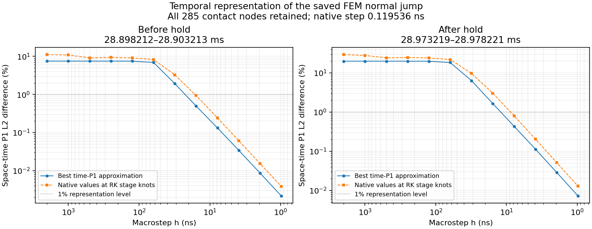

# 原生 FEM 接觸路徑與 BEM 時間表示的限制

從已完成的 [dt/16 接受狀態](fem_dt16_window.md)重播停止載入前、後各一個原保存區間，
逐步觀測全部 **285 個原界面節點、八個 float64 接觸場**。
這不是另一個材料／載入 case，也沒有改原 step、摩擦律或停止判據。

|區間|實際 shear time|fine steps|
|---|---|---:|
|停止前，chunk 55|28.898211582–28.903212982 ms|41840|
|停止後，chunk 70|28.973219194–28.978220594 ms|41840|

兩段的全部 **17 個原生 scalars、12 個最終 carry arrays、八個原保存 endpoint fields**，
均與原資料逐位元相同。新增 JAX post-state observer 的最後一列也完全一致。
原生步長為 **0.119536 ns**；重播不額外評估接觸力，只在原接受步之後輸出場。
本次資料條件於原 checkpoint／這條 dt/16 軌跡，仍不是已收斂的 FEM 連續解。

## 從已保存路徑取 stage 值的結果

在全域 shear-time 的 Radau `h/3, h` 節點，以原生 FEM 的 P1 interpolant 取值，
再重建分段線性路徑。保留區間兩端作為額外 anchors，沒有 fitted shift 或外插。
全部原空間端點均保留。下表是已保存場的時空 P1 L2 差，**不是已計算 BEM 的誤差**：

|區間／macrostep|pressure 插值差|signed shear 插值差|
|---|---:|---:|
|停止前，2 µs|11.18%|5.34%|
|停止前，1 µs|10.90%|4.63%|
|停止後，2 µs|29.17%|11.14%|
|停止後，1 µs|27.62%|10.42%|

停止後，production BEM 局部 LSW 律在完整原生位移路徑上重播通過，
最大 shear 差為 1.37e-11 MPa、累積滑移差 1.14e-13 mm。
只將輸入位移換成上述 stage-P1 路徑，局部律仍在**每個原生 fine endpoint**更新：

|位移路徑|末端最大累積滑移|全場累積滑移波形相對 P1 L2 差|
|---|---:|---:|
|原生 FEM 路徑|2.289863 mm|基準|
|2 µs stage-P1|1.882842 mm|0.798%|
|1 µs stage-P1|1.883539 mm|0.789%|

兩個 stage-P1 控制的末端最大 pointwise C 差都約 **0.413554 mm**。
全場相對 C 差較小不能代表局部最大滑移已重現；
完整 tangential jump 的相對誤差亦含大的初始 plastic offset，不能取代本構重播檢查。
本實驗支持分開控制 bulk 路徑與摩擦子步：更密的局部更新不能自行補回輸入路徑漏掉的運動。

停止前的重播保留為**失敗 gate**：只有 µ 的最大差 **2.87e-12** 超過既定 1e-12；
pressure、shear、plastic／cumulative slip 均通過，C 差至多 1.88e-13 mm。
使用原 FEM 的標量運算次序也得到相同結果，尚未單獨證明差異來源。
門檻沒有放寬，該段的本構投影結果不採用；只保留獨立有效的場插值分析。

## 最佳分段線性表示下限

上面的插值差不是最佳近似誤差，因此另求固定 stage knots 上的**最佳 L2 time-P1 projection**。
所有係數（包括兩個時間邊界的值）均可自由選擇，以時間質量矩陣解 `M_t C = B`。
RHS 在原生／stage 聯集格上確切積分；共同且可逆的空間質量矩陣可消去，
故逐空間節點求解也給出同一時空 P1 L2 的正交投影。

即使允許時間基底的係數為任意空間函數，逐空間點的最優係數仍是原參考場的線性組合，
會落在同一個參考空間 P1 空間內。因此這個計算也是更大的固定時間 P1 函數族的最優值，
可作為目前兩段線性 normal-jump 路徑對**這份已保存原生場**的表示誤差下限。
它沒有提供 PDE 誤差、整個事件誤差或足夠步長的證明。
pressure 的 opening clipping 與非線性 shear 可產生額外 kink，
因此不能把它們的 P1-field 投影下限直接當作實際非線性 BEM traction 的下限。

|macrostep|停止前最佳 normal-jump 差|停止後最佳 normal-jump 差|
|---|---:|---:|
|2 µs|7.523%|19.945%|
|1 µs|7.522%|19.942%|
|125 ns|7.501%|19.876%|
|62.5 ns|6.944%|18.427%|
|31.25 ns|1.923%|6.361%|
|15.625 ns|0.496%|1.651%|
|7.8125 ns|0.133%|0.434%|

在所測階梯中，停止後的最佳表示首次低於 1% 是 7.8125 ns；
**這不是推薦的 BEM 步長**，實際 CQ、空間離散、非線性 root 與 FEM 參考誤差仍需另外控制。
目前只有這兩段約 5 µs 的路徑證據，沒有宣稱整個 45 ms 的必要解析度相同。
原 2 µs 長程 BEM 保留為完整對照，尚未因這項局部診斷更換其 producer 或接受門檻。

## 完整性、失敗紀錄與成本

`replay_fem_native_contact.py` 只負責重播、逐位元核對與 atomic NPZ 提交；
`compare_fem_contact_paths.py` 從已提交資料分析。
第一版將分析放在提交前，因上述 µ gate 失敗而未保留完整路徑；
此輸出順序已修正，失敗的來源快照、exit code 與全部成本仍保留。
分析方法再修改時，不需重做已付費的 FEM 計算。

23 項觀測／window controls 通過；另 4 項最佳投影測試通過，
包含獨立 dense Gauss 質量矩陣、正交性、Pythagorean identity、affine／相同 clock 的精確重現與邊界檢查。
數學測試不能代替 FEM 連續解的收斂證據。

- 第一版 pilot 外層 **37.861 s**；未保留完整路徑的失敗控制 **222.034 s**。
- 修正版 tests／pilot／兩段完整記錄／分析外層 **483.312 s**；其中記錄 **429.261 s**、分析 **19.163 s**。
- 最佳投影與測試外層 **101.299 s**；繪圖／發佈外層 **9.311 s**。
- 本輪列出的外層成本共 **853.817 s**，全部保留在原 BEM 的 wall cost，沒有扣除失敗或暫停。

各控制結束均恢復相同 BEM owner／quota／numerical 程序；
原 1,154,912,256-byte prefix 的 SHA 前後相同，原 Tatva 目錄維持唯讀。
[完整指標、原生資料 hashes、逐位元證據、來源快照及失敗成本](fem_native_contact_paths_results.json)已保留。

下一步需評估可控誤差的時間路徑與完整波歷史成本，
並繼續完成原完整細網格事件、原始因果方程、初始化 AD 及 FEM 的時間／空間收斂。
目前仍沒有同精度的速度或穩定性優勢。
