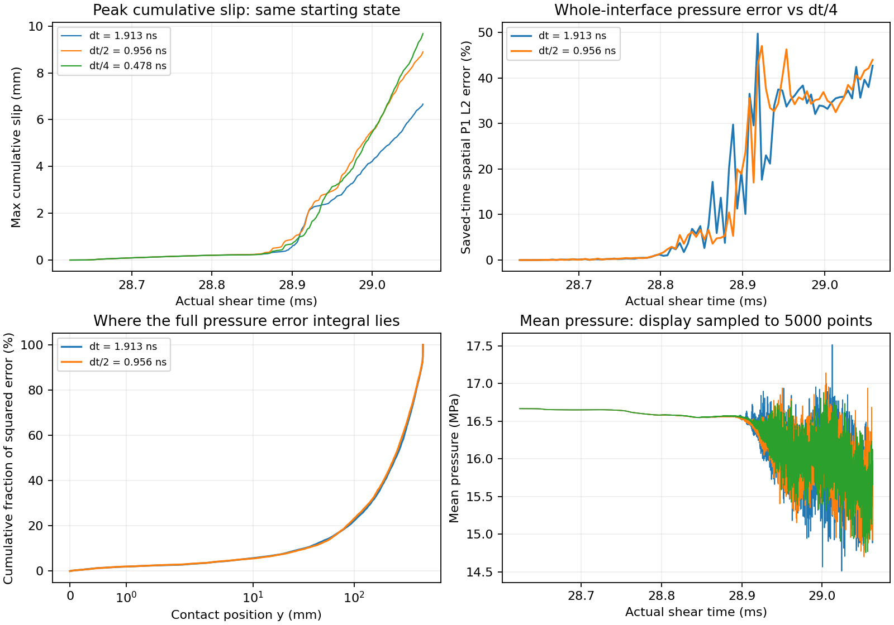

# 破裂後 FEM 時間步長控制未通過

延伸 [checkpoint 局部控制](fem_timestep_window.md)至
28.623182397–29.063076087 ms（230000 個原步，約 440 µs）後，
原 dt、dt/2、dt/4 均已完成。相同 12-array 原接受狀態先共同前進一步，
再對齊 integer-time velocity；原摩擦記憶、空間網格、penalty 與整面載入停止政策不改。
原 dt 分支在 **87 個共用保存時刻**的八個 float64 contact fields，
以及 16 個非時間 scalar 欄位的原 float32 保存值，全部 bitwise 相同。
所以此控制沒有靠改寫原 source trajectory 取得不同的 coarse 結果。

局部 1% contact diagnostic **失敗**。相對 dt/4：

|場|原 dt：時空 P1 L2 差|dt/2：時空 P1 L2 差|dt/2：最後共用時刻 P1 L2 差|
|---|---:|---:|---:|
|pressure|16.55%|17.68%|43.98%|
|signed elastic shear|10.17%|10.05%|39.37%|
|plastic slip|0.310%|0.270%|0.535%|
|cumulative slip|6.34%|4.88%|4.33%|
|friction coefficient|0.877%|1.133%|0%|
|friction strength|13.89%|14.91%|43.98%|

接觸場比較僅涵蓋原共用保存時刻間的 P1 interpolants；最後共用時刻與 window 的
完整末端不同，精確時鐘見結果 JSON。所有端點都保留，沒有時間平移或濾波。
此外，原 dt／dt/2／dt/4 分別保留 230000／460000／920000 個 fine scalar steps。
在 window 完整末端，最大累積滑移為 6.66531／8.89445／9.67620 mm；
dt/2 的完整 max-slip 波形對 dt/4 相對 L2 差 6.51%，kinetic-energy 波形差 7.14%。
載入停止首個 fine endpoint 約為 28.908691／28.907781／28.913292 ms。

**差異不是只局限在尖端。** 以 dt/2 對 dt/4 的完整 pressure squared-error integral
分區，y=100–460 mm 占 66.31%，0–20 mm 占 7.52%，460–480 mm 占 10.44%。
分區是診斷，沒有從接受門檻移除任何節點。每個 cell 的時空積分加總已重建原
全場 P1 L2 指標到 roundoff，分區總和也核對為 100%。

這項結果證明目前 reference **沒有通過這段時間窗的步長收斂檢查**，
不能用原 45 ms FEM 的「completed」狀態或很小的 source CFL limit 代替精度證據。
它不等同於能量發散／數值失穩的證明；非單調的場差也不支持直接做 Richardson 外插。
尚需更細步長、空間／時間與反射波診斷，或可驗證的收斂誤差界；
不會調整 BEM 的物理阻尼、摩擦律或捨棄端點去配合未收斂曲線。

三支 control 連準備／檢查 7011.51 s；外層 numerical stage 7017.07 s，
比較 10.03 s。原 BEM 暫停 7027.13 s，完成後已恢復；這些等待仍計入其 wall cost。
對應 source commit `174b2c9` 的 Python 3.11／3.12 CI 通過。
[完整誤差、時鐘、空間分區及來源證據](fem_postrupture_timestep_results.json)保留失敗結果。

細網格 BEM 仍在補完獨立原始核及後續完整事件稽核。後續的 FEM／BEM 相符結果，
仍須和已收斂的參考誤差一起判斷；目前完整同精度速度／穩定性優勢未達成。
