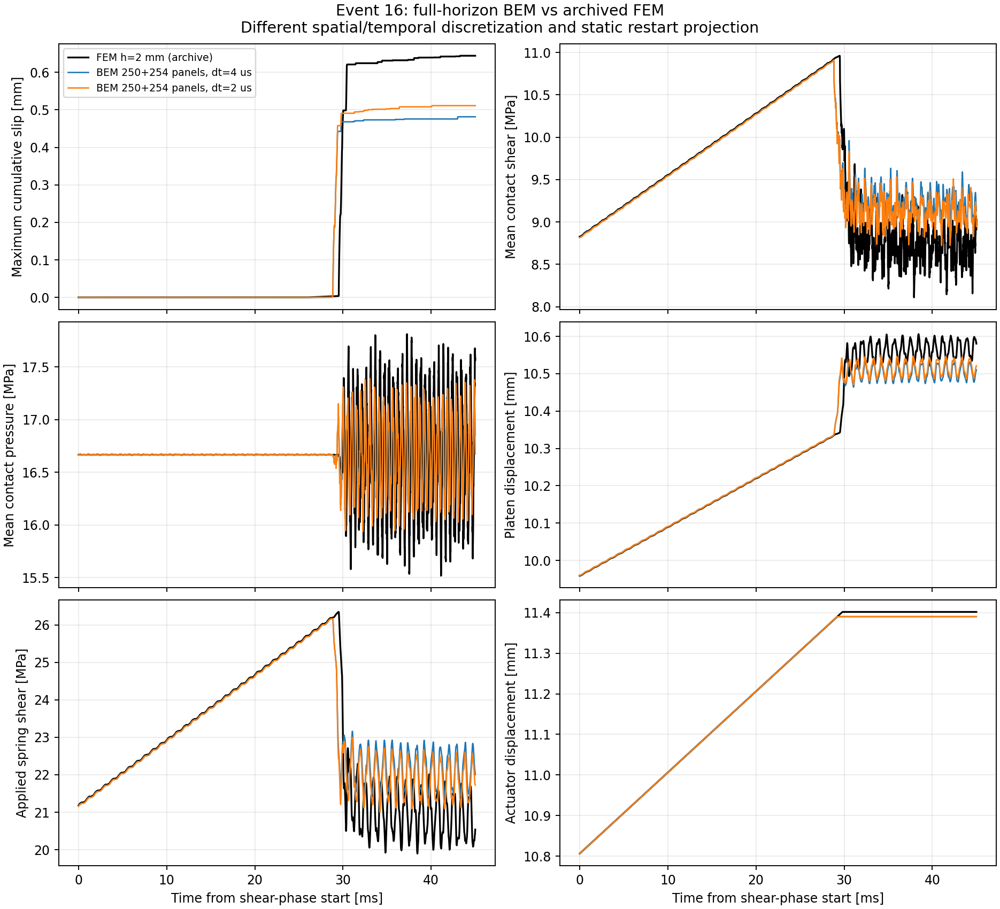
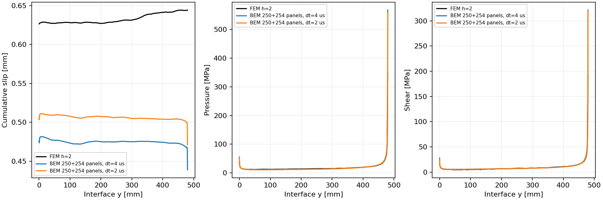
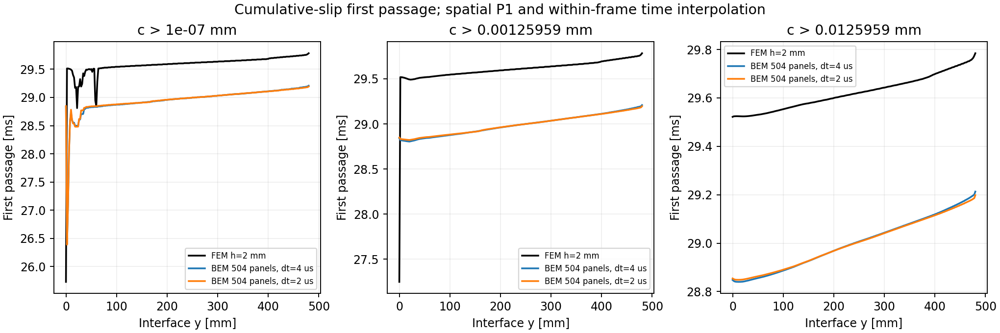

# 45 ms 完整事件：2 us／Q12 的最新結果

2026-10-24。137 個接觸節點、250+254 面板、外邊界 h20、contact5、
端點／角落0.5 mm，局部 restart-knot 加密與上一組相同。
以 2 us、Q12 完成 22500 步；原 FEM 仍是未改參數的 h2 event-16。
**最大滑移偏低 20.65%，尚未達到重現與同精度效能的驗收條件。**
原外接磁碟 Tatva 維持只讀。數據與 JSON 指紋見
[fine2_event_results.json](fine2_event_results.json)。

|量|4 us／Q6|2 us／Q12|原 FEM|
|---|---:|---:|---:|
|最大累積滑移 [mm]|0.481450|0.511082|0.644123|
|首次保存滑移 [ms]|26.396|26.390|25.733|
|停止載入 [ms]|29.216|29.200|29.788|
|末滑移分布相對 L2 差|24.98%|20.03%|—|
|末壓力／剪力分布相對 L2 差|20.34%／21.40%|20.16%／21.01%|—|
|達到 Dc 的前緣到達時間 RMS 差 [ms]|0.6231|0.6234|—|

這次同時改變時間步與積分階數，不能視為固定離散的純時間收斂研究。
滑移幅度改善，前緣卻沒有同步改善；微滑移前緣的最大到達時間差仍約3.125 ms。
後續必須在相同 Q12 下比較時間步，並繼續檢查初始場與接觸端點的空間誤差。





最大接觸平衡殘差1.80e-10 MPa；保存場皆有限、壓力最小8.984 MPa、
累積滑移非遞減，摩擦強度比最大為1。actuator–platen 最小差0.839975 mm，
因此此已完成路徑上的彈簧保持壓縮。這些檢查支持求解品質，仍不能取代空間／時間
收斂或與 FEM 的一致性，也不是完整能量穩定性證明。

最大單步弱化進度仍為84.24%；沒有節點一步跨過10%→90%，但尚未充分解析弱化過程。
固定當步壓力積分的摩擦功診斷差由8.88降至6.31 MPa mm²，約為當次摩擦功的0.263%。
此值不是總能量誤差或滑移誤差上界。正在建立的局部摩擦子步會沿線性 jump 路徑
反覆呼叫原 `contact_point`；bulk CQ 時間步仍固定，因此也不能單靠局部子步宣稱時間收斂。



冷建立記錄為73048.7 s，期間有其他診斷與計算重疊；不可用它做公平速度比較。
本次載入／初始化20.19 s、推進73.81 s、總計94.70 s，程序峰值 RSS 約10876 MiB；
快取推進與第一次冷建立的成本分開保留。原 h2 FEM 四核心獨立對照已啟動，
其結果完成後另行比較；目前沒有同精度速度優勢的證據。

完整條件式 adjoint 已算出五個接觸參數梯度，目標是末時刻接觸加權平均累積滑移。
本組沒有獨立參考梯度，所以 `independent_reference_compared=false`、
`all_compared_cotangents_passed=null`；不能稱為本組 AD 已獨立驗證。
材料、幾何、初始場及停止載入事件時間的導數仍未涵蓋。

已存在 prepared kernel 時可重跑，毋須重新建立頻域核心：

```sh
FDBEM_CORES=4 bem/run.sh resolvent-simulate bem/outputs/direct-resolvent-fine2-q12 \
  --output bem/outputs/fine2-q12-rerun --max-memory-mb 16384
```

輸出須使用新資料夾。建立核心、原方程核對與 adjoint 的範圍另見
[resolvent](resolvent.md)、[AD](autodiff.md) 與[文獻決策](literature.md)。
