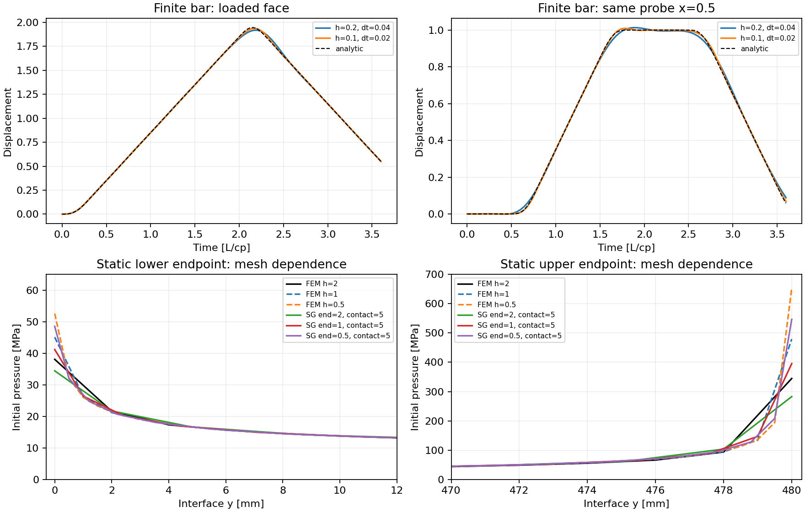
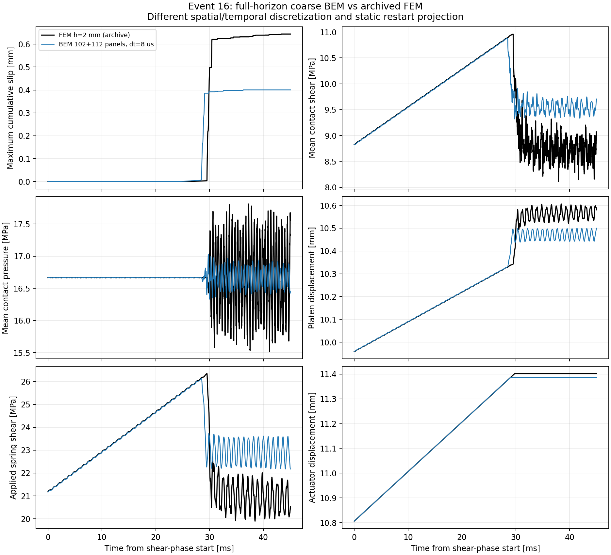
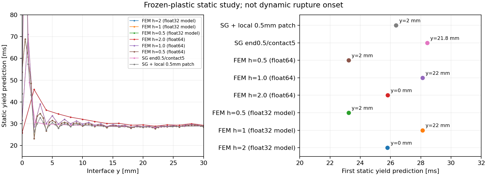
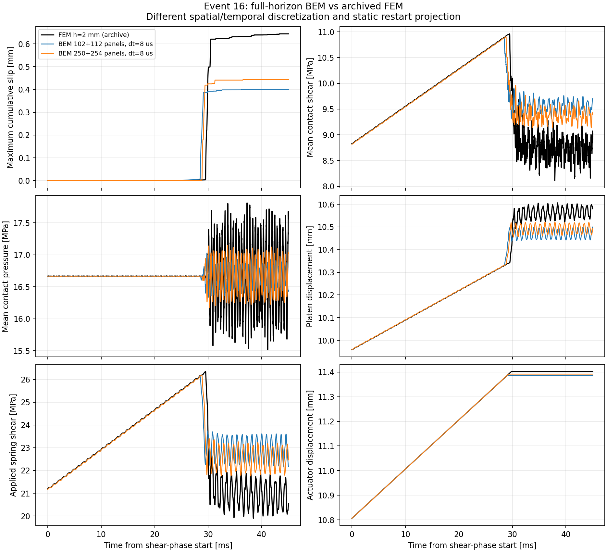
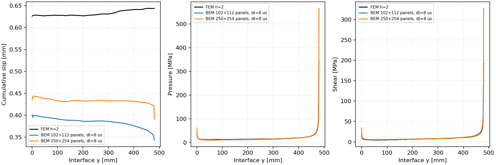
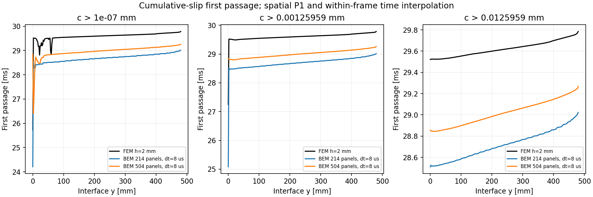
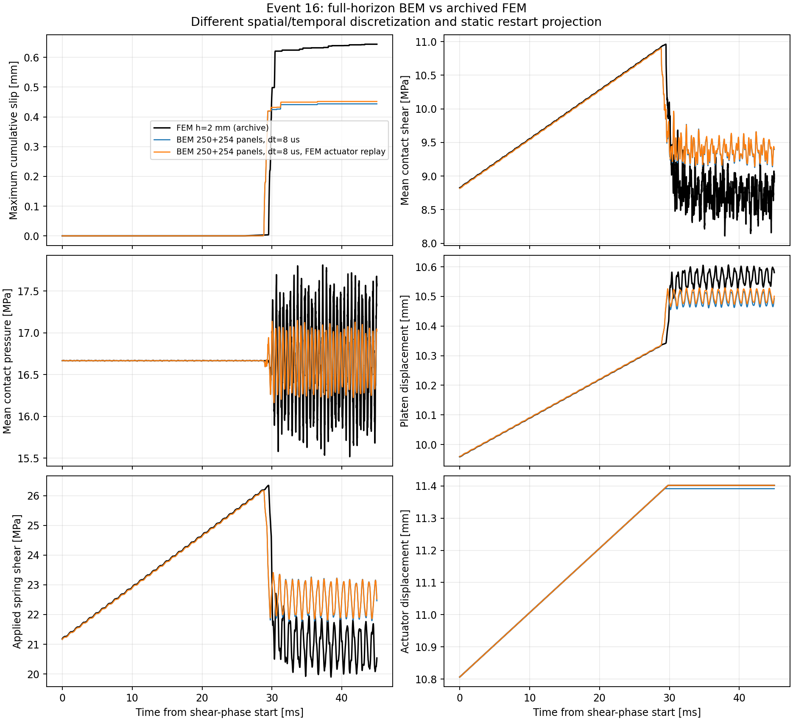

# 對稱 Galerkin 動態 BEM

2026-10-23。本次把文獻中的能量一致空間離散接回既有 BDF2-CQ、
兩有限 block、LSW、JAX Newton 與完整歷史 adjoint。
**完整 FEM event-16 的空間／時間收斂與同精度速度優勢仍待驗證。**
下列線性與短程檢查不代表完成這個驗收。

## 方法與來源

[Aimi、Di Credico、Gimperlein (2024)](https://arxiv.org/html/2405.08566v1)
以 Poincaré–Steklov 算子建立動態摩擦接觸的 energetic Galerkin 形式。
本實作採用其對稱 bulk 結構，時間積分仍使用既有 BDF2-CQ，
接觸保留原 Tatva penalty 與 previous-state slip weakening。
這不是該文 space-time Uzawa／Tresca 演算法的逐式實作，亦不沿用其誤差定理。

連續位移以 P1 nodal hats 表示，single-layer 的輔助密度使用 P0：

```text
V = <P0, single layer P0>
H = <P0, (1/2 I + double layer) P1>
S = H.T solve(V, H) + D
```

`D = -T_x double_layer_y` 使用
[Bao、Xu、Yin 的二維 regularization，式 (3.6)](https://arxiv.org/html/1608.08759v1)，
以 `omega = i*s` 延拓至 Laplace 域；它等於 Aimi 文獻中的 `-W`。
複頻率使用雙線性轉置 `.T`。程式不裁掉負特徵值，也不事後對稱化矩陣。

`S` 輸出與 nodal displacement 共軛的 **nodal force**，與舊 midpoint
traction 分開處理。接觸採正的 P1 lumped line weights，包含半個端點權重，
總長 480 mm；下端與剛性 platen 共用同一位移自由度。
兩體的 nodal forces 在頻率域精確縮減為 contact jumps 與 platen，再建立完整 CQ。

奇異積分使用 self／adjacent Duffy 轉換與解析 log moments。
`galerkin.py` 保留逐對參考組裝器；`galerkin_fast.py` 共用唯讀幾何、
批次組裝並重用 Bessel 值，積分公式與階數一致。
資源規劃包含共享幾何與每個 worker 的有界暫存，沒有截短時間歷史。

## 獨立驗證

- 弱式 hypersingular form 對照獨立的 traction 有限差分。
- 非正交多邊形的平移／轉動模態、仿射應變與積分 nodal forces。
- P 波與 S 波製造解的空間加密。
- 頻率縮減前後的功率、支承與互易性。
- 有限桿波到達、固定端反射與同一物理 probe 的加密。
- nodal 靜態 lift、端點、NumPy／JAX 軌跡與輸出積分權重。
- 全歷史 reverse-CQ、scan AD 與中央差分梯度核對。

已取樣的 `s=200+2*pi*f*i`、`f=1,5,10 kHz`，幾組均勻與角落加密網格
的 velocity impedance Hermitian part 均為正。
接觸 5 mm、角落 2 mm、5 kHz 的正規化最小值約 `+1.53e-5`，
同幾何舊 collocation 約 `-7.00e-4`。
有限取樣仍不能證明整個非單調摩擦問題穩定。

有限桿 loading-face 相對 L2 誤差由 0.875% 降到 0.360%，
同一位置 `x=0.5` 的 probe 誤差由 1.479% 降到 0.570%。
空間與時間同時加密，此處不單獨宣稱兩者的收斂階數。

## 成本與 FEM 差異

同一 102+112 面板模型、八個相同頻率、4 workers、BLAS=1，交換執行順序：

|順序|逐對參考組裝|批次組裝，含幾何準備|
|---|---:|---:|
|reference → prepared|76.32 s|9.97 s|
|prepared → reference|77.71 s|9.92 s|

約 7.7 倍是相同離散算子的組裝加速，尚非 FEM 同精度的總速度優勢。
數值、執行環境與程式指紋見 [galerkin_results.json](galerkin_results.json)。

靜態 lift 的中段 traction 已接近 FEM，角落仍有明顯差異。
接觸 5 mm、角落 2 mm 的 frozen-plastic 屈服預估約 24.25 ms、位置 y=0，
FEM 首次保存滑移約 25.73 ms。靜態預估不能當成動態成核時間。
後續要獨立解析端點、process zone 與時間步，不能只把曲線調到吻合。

以原版本 FEM 原始碼在本 checkout 做加密的靜態初始化，保留同一份
分段線性塑性滑移 seed 與 actuator，得到：

|FEM 網格|下端 p|上端 p|接觸加權平均 tau|platen|
|---|---:|---:|---:|---:|
|2 mm，原紀錄|38.07 MPa|344.62 MPa|8.82654 MPa|9.958879 mm|
|1 mm，本機|45.08 MPa|479.08 MPa|8.82068 MPa|9.959424 mm|
|0.5 mm，本機|52.55 MPa|653.84 MPa|8.81805 MPa|9.959684 mm|

端點峰值仍隨 FEM 網格改變。加密 Galerkin 的平均 tau 約 8.81680 MPa、
platen 9.959814 mm，積分反應比端點峰值更接近；這仍不是動態破裂等價的證明。
FEM 對照只初始化並推進極短時間，沒有完成加密網格的 45 ms 事件。
工具沿用舊名稱 `restart_projected_to_coarse_mesh`，此處實際是加密網格。



同一 event-16 CQ contour 的九個取樣點，積分階數 8／12 相對階數 16 的
traction-scaled 矩陣差最大約 `3.45e-6`／`2.86e-7`。
階數 8 的完整動態對照仍須核對更高階積分與更嚴格的頻率插值。
這是取樣檢查，不是全頻誤差界。

目前本機 70 項 BEM tests 通過。短程 Galerkin 滑動診斷的
mu_s 梯度與中央差分相對差約 `2.21e-9`，兩側差分沒有改變保存的接觸分支；
該診斷使用加速載入，不是 event-16 的物理參數識別。

## 完整 45 ms：已完成一組四 worker 對照

102+112 面板、35 接觸節點、dt=8 us、Gauss 8、adaptive tolerance 1e-8，
使用原載入及停止政策，完成 5625 步。此組是較粗空間解析度的結果。

|量|Galerkin BEM|原 FEM h=2 mm|
|---|---:|---:|
|首次保存滑移 >1e-7 mm|24.216 ms|25.733 ms|
|停止載入|29.024 ms|29.788 ms|
|末最大累積滑移|0.400258 mm|0.644123 mm|

最大滑移偏低 37.86%，共同 P1 插值網格的末滑移分布相對 L2 差為 39.25%；
壓力／剪力分布差約 10.03%／10.39%。**尚未達成 FEM 等價驗收。**
末界面的 [滑移、壓力與剪力分布](figures/galerkin_profiles.png) 另存供比較。
這也顯示修正先前的負 bulk 方向，並未單獨消除這組載入下的主要滑移差異。

最大接觸平衡殘差約 1.21e-10 MPa，保存狀態皆有限，累積滑移非遞減，
按當步實際摩擦係數計算的最大強度比為 1。塑性摩擦功為 1823.17 MPa mm²。
另以獨立的整段 zero-padded FFT 重建 bulk 力，和直接歷史加總的最大差約
1.50e-11；BDF2 速度的累積 bulk 擾動功最小值為 0，末值 56.27 MPa mm²。
這是固定靜態 lift 周圍的擾動功檢查，沒有把它當作整個非線性系統的能量證明。

冷權重建立 2100.24 s，實際推進約 2.75 s；重用相同權重後，全程約 5.7 s。
冷建立期間有少量報告整理與打包，列為探索性 wall time；
它與未知核心數的 FEM 歷史耗時不構成同精度四核心速度比。
3336 次 transfer 評估取代 8193 個 dense 頻率點；這個新方法的完整 dense／
更嚴格 tolerance 與時間加密軌跡仍需核對。

同一完整軌跡的條件式 adjoint 已檢查 mu_s、mu_k、Dc，
中央差分相對差分別約 1.8e-7、1.5e-5、3.3e-7，兩側差分均未改變保存的接觸分支。
微分範圍維持固定 bulk、lift 與記錄的載入；並未包含停止事件時間。



## 端點、初始場與下一組網格

使用同一 archived FEM solver 與同一 piecewise-linear 塑性滑移 seed，
frozen-plastic 靜態屈服預估並不隨網格單調收斂：

|FEM 網格|預估時間|預估位置|
|---|---:|---:|
|2 mm|25.803 ms|y=0 mm|
|1 mm|28.123 ms|y=22 mm|
|0.5 mm|23.227 ms|y=2 mm|

這些是靜態預估，不是加密 FEM 的完整動態事件。原 2 mm 曲線仍保留作比較基準；
目前資料不能把它或任一加密結果當成已收斂真值。
seed 在 2 mm 節點存在斜率轉折，漸變網格會重新近似這些特徵。
新增 `--restart-knot-window` 保留指定端點區間的原節點，
`--restart-knot-subdivisions` 可再細分該區間。
細分 patch 與中段採一致的漸變銜接，避免把兩套網格疊加成過短的面板。

另固定 P1 trace、只把角落附近 P0 density 加密 2／4 倍：
原 hypersingular 弱式限制回原 trace 後的相對差低於 4.5e-12，
壓力／剪力初始分布誤差由約 12.1%／15.0% 降到 9.85%／11.75%，
但屈服預估由 24.25 ms 移到 22.82 ms，未改善原 FEM 時間對照。
因此目前保留為誤差分離實驗，未升為動態預設值。



較細一組採 contact 5 mm、corner 0.5 mm、端點 8 mm 區間的 0.5 mm patch，
250+254 面板、137 接觸節點、Gauss 6。四 workers 完成原載入的 45 ms／5625 步。
其 Gauss 6／16 靜態屈服預估差約 0.08 us；動態積分與時間收斂仍須另行驗證。

|量|粗 Galerkin|較細 Galerkin|原 FEM|
|---|---:|---:|---:|
|首次保存滑移|24.216 ms|26.408 ms|25.733 ms|
|停止載入|29.024 ms|29.272 ms|29.788 ms|
|最大累積滑移|0.400258 mm|0.443675 mm|0.644123 mm|
|末滑移分布相對 L2 差|39.25%|31.53%|—|
|末壓力／剪力分布相對 L2 差|10.03%／10.39%|20.27%／22.31%|—|

較細網格改善成核與滑移，但最大滑移仍低約 31.12%，端點峰值也使壓力／剪力的
分布差增大。不能把這兩組當成已收斂解，更不能宣稱與 FEM 等價。
此次冷建立約 7938 s、推進約 22.3 s；頻率評估 3210 次，完整歷史保留。
冷計算期間有短程診斷重疊，因此不是與 FEM 的受控速度比較。

最大平衡殘差約 2.06e-10 MPa，累積滑移非遞減，壓力保持正值，強度比不超過 1。
獨立 FFT／直接加總的 bulk 力最大差約 3.25e-11，累積 bulk 擾動功最小值 0、
末值 37.80 MPa mm²；這仍不是總非線性能量證明。
全歷史 adjoint 的 mu_k、Dc 中央差分相對差約 8.8e-8、8.5e-6。
mu_s 以 1e-8 擾動時改變一個滑動狀態；改用 1e-9 後兩側分支均不變，
相對差約 2.9e-6。這些仍是固定 bulk、lift 與記錄載入的條件式導數。




另以原 FEM 的 241 個界面位置，比對累積滑移第一次跨越 1e-7、0.1 Dc、Dc 的時間。
BEM 在空間上作 P1 插值；兩邊都記錄原 frame 的左右時間括號，線性內插僅為括號內估計。
FEM 保存間距約 5 us、BEM 為 8 us，不能由內插小數位宣稱更高時間解析度。
達到 Dc 的節點到達時間 RMS 差，粗／較細網格約 0.905／0.605 ms，
最大差約 1.010／0.679 ms。但 1e-7 門檻在下端點的最大差，較細網格仍達 3.112 ms。
因此第一個成核點接近，不等於整段微滑移前緣已吻合。
這三個門檻的 FEM 小型 arrival table 已保存，可不讀外接 HDF5 重跑此項對照。



## 完整歷史的記憶體改良

`OnlineConvolution` 現在只快取之後還會使用的 dyadic kernel FFT；
只使用一次的大區塊改為每四個輸出列計算。若目前區塊結束於 n、長度 b，
同層下一區塊結束於 n+2b；只有它仍有未來目標時才需要重用 FFT。
沒有刪除 CQ 權重或歷史項，正向和轉置 adjoint 共用同一規則。

六種短／非整齊長度、非對稱矩陣、轉置 strided 權重與不同列數，都逐步核對直接加總。
完整粗網格 event-16 的 forward、五參數梯度、每步 actuator 梯度與初始狀態 cotangent，
和原 cache-all 規則逐項相同；此段 forward+adjoint 峰值 RSS 約 1520→804 MiB。
較細網格也重跑完整 forward 與 adjoint，所有保存物理欄位及梯度逐位相同，峰值 RSS 約
12819→6358 MiB。兩次 cold／warm 的配置不同，此數字是程序峰值記憶體觀察，
不是同成本的速度比。較細案例的陣列預估降至約 13774 MiB；半頻譜仍限制更小 dt。

再以分開的 child processes、相同已保存權重和完整 forward+adjoint 作配對測試，
137 接觸節點的峰值 RSS 為 15188→6417 MiB（約減少 58%），
所有物理欄位、摩擦／actuator／初始狀態梯度仍逐位相同。
此測試期間另有核心建立工作，因此不採用其 wall time 作速度結論。

CQ cache key 現在分開記錄數學 contour／權重函式，避免僅調整記憶體預估就重建核心。
舊 cache 不會自動沿用：`tools/migrate_galerkin_cache.py` 必須先核對原 run 的
Git source hash、所有算子檔案、CQ 數學函式 AST、幾何與 metadata，才建立有 provenance
的 hard link。較細案例遷移後已完成上述逐位相同的重跑。

另一個隔離原型針對程序取樣中的 Bessel 成本，依
[NIST DLMF 10.40.10–12](https://dlmf.nist.gov/10.40.iii) 的右半平面餘項界，
測試 K0／K1 的 16 項展開，|z|<25 保留 SciPy。約十萬個複數點的 scaled K 相對差
低於 1e-15，八個 CQ contour 點的縮減矩陣相對差低於 6e-15。
它仍在 `tools/benchmark_bessel.py`，沒有接入主核心；單點計時重疊其他工作，
不能由此聲稱總速度優勢，也還沒有完整軌跡核對。

已另外啟動同一粗網格、Gauss 8、45 ms、dt=4 us 的四 worker 計算，
固定其餘設定以分離時間誤差。產生完整 summary 前不列為已完成或已收斂。

## 分離載入停止與摩擦時間解析度

固定較細網格、同一組 CQ 權重、摩擦參數及 static lift，改為指定 FEM 已保存的
actuator 歷程，關閉 BEM 自己的 coverage hold。這是用於分離誤差的診斷，
不能替代原停止政策的驗收。t=0 使用 static lift 的精確 actuator，
其後沿用 FEM 記錄的線性內插值；完整來源指紋寫入 manifest。

最大滑移由 0.443675 增至 0.451780 mm，增加約 0.0081 mm，仍比 FEM 低約 29.86%。
末滑移分布 L2 差由 31.53% 降至 30.39%，成核保存時間仍為 26.408 ms。
載入停止差異只解釋原最大滑移差距的約 4%；空間／時間誤差仍須繼續處理。



另直接檢查每個接受步的累積滑移。較細 8 us 案例中，
仍在弱化的節點最大單步增量約為 2.97 Dc；9／137 個節點曾在一步內跨過
10%→90% 的弱化區間，對應 lumped line measure 約 2.61%。
各節點最大單步弱化進度的節點中位數約 60.5%，局部整段弱化會在一步內完成。
這顯示弱化轉換只由少數時間步表示，仍須以時間加密驗證；平衡殘差很小並不能替代此項檢查。

沿每步保存的壓力固定不變，把 `mu(c)` 對該步塑性增量精確積分，
可比較 previous-state 係數的矩形積分差。較細案例差約 11.92 MPa mm²，
約為已計算摩擦功的 0.577%。這是局部固定壓力的積分診斷，
沒有把它當成整個耦合問題的能量誤差界或 FEM 滑移偏差的已證明原因。
工具 `audit_weakening_resolution.py` 保存逐節點結果，供 4 us 案例完成後直接比較。

## 磁碟頻譜原型

時間步再縮小時，半頻譜與實數權重會同時佔用大量 RAM。
`tools/benchmark_disk_spectrum.py` 在隔離程序中，保留原 sampler 的程式碼，
只把半頻譜配置換成磁碟陣列。每次最多映射 64 個頻率矩陣，讀取時複製所需列，
映射隨即關閉；原本的四列 IFFT、radius 修正與 dense 權重配置均保留。
目前用 private function copy 注入配置器，沒有改寫 NumPy globals 或主套件；
正式接入仍需明確的 storage API 與資源預估。

4097 步、64 DOFs 的有理 transfer 測試中，adaptive 取樣決策、全部權重逐位相同，
峰值 RSS 約 821→338 MiB。磁碟 I/O 有額外成本，不能由此宣稱速度優勢。
既有 h=80 mm／32 步強載入 BEM 診斷也完成：最大滑移 0.906945 mm，
解、五參數梯度、actuator 梯度與初始狀態 cotangent 逐位相同。
這個短診斷不是原 45 ms event-16；較細 4 us 的完整磁碟版本尚未執行。

另有 h=160 mm／128 步強載入的 reference 在第 104 步 Newton 失敗，
當時尚未執行 disk variant。失敗條件與殘差亦保存，未把它列為通過的儲存或穩定性測試。

```sh
FDBEM_CORES=1 bem/run.sh fem-loading-replay \
  bem/outputs/galerkin-patch5-dt8-q6-streamed --name prescribed-loading-diagnostic
FDBEM_CORES=1 bem/run.sh weakening-audit bem/outputs/galerkin-patch5-dt8-q6-streamed
FDBEM_CORES=1 bem/run.sh disk-spectrum-benchmark --adaptive
FDBEM_CORES=1 bem/run.sh disk-spectrum-benchmark --bem --adaptive \
  --output bem/outputs/disk-spectrum-bem32
```

## 重跑

從 repository 根目錄執行，所有輸出留在 `bem/outputs`：

```sh
FDBEM_CORES=4 bem/run.sh galerkin-wave
FDBEM_CORES=4 bem/run.sh galerkin-benchmark --graded
FDBEM_CORES=4 bem/run.sh galerkin-audit --refine-corners --static-only
FDBEM_CORES=4 bem/run.sh galerkin --h 80 --steps 32 --dt 8e-6 \
  --diagnostic-actuator-increment 2 --sampling dense --name galerkin-sliding-32
FDBEM_CORES=4 bem/run.sh adjoint bem/outputs/galerkin-sliding-32 \
  --finite-difference --fd-parameters mu_s
```

`galerkin` 未給 diagnostic 選項時採原 20 mm/s 載入與 coverage hold。
完整 45 ms 的預設步長仍需驗證；可明確指定 `--duration .045`、接觸／角落尺度、
積分階數和資源上限，並保留 manifest。失敗或資源不足會回報，不能算完成。

AD 重用固定材料／幾何的 CQ 權重，高效計算摩擦參數的條件式梯度。
SciPy bulk、靜態 lift 和停止載入事件時間的參數導數仍未串接；
這些限制對新 backend 同樣成立。原 `/Volumes/Gauss-T7/tatva` 保持只讀。

FEM 靜態 study 的小型設定已包入 `resources/data/fem_static_onset_input.json`，
原 solver revision 保存在 repository 的 `codex/fem-event16-reference` 分支。
需要 Tatva/FEM 依賴；一般完整 clone 已有此 Git object，若是單分支 clone 可先 fetch：

```sh
git fetch origin codex/fem-event16-reference
python -B bem/tools/fem_static_onset.py
python -B bem/tools/compare_fronts.py bem/outputs/galerkin-patch5-dt8-q6-streamed \
  --reference-table validation/static_bem2d/reference/fem_front_arrivals.csv
FDBEM_CORES=1 bem/run.sh galerkin-density
FDBEM_CORES=1 bem/run.sh galerkin-audit --refine-corners --static-only \
  --restart-window 8 --restart-subdivisions 4 --end-values .5
```

此 FEM study 不需要外部原 HDF5；以包入設定重跑 2 mm 的預估時間與先前結果相同。
完整動態較細案例的目前命令為：

```sh
FDBEM_CORES=4 bem/run.sh galerkin --h 20 --contact-h 5 \
  --contact-end-h .5 --corner-h .5 --restart-knot-window 8 \
  --restart-knot-subdivisions 4 --quadrature 6 --dt 8e-6 --duration .045 \
  --sampling adaptive --sampling-rtol 1e-8 --max-memory-mb 20480 \
  --name galerkin-patch5-dt8-q6
```
