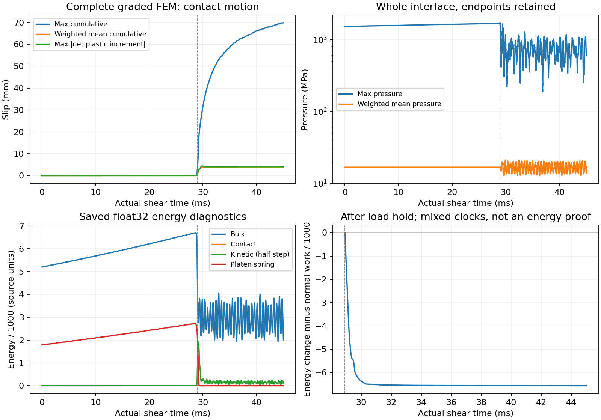

# 完整 graded FEM 事件與尚未解決的動態收斂

2026-10-30 已確認原 archived `933ae1f` 的獨立 FEM 參考完成：
相同 event-15 float64 plastic-slip／actuator 種子、healed weak-memory reset、
原 penalty／摩擦律／載入停止政策，h2、end 0.015625 mm 的 chamfer-preserving mesh。
原 `/Volumes/Gauss-T7/tatva` 全程只讀。新增的是已驗證不改 integrator 的網格與輸出 adapter。
12 個 carry arrays 的已重播 checkpoint prefix 保持 bitwise identity。

實際 dt = 1.9125812604139645e-9 s，共 23528413 個 shear steps；
剪切末端整數步時鐘為 0.0450000017910803 s。9000 筆真正 float64 剪切接觸場
覆蓋整個 285-node 接觸面，bulk／原 scalar history 仍是 float32 保存。
完成資料檔為 311077677 bytes，streaming SHA-256：
`a38f08a4ee8a3066d45cf79cea5da56dd3508fe591b9ab7affa988601ec5a48c`。

|保存時鐘上能解析的事件|剪切時間區間|
|---|---:|
|第一個 native node 累積滑移超過 1e-7 mm|21.717414–21.722415 ms|
|第一個 native node 達到 0.1 Dc|28.633183–28.638183 ms|
|第一個 native node 達到 Dc = 0.0125959 mm|28.648184–28.653185 ms|
|整個接觸面達載入停止條件|28.908212–28.913214 ms|

Dc 的 48→432 mm gauge travel 為 0.190023–0.200022 ms，對應
1919.79–2020.81 m/s。這是兩個固定位置的首次通過速度區間，
不是連續瞬時 rupture speed；上述 bracket 只描述已保存時間間隔，沒有界定 PDE 誤差。

**已完成不等於已收斂。** 最大累積滑移達 69.87235 mm，位置在 y=0.015625 mm；
最後的 contact-weighted 平均累積滑移為 3.98228 mm，最大淨 plastic increment
約 4.03778 mm。累積滑移計算全部塑性增量的絕對值，不能把 69.9 mm 當成淨位移。
28.648 ms 時最大值約 0.00867 mm，28.998 ms 已為 4.18115 mm，30 ms 約 31.7438 mm；
差異主要在 rupture 後出現。

這比先前未做同樣端點加密的完整 FEM 大得多。需要端點／背景網格與 dt 的獨立動態
加密控制，才能判定其物理意義；不能調 BEM 的阻尼或摩擦參數去擬合某一份未收斂的曲線。
目前細網格 BEM 正在依原計畫建核，完成後仍以六個完整接觸場、原始因果方程、
substeps、macro time、空間加密及 initialized gradients 分別稽核。

初步穩定性診斷另讀取原 float32 能量欄位，加入 compression-only platen spring
能量 `reaction²/(2*k*face_length)`，並扣除停止載入後的法向外力功。
這裡沒有重複加 extension energy，因原 bulk energy 已包含它。
保存資料沒有顯示停止載入後的淨能量成長；因此單看很大的累積滑移**不足以判定失穩**。
但 kinetic 使用 half-step velocity、其餘多是 endpoint，且 scalar history 是 float32／
約 5 µs 取樣；此診斷不是嚴格的離散能量收支或未保存振盪的界。
圖表保留原二維每厚度能量 scalar units，只做 /1000 的顯示縮放。

[事件與穩定性指標](graded_fem_complete_results.json)保留所有保存時間、完整表格與來源指紋。
FEM 兩次 invocation 的 simulation wall cost 合計 109028.21 s（約 30.29 小時），
包含開發驗證時暫停與共用機器的等待；不能當作已隔離的同精度速度 baseline。
目前仍未證明 BEM 在相同精度下更快或更穩定。

後續 [checkpoint 局部 dt 控制](fem_timestep_window.md)已通過原步長的 bitwise
接觸場／scalar identity，並完成 dt/2、dt/4 的 11.5 µs 起始窗。這是 conditional
局部證據；破裂後大滑移及完整事件的時間收斂仍未證明。

延伸的 [破裂後時間控制](fem_postrupture_timestep.md)已完成且未通過：
dt/2 對 dt/4 的全場 pressure 時空差 17.68%，大部分 pressure 誤差平方積分
落在 y=100–460 mm。因此這份已完成 FEM 尚不能視為已收斂動態真值。
