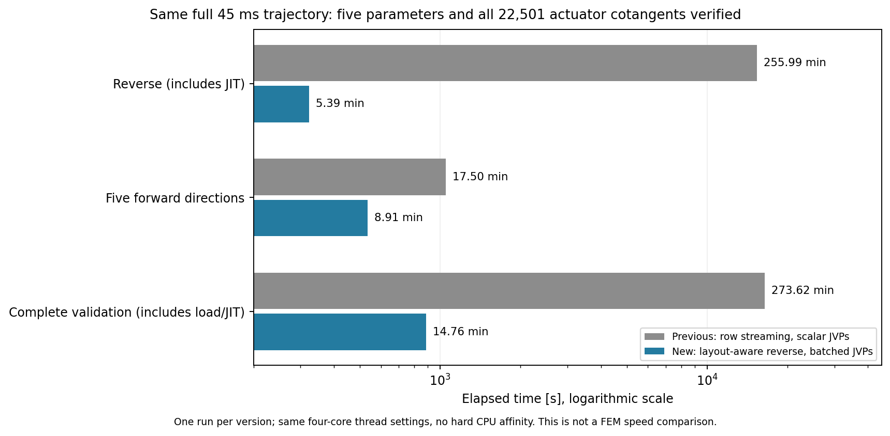

# 轉置權重的完整 reverse history 串流

完整 Γ4／N64 控制的 conditional reverse/JVP 核對已通過，最大 gradient 差
3.16e-11。原始時間為 reverse 15359.56 s、五方向 forward 1050.29 s；
這些程序時間含 JIT、IO 及 macOS 背景狀態，並非硬 CPU 隔離 benchmark。
因此，這次實際瓶頸主要出現在 reverse，不能只靠合併五套 JVP 歷史解決。

原權重以 C-order `(lag, row, column)` 儲存。reverse 使用最後兩軸的 view transpose，
既有 output-row streaming 因此每個小區塊都跨過幾乎整個原矩陣的頁面。
275 DOF、每塊 4 rows、4096-byte page、實際 NPY header offset 的單 lag
address-footprint 計算，output-row／input-column 分別為 10212／215 個頁面，
比值約 47.50。這只是位址計數，不是量測到的 IO 倍數或速度比。

`layout_aware_history.py` 保留全部 dyadic causal pairs、小區塊與既有容量快取。
對轉置 layout 的大區塊，它沿 input columns 讀取原連續方向，把各小區塊的
frequency product 累加後只做一次 inverse FFT；一般 layout 沿用原路徑。
不需要額外保存 13.6 GB 的轉置權重，不丟棄時間尾端或降低矩陣秩。
部分和的 floating-point grouping 會改變，完整梯度必須另行核對。

五個小矩陣／disk-layout 控制在本機通過（0.35 s）：一般與轉置、零／正 cache、
所有非對稱 causal pairs，以及完整 forward/reverse inner-product pairing。
另有包含滑動的短程 JAX gradient／actuator cotangent 對照，交由 CI 驗證。
完整事件量測已完成，結果見下方；頁面比值本身仍不是速度證據。

`check_initialized_contact_ad.py` 現可指定 `--history-layout auto|row`；預設 auto。
以相同 saved primal 比較舊完整 Γ4 conditional 梯度：

```sh
PYTHONPATH=bem/src python -B bem/tools/check_initialized_contact_ad.py COMPLETED_PRIMAL \
  --history-layout auto --initialization-gradient fixed \
  --legacy-ad OLD_AD_SUMMARY --output NEW_LAYOUT_AD_OUTPUT
```

工具會核對 legacy 的 primal hash、參數順序、梯度與完整 reverse／batched-JVP，
保存實際 streaming 統計；`active-set` 則包含初始化敏感度，不能與固定初始化的
legacy 梯度混為同一目標。物理 bulk、restart input 與 recorded loading 的範圍明列。

正在執行的舊 Γ8 AD 保留；目前只暫停其排程監督程序並取消尚未啟動的舊 queue，
避免再串接相同慢布局的工作。控制 journal 保留 PID 身分、原狀態及原因。
六條 primal、kernel、FEM 及原始 Tatva 均未改動。下一批依序使用同一四核心設定。

## 相同完整軌跡的實測

`conditional-subdiv4-layout` 已通過完整 Γ4／N64／45 ms 檢查，primal SHA-256
與舊程序完全相同。五參數 reverse gradient 相對舊版最大差 4.86e-12，
全部 22501 個 actuator cotangents 最大差 2.43e-13；新 reverse／batched forward
最大差 2.84e-11。保留所有 causal pairs，沒有縮短尾端或重用舊梯度。

|含 JIT 的階段|原程序 s|新程序 s|單次耗時比（原／新）|
|---|---:|---:|---:|
|reverse|15359.56|323.24|47.52|
|五方向 forward|1050.29|534.36|1.97|
|含讀檔／hashing／JIT 的完整檢查|16417.27|885.33|18.54|

原 forward 為五套 scalar JVP，新 forward 共用 batched kernel FFT。
這是相同四核心 thread 設定下各一次量測；沒有硬 CPU affinity、交換順序或
統計信賴區間。完整輸入、方法與範圍見
[layout_history_results.json](layout_history_results.json)。它不含 cold BEM kernel
建立成本，不能作為同精度 FEM 的速度比。



舊 Γ8 AD 也已完成，原排程 observer 在該數值程序結束後才退出。
新排程目前繼續 coarse-P1／original-P1 Γ8 的 initialized full-history AD。
Γ4／Γ8 conditional 梯度仍有大的 resolution difference，見
[敏感度收斂證據](contact_gradient_resolution_results.json)；此次加速沒有解決那個物理問題。
