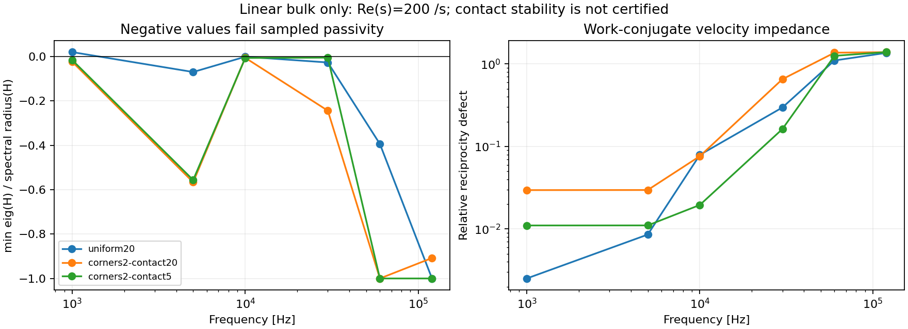

# 近期文獻與 FEM 對照的實作決策

檢索／閱讀日期：2026-10-24；補讀至2026-10-28。範圍是有限彈性體的 fully dynamic 接觸、
時間域 BEM、卷積歷史加速與角落誤差；以下不是整個 BEM 領域的完整系統性回顧。
目標是在相同物理模型與可量化誤差下重現 FEM，然後證明穩定性或總時間的優勢。
目前尚未達成這個目標。

2026-10-28 新增[相同實際細網格的 bulk 時間符號比較](bulk_time_symbol.md)。
在 closed-stick 線性 transfer、Re(s)=200 /s 的 10 kHz 取樣，
2 µs BDF2 相對連續時間的 pressure／signed shear 差達 59.16%／46.59%；
0.5 µs 仍為 7.57%／5.01%。1 kHz 的 2 µs 差則僅約 0.05%。
這是本專案的實測，不是引用論文的數字，也不是 rupture 的頻譜或非線性誤差上界。
因此接觸子步及小 Newton residual 仍不足以證明 bulk 時間精度；
同網格 Radau IIA 的 2 µs pressure／signed shear 差為 0.666%／0.433%，
1 µs 則為 0.0836%／0.0543%；這支持後續完整 RK 事件驗證，並非 FEM 誤差或速度比。
目前 BDF2 circle 對這些小 RK 步長無法通過解析域 guard，因此開始實作
[fresh raw Radau 取樣核心](raw_radau.md)。完整原事件的空間／時間收斂仍保留。

2026-10-27 的端點控制已把上述 graded-mesh 文獻方向轉成
[相同幾何的獨立 FEM／BEM 靜態加密與 linear dynamic controls](chamfer_refinement.md)。
同 end 0.015625 mm 的全接觸面 pressure／shear P1 L2 差為 0.9165%／0.6189%；
三個連續時間取樣頻率亦通過原 5% linear screen。
這些是本專案的量測，不是文獻定理對本接觸律的保證。
新的 full-body 靜態 backend 解決了最細面板的重建 roundoff 超標；
完整事件、FEM 背景加密、積分精度與時間收斂仍各自保留為必要驗證。

2026-10-27 補讀 You、Zheng、Li，
[Energy-Controllable Time Integration for Elastodynamic Contact](https://arxiv.org/html/2602.08094v1)
的 §1、§4.5 及 limitations。它研究 FEM／barrier 接觸的能量可控積分；
其動畫案例的低頻能量保留不等於有限 block 反射波及 slip weakening 的精度。
§4.5 對非保守力另採 implicit 處理，亦說明直接套用可能失去穩定性；
limitations 指出 A-1/A-search 目前是一階精度。
因此目前不加入可調能量目標來配合 FEM 曲線，而繼續分開檢查物理摩擦功、
完整原始因果方程 residual、空間／時間誤差。新的
[healed 靜態初始化控制](fem_static_initialization.md) 則直接依 archived Tatva
原始方程實作，不是這篇積分方法的移植。

原[完整2 us／Q12事件](fine2_event.md)最大滑移差約20.7%；
[十六接觸子步](substepped_contact.md)降至約13.2%，壓力／剪力分布差仍約20%。
文獻方法的局部改善必須與這個完整事件的精度門檻分開判讀。

## 直接相關的研究

|文獻與閱讀範圍|對本模型的決策|
|---|---|
|Aimi, Di Credico, Gimperlein, **Space–time boundary elements for frictional contact in elastodynamics**, CMAME 427 (2024), 117066。[論文／全文](https://arxiv.org/html/2405.08566v1)，[DOI](https://doi.org/10.1016/j.cma.2024.117066)。已讀兩物體接觸、算子、離散、求解與數值實驗。|以 energetic space-time Galerkin 與對稱 Poincaré–Steklov 算子作為穩定性升級方向。其嚴格誤差結果針對 unilateral Tresca；Coulomb 和兩物體結果含數值證據，不能直接宣稱涵蓋目前的非單調 slip weakening。|
|Melenk, Nick, **Parsimonious convolution quadrature**, arXiv:2410.15079v1 (2024) 預印本。[全文](https://arxiv.org/html/2410.15079v1)。已讀分段插值、BDF2 延伸與實作章節。|先減少重複 Laplace 求解，保留 dense CQ 對照。採自適應 Chebyshev 版本，另加獨立點檢查及直接計算 fallback；這不是原文預設分割的逐式重現，也不沿用其複雜度／誤差證明。|
|Kramer, Marussig, Schanz, **A higher-order time-domain boundary element formulation based on isogeometric analysis and the convolution quadrature method**, CMAME 451 (2026), 118609；2025 年預印本。[全文](https://arxiv.org/html/2510.06804v1)，[出版資料](https://tugraz.elsevierpure.com/en/publications/a-higher-order-time-domain-boundary-element-formulation-based-on-/)。已讀混合算子、空間基底與收斂實驗。|P1／更高階空間離散及 Radau IIA 值得實作，但平滑波的高階收斂不能直接套到接觸開閉、yield 與 weakening 切換。先分離空間和時間誤差，不直接放大 dt。|
|Keshava, Schanz, **A 3D-ACA accelerated time domain boundary element method for elastodynamics using FMM and H-matrix techniques**, 2026 預印本。[全文](https://arxiv.org/html/2607.15292v1)。已讀 gCQ、face/fiber 壓縮及數值比較。|後續以頻率／空間張量壓縮解除 fine-mesh 歷史儲存瓶頸。其 3D 線性案例不是 2D 摩擦驗證；FMM 也不保證在本機四核心比 H-matrix 快。|
|Schanz, Keshava, De Gersem, **Comparison of H-matrix- and FMM-based 3D-ACA for a time-domain boundary element method**, Computational Mechanics 78 (2026), 563–578，2026-03-25 出版。[全文](https://link.springer.com/article/10.1007/s00466-026-02768-9)。|這篇是 acoustic wave／gCQ 的壓縮比較，與上面的 elastodynamics 預印本分開看待。借鑑其誤差與成本比較方式，不把聲學結果當成本問題的證明。|
|Aimi, Desiderio, Gimperlein, Guardasoni, **Space-Time Boundary Elements on Graded Meshes for 3D Elastodynamics**, IJNME 126 (2025), e70163。[出版全文](https://onlinelibrary.wiley.com/doi/10.1002/nme.70163)。已讀奇異性、§5.1 grading、積分精度的數值比較與結論。|角落加密須配合鄰接面與積分精度；單看最小面板長度或成核時間不足以判斷收斂。其 3D 線性 Dirichlet 問題的 large-CFL 結果不能替本案 slip-weakening／BDF2 的時間精度背書。|
|Matsumoto, Maruyama, **A fast direct solver for two-dimensional transmission problems of elastic waves**, Engineering with Computers 42 (2026), 68，2026-03-22 出版。[出版全文](https://doi.org/10.1007/s00366-026-02302-8)。已讀 mixed P1/P0 基底、§4 proxy 與 recursive skeletonization、§5 精度／成本、Remark 4–5 及結論。|與現有 P1/P0 基底相容的分塊低秩求解值得研究；節點與面板須用各自的 tree。其固定低實頻 O(N) 結果不能直接套到完整複數 CQ contour；還要驗證所有所需頻率的 rank、消去誤差與轉置求解。論文也記錄 DOF 增加時的精度退化。尚未實作此 solver，亦未借用其速度比。|
|Hipperson, Hargreaves, Cox, **JAX-BEM: Gradient-Based Acoustic Shape Optimisation via a Differentiable Boundary Element Method**, arXiv:2604.21431v1，2026-04-23。[全文](https://arxiv.org/html/2604.21431v1)，[作者程式](https://github.com/jrhip/jax-bem)。已讀 §3.1–3.2、§4 與 §5。|將拓撲／積分類型選擇放在可微分序列外，對線性平衡根做 custom VJP，避免反傳 GMRES 迭代。它是 3D 聲學形狀最佳化，不能直接證明本案 transient friction 的精度或速度。其記憶體討論也支持先使用局部 VJP／完整轉置歷史，再研究分批 bulk 材料導數；本專案尚未具備完整材料／幾何 AD。|

另檢索到 2026 年 mCCSR 平行 TDBEM 工作，但本次沒有取得可讀全文，
因此未作為程式推導或速度結論的依據。高階 p-version CQ 的 SIAM 2025
[出版資料](https://epubs.siam.org/doi/10.1137/24M1642524) 亦列為後續閱讀，
目前不據此宣稱對不光滑摩擦歷程有指數收斂。

2026-10-26 另檢索到 Wang、Li、Ding，
**A differentiable Boussinesq framework for forward and inverse three-dimensional elastic contact**，
Engineering Analysis with Boundary Elements 191 (2026-10), 106954，
[出版頁](https://doi.org/10.1016/j.enganabound.2026.106954)。
本次讀取範圍是出版方搜尋索引提供的摘要、引言與章節預覽；直接全文請求回傳 403，
未取得完整算法與實驗表。其 BEINN 把固定 Boussinesq 算子及 zero-padded FFT 卷積
放進可微分計算圖，以壓力場為網路輸出，並示範模數與剛體壓入量的反算。
這是三維彈性半空間法向接觸，不能當作有限 block 動態波傳、LSW 或反射歷史的替代。
對本案可借鑑的推論，是將可重用的線性物理作用與局部非線性 AD 分開；
目前採收斂平衡根的隱式微分及完整歷史轉置，不新增神經網路或改變原摩擦律。

同日再核對 Matsumoto、Maruyama 的出版全文 §5.2。其量測指出，在其固定低頻
案例約 10000 DOF 以下，傳統 dense LU 可以比 fast direct solver 更快。
所以低秩漸近複雜度本身不足以證明目前中小型頻率矩陣會加速；
若接續實作 proxy／skeletonization，須量測實際 CQ 輪廓上的 rank、
所有準備成本及相同誤差下的交叉點。

本輪新增[固定 bulk 的接觸積分加密](refined_contact.md)，以正權重與功共軛映射
保留原方程。短程原始 Z 歷史、全邊界靜態平衡及細網格 AD 分別驗證，
完整事件的細接觸結果仍須等待 h1 FEM 及完整歷史擴充後的實際執行。

為了把 CQ 反轉與時間離散誤差分開，另補讀 Betcke、Salles、Smigaj，
[Overresolving in the Laplace domain for convolution quadrature methods](https://arxiv.org/pdf/1603.01761)
(2016) 的 §2.1、Theorem 4.1、Theorem 4.5 與 Remark 4.6。
其反轉誤差由較晚的離散時間係數疊加，較小輪廓半徑同時會放大有限精度影響。
該文的外域聲學分析沒有給出本案非線性接觸的誤差上界；本專案據此增加
[原始因果方程稽核](original_history_audit.md)，直接量測完整事件的 retained-force 殘差。

2026-10-25另讀Ferry、Molinari，**Do slip-weakening laws shapes influence
rupture dynamics?**，Extreme Mechanics Letters 74 (2025), 102272，
[出版全文（EPFL）](https://infoscience.epfl.ch/server/api/core/bitstreams/3145f407-d973-4fc9-a2d3-0c42b621e883/content)，
重點為§2、§3與§4。它以mode III、半無限體的spectral boundary integral及
阻止邊界反射回來的FEM比較，顯示摩擦曲線形狀會影響速度峰值。
出版版還討論滑移未達Dc時，相同總fracture energy的不同曲線可有不同越障結果；
不能沿用2024預印本將越障差異視為普遍不重要的結論。
本案由此保留原摩擦曲線與歷史，分開檢查局部子步及bulk時間誤差；
這是本專案的實作判斷，並非該文對有限block／CQ的驗證或收斂保證。

補讀Ciardo、Romanet（2026）
[A divide-and-conquer strategy for fast elastodynamic simulation of earthquakes and aseismic slip on fault networks](https://arxiv.org/html/2603.00383v1)，
重點為§2.3.1–2.3.2、§3.2與§4.2–4.3。
其驗證是無限域反平面mode III、rate-and-state平面斷層，將self effects交給非週期spectral算子，
遠距離互作用分fault tree做H-matrix／SVD，近場保持dense。
§3.2亦顯示近距離X形斷層對歷史截斷參數敏感；§4.2的自由面須額外建模。
因此其截斷窗口或速度比不能直接套到目前有限block、plane strain、會反射的CQ resolvent。
本專案的實作推論是先保留完整歷史、近場與接觸律，
對可精確共用的頻率／幾何部分減少重算，再研究有獨立誤差控制的遠場壓縮。
新增[完全相等r的徑向重用實驗](unique_radius.md)服務後續接觸網格加密；
它不是這篇H-matrix演算法的重現，也尚未量測完整加速。

2026-10-26再核對其式(6)的瞬時速度項／完整歷史分解，
新增[有限體P1/P0離散輻射高頻檢查](radiation_limit.md)。
平直面板的混合離散主導項包含P0投影，不能直接換成一致P1 mass；
小型有限block高階積分控制支持這個推導，目前細網格的最差能量方向仍未接近極限。
這是本專案推導與算子診斷，並非文獻已證明本案的multirate方法；
完整事件、反射歷史、穩定性與AD仍須接回後獨立核對。

補讀Linder、Najera-Flores、Kuether、Krack（2026）
[Enabling topography-resolving structural dynamic contact simulation](https://arxiv.org/html/2603.26446v1)，
重點為§2.1–2.3與§3.3–3.5。其細接觸半空間BE與降階FE耦合，
以massless boundary和semi-explicit leapfrog降低接觸人工振盪；
時間步仍受保留模態限制，並非無條件穩定的純dynamic BEM。
文中另展示preload／residual traction與settling對比較的影響。
這支持本案先核對相同初始狀態及接觸量、分開觀察模態與摩擦耗散的做法。
目前沒有移植此混合模型；有限block端點與slip weakening亦不由其半空間結果保證。

另檢索 Gu 等人 **High-order time-spectral BEM for efficient elastodynamic analysis**，
Computers & Structures 321 (2026), 108076，出版日期 2026-01-15，
[出版頁／摘要](https://doi.org/10.1016/j.compstruc.2025.108076)。目前僅讀摘要，未取得完整公式。
摘要描述靜態基本解、等效體積慣性項與正交多項式時間積分，故列為備選研究；
尚不能據此斷言是適合本案的純邊界方法，或已解決非單調摩擦與 AD。

補讀 Hoonhout、Löscher、Steinbach、Urzúa–Torres（2026）
[Stable least-squares space-time boundary element methods for the wave equation](https://doi.org/10.1007/s10444-026-10282-y)，
重點為混合離散、Lemma 7、§4.4 與結論。其可靠誤差指標需要 nested spaces、
discrete inf-sup 與 saturation assumption；論文的具體分析／實驗是空間一維純量波，
高維 elastodynamics 仍列為延伸方向。因此，不能把目前 Newton residual 很小視為
已證明與 FEM 一致，也不能直接把該指標移植成 slip-weakening 接觸的誤差上界。
本專案目前分開記錄原始方程 residual、空間／時間加密差與 FEM 差；
新 resolvent 也須經原始完整 Z 歷史的獨立核對，詳見 [驗證紀錄](resolvent.md)。

補檢索取得 Zhou、Chen (2026)
[mCCSR 平行 TDBEM 的摘要、引言與章節預覽](https://doi.org/10.1016/j.advengsoft.2026.104190)，
尚未取得完整公式與實驗章節。其重點是 3D 波因果性、block sparsity 與 CPU 排程，
不能把 48-thread 結果當成本機四核心的速度保證；2D 波具有長尾，亦不能直接沿用
3D 時間支撐造成的零區塊。此項目前只作方法篩選，沒有宣稱已實作 mCCSR。

為釐清長尾記憶體的適用條件，另讀 Banjai、López-Fernández、Schädle
[Fast and oblivious algorithms for dissipative and 2D wave equations](https://arxiv.org/pdf/1604.04135)，
SIAM J. Numer. Anal. 55(2), 621–639 (2017)，尤其式 (2.1)、§4.2。
該方法把波前附近的直接歷史與通過最大傳播時間後的平滑長尾分開，
在 shifted-sectorial 條件下以輪廓積分和 ODE 狀態壓縮後者；這不是任意刪除長尾。
本問題的 raw layer kernels 值得沿此路線研究。經全域消去的 `Z(s)` 含有限體共振，
仍須另證解析延拓與界，不能直接套用這篇定理或其記憶體複雜度。

補讀 Guo、López-Fernández（2025）
[Runge–Kutta generalized Convolution Quadrature for sectorial problems](https://arxiv.org/html/2506.21242v1)
的 Assumption 1 與 §5 fast/oblivious 分解。該文要求 transfer 在
`|arg(z)| < pi` 解析，並有 `M*|z|^(-alpha)` 的界，`0 < alpha < 1`。
本案有限體 resolvent 可能有虛軸模態極點；尚未證明它滿足這些條件。
因此目前不直接移植其長尾壓縮或沿用複雜度結論，而先保留完整的非零修正記憶。

2026 的 3D-ACA 同樣有一項實作限制：目前 `Z(s)` 的單一 entry 也依賴全域求解，
不能假設 fiber 可像 raw Green kernel 一樣便宜取得。
後續需比較對 V/H/D 做分塊壓縮、保留 mixed 歷史，或對已建立權重作受控壓縮。
這些是針對目前架構的實作推論，尚未量測；每條路線都需保留對應的轉置歷史以驗證 adjoint。

### BDF2 解析域的獨立核對

對本程式的標準符號 `delta(z)=3/2-2*z+z*z/2`，令 `z=r*exp(-i*theta)`，
直接解 `Re(delta)=0`、取靠近 `r=1` 的分支可得

```text
rcrit = 3 / (2*cos(theta) + sqrt(4*cos(theta)^2 - 3*cos(2*theta)))
log(rcrit) = theta^4/4 + O(theta^6).
```

這與 [Melenk、Nick v1 §5.1](https://arxiv.org/pdf/2410.15079#page=9)
所列的二次邊界展開不一致。本處是對既定符號的代數／數值核對，
沒有據此提出完整的替代插值定理或複雜度結論。
`tools/bdf2_domain.py` 重算精確根與直接代入值；例如 `theta=.1`，
精確額外 log-radius 約 `2.4713e-5`，沿 `0.3*theta^2` 半徑延伸已得到
`Re(delta)=-.003005`。因此不以該二次展開替目前 BDF2 實作的取樣數或誤差背書。
現有程式使用獨立點、係數尾端、細分與直接取樣 fallback，仍需以 dense 軌跡核對。

## 從文獻到目前程式

2026-10-26補讀Aimi、Di Credico、Gimperlein、Guardasoni，
**A Space-Time Adaptive Boundary Element Method for the Wave Equation**，
SIAM J. Sci. Comput. 48(2) (2026), A984–A1005，
[出版資料](https://doi.org/10.1137/25M1782170)、
[作者預印本全文](https://arxiv.org/html/2511.04265v1)。閱讀Theorem 3.1、§4、§5.3與結論。
它用空間／時間residual導數標記局部張量積網格；局部加密會失去全域Toeplitz結構，
只有DOF減少足夠多時，記憶體節省才會抵過失去共用矩陣的成本。
其實驗是2D純量聲學散射，端點奇異例子的收斂改善不能直接當成有限block摩擦的誤差界。
本專案的下一步判斷是先用固定空間網格加密分離誤差、保留可共用的CQ歷史，
再研究局部時空加密；不把Newton平衡residual直接用作此文的離散誤差指標。
這篇自適應演算法目前尚未移植。

補讀高階時間積分的基礎分析：Banjai、Lubich
[Runge–Kutta convolution coercivity and its use for time-dependent boundary integral equations](https://arxiv.org/html/1702.08385)，
IMA J. Numer. Anal. 39 (2019), 1134–1157。兩階段 Radau IIA 的 b 加權 coercivity
使它值得獨立測試；非線性誤差分析的 strict monotonicity 不能涵蓋本案的 slip weakening。
已建立 [Radau 原型與反例紀錄](radau_experiment.md)，時間加密時必須同步核對空間積分。

2026-10-25補讀Aldahham、Banjai的2025年出版
[Modified CQ與Galerkin BEM](https://arxiv.org/html/2203.00996v1)（2022年預印本），
閱讀§3–6與§7.2–7.3。其延遲修正針對純量聲學；
trapezoidal的積分敏感性與本專案先前的Radau反例都提醒，不能單憑A-stability選較大dt。
另以[解析模態診斷](modal_time_resolution.md)量化BDF2與既定Radau符號的人工耗散；
它不是目前有限block頻譜或耦合解誤差的量測，也未據此移植modified CQ。

縮減歷史方面，補讀 Poussot-Vassal 等
[Data-driven port-Hamiltonian structured identification for non-strictly passive systems](https://arxiv.org/html/2211.16250v2)
（ECC 2023），尤其演算法及多通道實驗。它採資料位移與穩定性修正處理非嚴格被動系統，
但原文連大型 MIMO 都仍未得到滿意結果，少通道的非對角 transfer 也有誤差。
不能直接把本案 275 通道套入一般 Loewner 擬合，再由頻率曲線相近就宣稱保持能量。

另讀 Xie、Wu（2025）
[Adaptive data-driven method for modeling of frequency-dependent multiport systems](https://doi.org/10.1016/j.ymssp.2025.112381)
的摘要、引言與章節預覽，未取得全文。其 tangential Loewner／自適應頻率選點適合後續比較，
但目前沒有據此實作完整接觸 ROM。先驗證完整彈性 resolvent 的等價變數分解，
再考慮有誤差控制及被動性檢查的近似，避免把新的模型誤差混入時間加密結果。

原 backend 使用 `V^-1(1/2 I+K)` 的 P0 collocation。
它在連續層級與能量相關的表示等價，但離散後不能把兩者視為同一方法。
把數值矩陣直接取對稱或裁掉負特徵值，也不能替代推導 Galerkin 式。

本輪先加入可重現的線性 bulk 檢查：力與位移的 transfer 是 `Z(s)`，
對速度的 impedance 則是 `Z(s)/s`。在 `Re(s)>0` 檢查它的 Hermitian part、
互易性及負能量方向。這是我們對離散算子的必要條件檢查：
找到負方向可以否定該取樣點的 passivity；通過有限取樣不能證明全域穩定，
更不能證明非單調摩擦問題的穩定性。程式不會用這個檢查改寫物理解。

加速部分新增 `--sampling adaptive`，目前只支援 interface formulation。
它在 FFT 角度上逐段擬合完整廣義力矩陣，用 traction 單位縮放檢查誤差；
同時檢查 Chebyshev 係數尾端與未參與擬合的點。不能通過就細分，
細到直接計算較省時時退回原 FFT 網格。dense sampling 仍是預設。
這只減少核心評估，沒有截短時間記憶，也沒有實作 3D-ACA 或 oblivious CQ。
因為插值點檢查不是嚴格的 operator-norm 上界，新解析度仍須核對完整軌跡。

記憶體預估同步改為按實際配置分階段計數：半頻譜加分列 IFFT，
或歷史權重加完整 dyadic FFT cache，再加空間核心與 workers。
另計 SciPy 對不足長度的 kernel FFT 做零填補時，與快取並存的實數暫存。
不再把早期完整複數 IFFT 的已移除配置重複計入。這不是歷史壓縮。

## 本輪量測與重要發現

完整資料、版本與程式指紋見 [literature_results.json](literature_results.json)。

同一個角落加密 45 ms 案例，新的 sampling 把 Laplace 評估由 8193 次降至
4196 次；權重相對 Frobenius 差為 3.34e-13，完整累積滑移最大差約
2.19e-12 mm，滑動分支未改變。這是對原 BEM 離散解的一致性檢查，
並未修正其約 39% 的 FEM 最大滑移偏差。探索性冷建立約 534 s，期間與短暫的
單執行緒 passivity 檢查重疊；它不與舊的 773 s 直接構成公平速度比。

另以相同幾何、時間網格、4 workers、BLAS=1、無權重快取做獨立對照，
並交換 dense／adaptive 執行順序。此小型核心建立 benchmark 與完整
45 ms 非線性對照分開記錄，不能當作 FEM 同精度的總速度結論。

|執行順序|dense 核心建立|adaptive 核心建立|耗時減少|
|---|---:|---:|---:|
|dense → adaptive|37.16 s|33.28 s|10.4%|
|adaptive → dense|37.99 s|31.92 s|16.0%|

此表是 2048 步、均勻上限 40 mm、相同 dt=8 µs 的兩次量測，
不是統計信賴區間。CPU 時間亦有下降，但評估次數減少不會等比例轉成總速度。

更重要的是，三組空間網格的 bulk velocity impedance 在部分取樣頻率
出現負的 Hermitian 方向。接觸面 5 mm 的例子，`s=200+2*pi*5000i`，
12／24／48 點積分得到的最小特徵值分別約為
−7.00140576e-4／−7.00140550e-4／−7.00140547e-4
（採程式中的 work-conjugate 正規化）。完整邊界重建所得的功率與其一致。
因此這個取樣失敗不能由提高 Gauss 階數排除，也不只存在於最粗的接觸面。



此結果沒有證明目前特定載入軌跡必然發散，卻已排除對這些離散算子作
無條件被動性宣稱。穩定性路線因此優先轉向一致的 P1／Galerkin 能量形式，
而不是僅加密 P0 後就宣告完成。新的 sampling 可繼續服務於兩種離散的成本控制。

後續已實作 [P1/P0 對稱 Galerkin 與 nodal-force 接觸](galerkin.md)，
接回完整 CQ 與 JAX adjoint。hypersingular regularization 另依據
[Bao、Xu、Yin (2017)](https://arxiv.org/html/1608.08759v1)，
以獨立 traction 有限差分核對。此頁的 P0 數值保留作歷史紀錄；
新方法的被動性、解析波、組裝效能與 FEM 差異記錄於新報告。

完整 reverse-CQ adjoint 也已重跑：相對 dense CQ 的五參數梯度最大絕對差
約 5e-10；mu_s、mu_k、Dc 的小步長差分相對差均低於 1e-5。
依然只涵蓋固定 bulk、初始場和保存載入歷程的條件式導數。

接觸 5 mm、角落 2 mm、45 ms／8 µs 的修正 preflight 預估約 10036 MiB，
目前只有資源規劃，沒有將它列為已完成或已驗證的破裂模擬。
本輪本機 49 個 BEM tests、Ruff、formatting 及 wheel 建置通過。

## 2026-10-27 補讀：保留複數對稱性的壓縮

Matsumoto、Maruyama、Ma、Yokota 的
[2026-09-27 preprint](https://arxiv.org/html/2609.33216v1)
以對稱 Galerkin P1 位移／P0 traction 延伸 HSS proxy 壓縮至 2D 彈性波傳遞。
重點是 bilinear transpose 的**複數對稱**，不是 Hermitian；可共用左右低秩基底。
其 192–1536 CPU core 研究不能直接預測本機四核心摩擦接觸的速度，
也沒有 slip-weakening 的非線性穩定性證明。

對本專案的推論是：未來做空間壓縮時，應從原 V／D 與 H／H.T 配對保存對稱性，
避免獨立近似兩半後破壞功共軛。當前優先量測完整 raw-layer 建核與 IO；
尚未實作這篇的 HSS／proxy 演算法，也不把對稱性當成正定性或被動性。
新近 elastodynamic [3D-ACA／FMM preprint](https://arxiv.org/html/2607.15292v1)
仍提供頻率與空間壓縮分開控制的路線；其線性、零初態條件也不能取代本事件驗證。

## 2026-10-28 補讀：新穩定性結果的適用條件

Ren、Su，**Stability and Error Estimates for Convolution Quadrature under Radial
Symbol Bounds**，[2026-10-23 v2 全文](https://arxiv.org/html/2610.23163v2)
（10 月 16 日首次提交）。已讀 §2.1、§3 的假設與 Theorem 3–4、§4 及結論。
它對 multistep CQ 保留徑向尺度函數的誤差估計；例子是分數黏彈性與記憶模型。
其前提包含算子在大於右半平面的指定扇形內解析，並有相應的全域徑向界。
它沒有證明有限彈性體、Radau 或非單調摩擦的穩定性。

對本案的適用性判斷：無阻尼有限體的共振不能被上述解析域假設略過。
例如固定一端的均勻彈性桿，其另一端位移至軸力的動態剛度
`Z(s)=rho*A*c*s*coth(s*L/c)`，在 `s=i*n*pi*c/L`（非零整數 n）有極點；
包含虛軸的扇形就不符合該假設。這是解析桿的反例診斷，
不是本兩 block 的模態計算，也不是否定右半平面 CQ 的適用性。
因此不引用此新定理放寬目前的因果算子 residual、時間加密或能量檢查。

另檢索到 Coppolino、Desiderio 於 2026-10-06 提交的
[An energetic marriage à la mode between FEM and BEM to solve complex 3D elastodynamic problems](https://doi.org/10.2139/ssrn.7570376)。
本次只能取得作者提交頁的摘要，PDF 回傳 403；未閱讀其完整證明或數值表。
摘要描述以非重疊 FEM/BEM 區域及人工界面條件建立能量穩定估計。
它可列為未來混合後端的候選，不能當作本純 BEM 摩擦模型已穩定或已加速的證據。

重新核對 Keshava、Schanz 的 [3D-ACA 預印本 §3](https://arxiv.org/html/2607.15292v1#S3)：
其矩陣值 pivot 由最小奇異值選取；無可逆 pivot 時回退 dense。
這支持在未來壓縮中保留失敗回退與原算子檢查的決策。
但目前尚未移植該 tensor ACA；既有 raw-layer Chebyshev 取樣也不能
沿用它的壓縮比或誤差保證。

接續工作的優先順序仍是完整 graded FEM 與 fresh Radau 的場比較，
再量測相同精度的穩定性／總耗時。最新
[執行紀錄](reference_first.md) 另外區分執行緒設定與實際平均 CPU 配額；
不把已做的靜態、線性與 AD 短程控制當成完整事件結果。

## 一致性與效能驗收

### 接觸空間配對與 penalty 模型

配合已觀察到的初態 pressure dip，重讀
[Aimi、Di Credico、Gimperlein (2024)](https://arxiv.org/html/2405.08566v1) §3.3、§5.3。
其 Theorem 3–4 對位移／接觸 multiplier 的 mesh/time 配對及 coercivity 有條件；
數值實驗則採相同 mesh/time 尺度。這不是「接觸點越多越穩定」的結論。
我們的 pointwise penalty internal states 也不是其獨立 P0 contact multiplier，
不能直接把該 inf-sup 條件當成目前程式已滿足或必然違反的證明。

[MOOSE 的原始 penalty-friction 文件](https://mooseframework.inl.gov/source/userobjects/PenaltyFrictionUserObject.html)
同樣明列 AD traction Jacobian 與 dual mortar basis，並將 augmented Lagrange
收斂解與 Lagrange-multiplier enforcement 聯繫。對本任務的建模判斷是：
不能為求穩定就把 Tatva 指定的有限 kn／kt 改成 exact contact，否則比較的是不同模型。
本階段先保留原 penalty、nodal rule 與完整歷史，使用已排程的 bulk 空間控制
確認誤差；mixed/dual-mortar 形式若日後採用，仍須對同一有限 penalty 問題重新驗證。

第一輪工程門檻暫定為：成核與停止載入時間偏差不超過 2%；最大滑移、
末界面滑移分布與剪力歷程的相對差不超過 5%，且 BEM 自身網格／時間加密的
差異應低於與 FEM 的允許差。壓力、platen、破裂前緣與波反射也要一起檢查。
這些是本專案的驗收選擇，不是引用論文給出的誤差界；達標後仍需看局部異常。

在不改 E、nu、rho、mu_s、mu_k、Dc、penalties 與載入政策的前提下，依序處理：

1. 比對初始界面 traction／塑性狀態，量化 static lift 與 FEM 初始內部場的差異。
2. 同時解析接觸面 process zone、端點與相鄰角落，獨立縮小 dt；不以成功收斂的 Newton 代替物理精度。
3. 對照完整 dense CQ 驗證加速誤差、接觸分支、停止事件與 JAX 梯度，再用加速版本跑加密研究。
4. 若取樣 passivity 或空間收斂不合格，優先實作一致的 P1／Galerkin 能量形式；不靠額外阻尼掩蓋。
5. fine-mesh 仍受權重儲存限制時，才接續低秩／分塊歷史壓縮及其轉置 adjoint。

速度需在同精度、同四核心設定下分開記錄冷核心、初始化、JIT、推進與輸出，
並另列同幾何摩擦校準的快取成本。穩定性需檢查殘差、耗散、能量異常與
dt 敏感度；物理上的 slip-weakening 破裂不能被當成要數值消除的「不穩定」。

JAX 的策略維持固定 bulk 重用、局部 VJP、平衡根隱式微分及完整 reverse-CQ。
目前 adaptive 選點與 SciPy bulk 並未對材料／幾何可微；新增加速不會自動補上
初始場與載入停止事件的導數。

## 重跑

```sh
FDBEM_CORES=4 bem/run.sh passivity
FDBEM_CORES=4 bem/run.sh event16 --formulation interface --sampling adaptive \
  --h 40 --contact-h 20 --contact-end-h 2 --corner-h 2 --quadrature 12 \
  --dt 8e-6 --duration .045 --backend jax --max-memory-mb 4096 \
  --cache bem/outputs/parsimonious-cache --name parsimonious-corners-dt8
```

原 `/Volumes/Gauss-T7/tatva` 持續只讀。新比較的結果應另存，保留前一輪
[refinement.md](refinement.md) 的歷史資料，不把舊測試改寫成新方法的成績。
