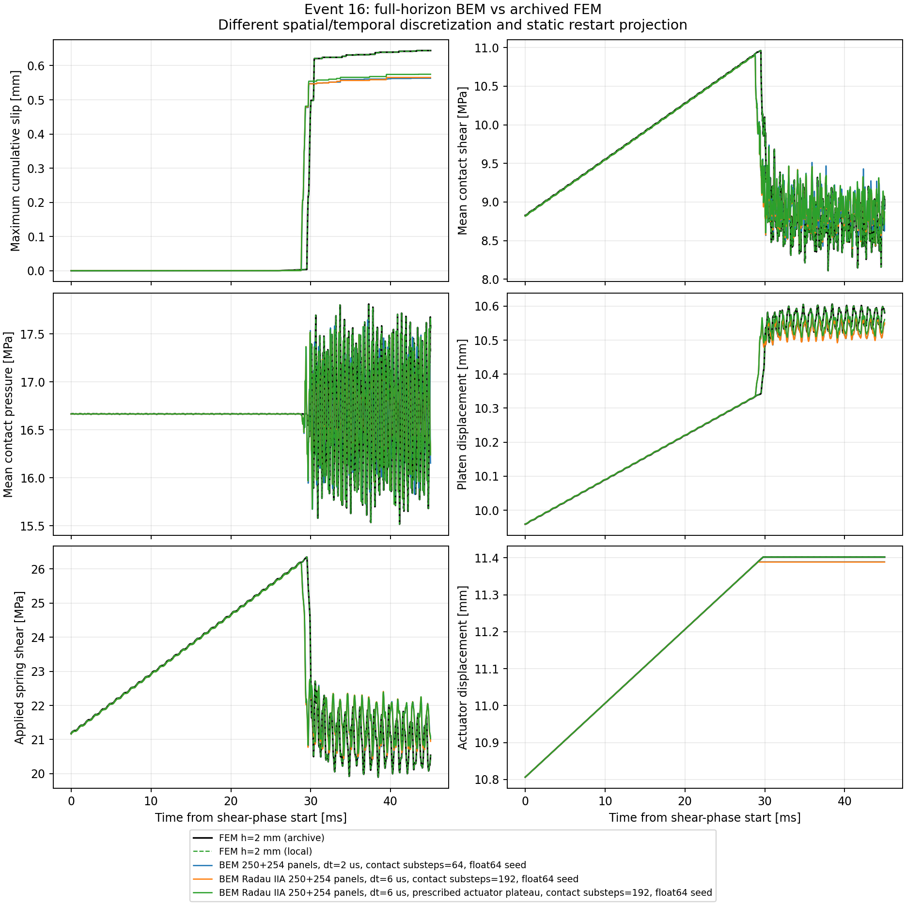
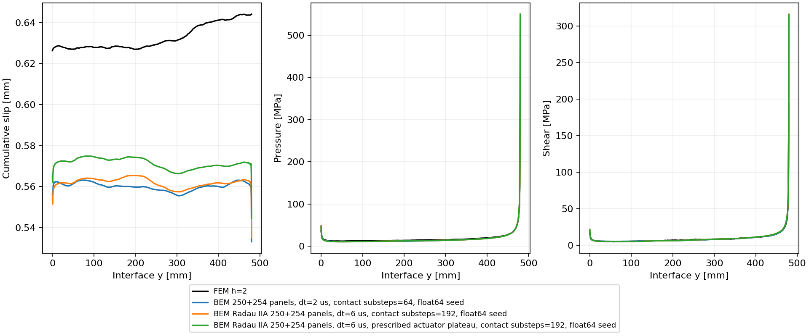
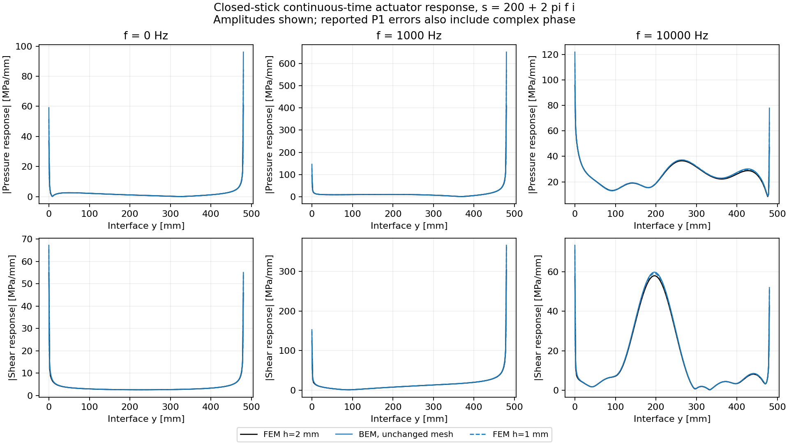

# 完整 Radau 事件與誤差分離

2026-10-26。已完成原幾何、原摩擦律、原float64塑性seed的45ms Radau事件，
**尚未達到與原FEM相同精度，也未證明較穩定或總時間較短。**
本頁保留完整事件、指定載入的診斷與連續時間線性對照的不同用途。
數字、原始輸出路徑與SHA256見[完整事件紀錄](radau_event_results.json)。

## 原政策的完整事件

空間離散固定為250+254個boundary panels、137個contact nodes、275個history DOFs，
Q12；所有彈性歷史、反射、局部摩擦律與coverage停止政策均保留。
Radau6us的兩段接觸子步為64/128，與BDF2的2us/N64同為31.25ns局部子步。
兩組皆使用同一份原float64 seed；舊stock-seed數字仍保留在舊報告，不混作同一控制。

|方法|最大累積滑移 [mm]|相對原FEM偏差|停止載入 [ms]|末滑移P1 L2差|已備核forward [s]|
|---|---:|---:|---:|---:|---:|
|原FEM h2、float64|0.644123|—|29.7883，首筆stored hold|—|8032.35，含輸出完整模擬|
|BDF2 2us/N64|0.563086|−12.58%|29.134|11.51%|117.30，輸出前|
|Radau 6us/64+128|0.565404|−12.22%|29.112|11.23%|167.89，含輸出|
|Radau，指定FEM停止值，僅診斷|0.574861|−10.75%|29.785615，仿射ramp推得|9.76%|186.94，含輸出|

Radau的末壓力／剪力P1 L2差為20.06%／20.55%，並未隨滑移小幅改善而一起消失。
完整滑移歷程的相對L2差約18.46%，BDF2對照約18.22%；不能只選最後的最大滑移宣稱全面改善。
兩組原政策的最大原方程殘差皆低於既有1e−7MPa門檻，Radau為4.51e−8MPa；
stage皆有限、c不減、contact pressure與spring extension皆正。
這些是方程與狀態檢查，不是非單調摩擦的穩定性定理或離散誤差上界。

另固定局部子步0.125us，原seed的2us/N16、4us/N32、Radau6us/16+32
最大滑移分別為0.559077、0.536574、0.561842mm。
接觸子步及bulk時間積分仍影響解；這些結果沒有建立時間收斂階。





## 成本與獨立檢查

完整Radau核心建立4173.50s：重取樣與頻譜寫入2146.96s、IFFT699.54s、
physical weights/startup506.33s、最後檢查與hash801.52s，另有準備18.80s。
兩個頻譜各9.91GB、兩份權重各2.02GB，存於外接SSD上獨立的Tatva-BEM-cache資料夾。
程序峰值RSS約6294MiB。五個獨立重組的完整550×550 stage矩陣，
最大相對差4.47e−11；初始inverse-CQ composition差1.90e−10。
短程完整原Z_RK的獨立核對見[Radau研究](radau_experiment.md)。

上述4173.50s**另依賴先前已支付的73048.67s來源核心**，後者建立時有其他工作競爭資源。
不能省略這筆成本，也不能把它當作公平四核心冷啟動benchmark。
新Radau原事件的cached forward約168s，BDF2對照約117s；目前沒有速度優勢。
所有執行均使用本專案四核心thread/worker設定，macOS沒有硬性CPU affinity。

## 兩項已完成的原因排查

1. **載入回饋。** 使用經完整欄位驗證的FEM `final_state` 真float64 actuator
   `11.401938974952637mm`，只將仿射ramp截在該值，停用coverage回饋。
   原ramp的完整startup和停止後correction均保留；小型獨立原Z歷史已核對此路徑。
   最大滑移只增加0.009457mm，末壓力／剪力誤差仍約20%。
   這不是原政策重現，也未反推或改寫摩擦參數。
2. **未保存frame內的反向塑性滑移。** 新`slip-variation-audit`比較
   `c_end-c_start`、`abs(z_end-z_start)`與sampled total variation。
   c由每個solver step累加，因此前兩者的差也會包含frame間未存下的反轉。
   FEM最大正差8.94e−7mm、最小−8.34e−7mm，屬float32儲存與計算誤差敏感範圍；
   界面加權平均差僅8.94e−9mm。BEM的對應差約1e−13mm。
   FEM／原政策Radau的平均滑移差卻為0.070703mm，這個反轉機制不足以解釋它。
   小負差原樣保留，未裁零；此處沒有提出完整浮點誤差界，也沒有排除其他bulk時間誤差。

## 時間積分前的空間對照

新`linear-bulk-compare`以原FEM能量Hessian、原lumped mass組成
`K+s²M+K_contact+K_spring`；固定原supports、rigid platen和閉合黏著切線。
BEM則直接組裝相同物理載入的`Z(s)+C_contact+C_spring`，施加單位actuator擾動。
兩邊各自保留其接觸節點與lumped line weights；這是連續時間、不同空間離散的對照，
**不含CQ、滑移弱化、開閉或停止事件**，也不是完整FEM事件的網格收斂結果。

所有點取`s=200+2*pi*f*i`；f=0仍是正實Laplace點，並非靜態s=0。
完整P1複數振幅誤差在共同knots精確積分，包含端點及相位差。

|f [Hz]|FEM h [mm]|壓力P1 L2差|剪力P1 L2差|platen複數振幅差|
|---:|---:|---:|---:|---:|
|0|2|25.09%|16.61%|0.0548%|
|1000|2|24.26%|13.06%|0.3965%|
|10000|2|4.54%|4.83%|5.21%|
|0|1|11.26%|10.54%|0.0220%|
|1000|1|11.13%|7.83%|0.1643%|
|10000|1|1.96%|2.49%|1.91%|

FEM h2有91550個bulk DOFs；對照各點的FEM相對方程殘差均低於1.1e−12，
BEM低於6e−16。h1與相同BEM的差明顯縮小，支持原h2的空間誤差不可忽略；
兩個網格、三個頻率仍不足以指定收斂真值或完整事件的誤差上界。
完整數字與複數響應檔案的SHA256見[線性對照紀錄](linear_bulk_response_results.json)。
下圖只畫振幅；上表使用複數差，因此也包含相位誤差。



工具保留原先一次未經run.sh thread設定就中止的試跑log；它沒有輸出可採用的數值，
本頁只採用之後兩組run.sh四核心設定的完成資料。

後續應同時檢查BEM contact/process-zone及角落加密，並保留FEM網格控制；
不能為貼合單一h2結果而改物理參數。局部radiation／完整retarded-history的多速率分解
也值得研究，但仍需先驗證有限體高頻算子及波反射，不能直接引用無限斷層的速度結論。

原BDF2 N64的完整五參數reverse/JVP核對已通過，但梯度尚未展示離散收斂；
Radau目前有局部root AD及完整transpose history，**尚未實作完整trajectory adjoint**。
初始化、材料／幾何及停止事件的導數仍是獨立工作。

重建診斷時選擇新輸出資料夾：

```sh
FDBEM_CORES=4 bem/run.sh linear-bulk-compare KERNEL --fem-mesh 2 \
  --frequencies 0 1000 10000 --laplace-real 200 --output NEW_RESPONSE_REPORT
FDBEM_CORES=4 bem/run.sh slip-variation-audit VERIFIED_FEM BEM_RUN \
  --field-comparison VERIFIED_FIELD_COMPARISON/summary.json --output NEW_SLIP_REPORT
FDBEM_CORES=4 bem/run.sh compact-radau-simulate KERNEL --segment-substeps 64 128 \
  --contact-root-recovery --kinetic-root-seed --restart-seed ORIGINAL_FLOAT64_SEED \
  --prescribed-actuator-plateau 11.401938974952637 --output NEW_LOADING_DIAGNOSTIC
```
