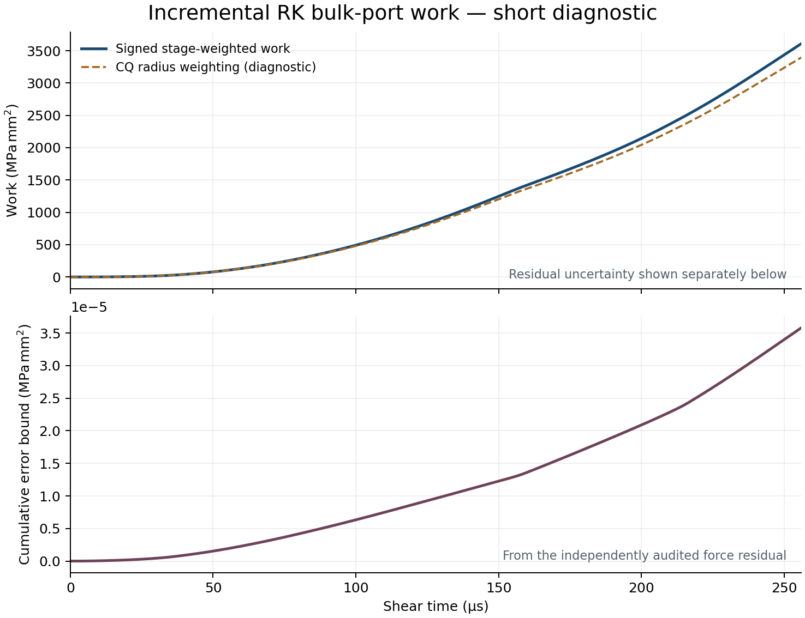

# RK 增量 bulk 功與力殘差界限

2026-10-28。此工具補充[完整因果方程稽核](radau_history_validation.md)，
不將 Newton 收斂或單一正功軌跡當成非線性穩定性證明。

[Banjai–Lubich §3.2](https://arxiv.org/html/1702.08385) 的 RK coercivity 使用
b-weighted stage inner product；兩-stage Radau IIA 的 b=(3/4,1/4)。
本文使用它定義離散功，沒有把該論文的聲學 nonlinear-impedance 定理
直接套到我們的 slip-weakening 接觸。
[Aimi 等人的動態摩擦 BEM](https://arxiv.org/html/2405.08566v1) 亦檢查能量，
其 Tresca 誤差理論與 Coulomb 數值例不是本案例的穩定性證書。

對零初始擾動 trace，每步 stage velocity 為

```text
v_k = inv(A) * (q_k - 1*q_previous_endpoint) / dt
W_N = dt * sum(k=1..N, stage=i) b_i * (Z_RK*q)_ki dot v_ki.
```

測試以另一套直接對一階 Hamiltonian 系統做 RK 的質量—彈簧模型核對。
有／無物理阻尼時，stage 加權功都與 endpoint 機械能、物理阻尼功及 RK
數值耗散之和一致。後者來自正半定矩陣
diag(b)A+A.T diag(b)-b b.T。測試也保留主動負阻尼的負功例，沒有裁成零。

## 實際兩 block 診斷

`tools/audit_radau_port_work.py` 要求同一 stages.npz 已通過獨立 original-RK
因果方程檢查，並核對其 SHA256、kernel、時間網格及完整性。
不重新建立大型頻譜，改由物理平衡還原增量 body force；因果稽核的殘差
epsilon 同時給出累積功誤差界限：

```text
R = Z*q + spring*q_platen + fc - fc0 + r0 - spring*(a-a0)
|work_error| <= epsilon * dt * sum(k,i,j) b_i * line_weight_j * |v_kij|.
```

初始實測 r0 保留；既沒有假設它恰為零，也沒有把 elastic reference diagonal
當成物理 body force。這是靜態 lift 附近的增量 bulk 功，排除 preload 的交叉項、
接觸彈簧儲能與摩擦耗散，不能把它們相加後就稱為完整物理能量平衡。

[實際數據](radau_port_work_results.json) 仍為 h160／Q12、128 步／256 µs 的
加速載入滑移診斷。所有 prefix 的增量 bulk 功與扣除殘差界限後的下界均非負；
末值為 **3610.5691 MPa·mm²**，累積功誤差界限為 **3.5820e-5 MPa·mm²**。
另一條 radius-weighted 曲線只作 CQ 診斷，不代表新增的物理阻尼。



這不是原 event-16 的載入。完整 fine 事件的功與 FEM 能量／精度／耗時比較仍待完成。

```sh
PYTHONPATH=bem/src OPENBLAS_NUM_THREADS=1 python -B \
  bem/tools/audit_radau_port_work.py /path/to/run /path/to/original-rk-audit \
  --output /path/to/fresh-work-evidence

PYTHONPATH=bem/src MPLBACKEND=Agg python -B bem/tools/plot_radau_port_work.py \
  /path/to/fresh-work-evidence --output /path/to/fresh-work-figure.png
```

短程診斷需明確給 `--allow-prefix`；`--preflight-only` 只檢查陣列預算，
不產生功的結論。PNG、SVG 與來源指紋一併保存。

## Fine 建核的早期原始算子控制

第一批 64 個已落盤的 slow-mode 矩陣中，以獨立原始 compliance-condensation
重新組裝 index 0 與 63，未使用 trace Schur producer 的 raw matrices。
[結果](early_fine_radau_results.json) 的最大相對 Frobenius 差為 7.98e-14，
最大弱方向 solve-composition 殘差為 5.60e-11，通過未放寬的 1e-6 門檻。
這只涵蓋兩個實際 fine slow-mode 點，不涵蓋 fast branch、完整 circle 或事件。

檢查與既有 constructor 序列執行，以控制 RAM；同一 PID 在 143.21 s 後恢復，
沒有重新建核或改寫已生成的矩陣。這段時間已包含在 constructor 的 wall interval，
另作紀錄，不能重複加計或從成本刪除。

## FEM normal-to-shear 初態查核

另檢視原 revision `933ae1f` 的 static-normal 分支與既有 h2 參考。
來源先以 healed mu_s 求靜態場，初始 velocity 為零；原 h2 設定亦確為
`normal_phase_mode=static`，不是由動態壓力 ramp 開始。
[最後 normal row 的保存數據](fem_handoff_energy_results.json) 中，kinetic energy
約 1.68e-19，elastic+interface energy 約 5212.23，比例為 3.23e-23。
因此該 h2 run 的 normal handoff 動能可忽略；這是對這筆數據的判斷。

這些標量來自原有 **float32 儲存的 history**，計算狀態則為 float64。
沒有將它們標成新的 float64 observer，也沒有把 phase-1 最後一列改名為 shear t=0。
這項查核不能取代未來 graded FEM 的 handoff 檢查或內部初始場的一致性驗證。
