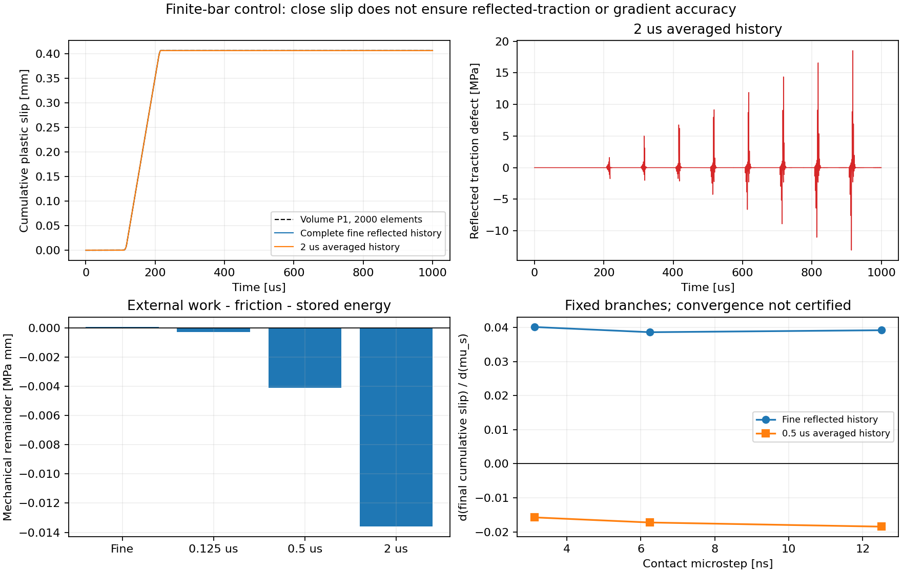
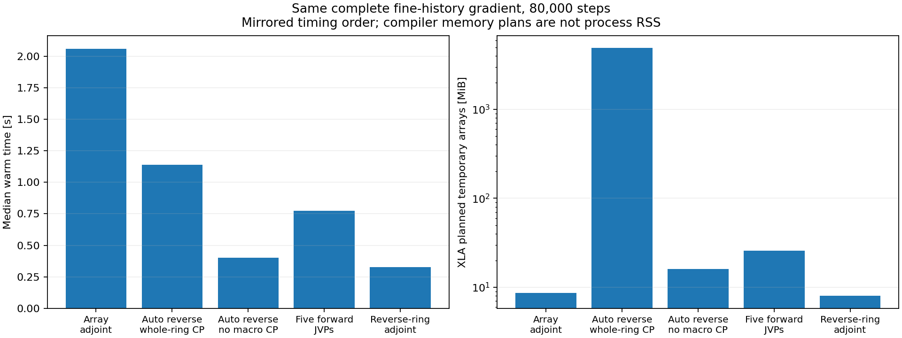

# 完整反射、快速接觸與可微分有限 bar 控制

2026-10-26。這個一維控制用來篩選快速接觸／慢歷史的耦合方式，
**不是原二維 event-16 的重現或效能驗收**。
保留完整細歷史的解能接近獨立FEM；單純平均歷史速度卻有很大的反射應力差，
並使部分參數梯度變號，因此沒有把此平均版本接回正式雙block模擬器。
完整路徑、SHA256、三組microsteps與AD benchmark見
[radiation_bar_results.json](radiation_bar_results.json)。

## 可獨立檢查的物理模型

兩根相同的anti-plane shear bars，remote ends固定，面積取1。
材料採原case的shear modulus、density；每根長度`L=cs*50us`，
相對端點位移為`q`。其解析Laplace impedance為

```text
T = L/cs, C = rho*cs/2
Z(s) = C*s*coth(s*T)
Z(d/dt)q = C*v(t) + 2*C*sum(v(t-2*m*T), m>=1).
```

最後一項包含每次固定端反射，不截斷返回次數。
純delay recurrence `g[n+D]=g[n]+2*C*v[n]` 以一個ring精確保存全部離散歷史。
`D=2*T/dt`是整數。這是此一維幾何的解析性質，不是一般有限二維BEM的歷史壓縮證明。

法向壓力固定`50/3 MPa`；使用原LSW參數`kn=76620`、`kt=7662`、
`mu_s=.8`、`mu_k=.6`、`Dc=.0125959`。
初始`q=z=c=0`，施加在相對端點座標上的traction於125us平滑升到14MPa，
模擬1ms，包含10次round trips。它沒有原event-16的prestress、platen或二維法向動力學。

接觸採backward-Euler瞬時速度項，對每個microstep的previous-state LSW有唯一scalar root，
再呼叫未改變的production `contact_point`提交z/c。
另一個參考獨立組裝lumped-P1體積bar，用central differences推進，不使用delay recurrence。
兩種線性零摩擦控制都對照既有的解析bar到達／反射解；
非線性控制也保留local residual、摩擦功與完整波場能量重建。

## 解與能量的結果

12.5ns microstep時，完整細歷史對2000-element FEM的q／c歷程相對L2差
為0.00767%／0.00768%，最後c為0.406292mm，FEM為0.406278mm。
FEM 500→1000→2000 elements的最後c依序為0.406265、0.406275、0.406278mm。
全部局部root residual均低於既有1e−7MPa門檻，場有限、c不減。

若改用macro interval的平均速度更新返回歷史，局部接觸仍在12.5ns更新：

|歷史間隔|q歷程L2差，對細FEM|最大原反射traction defect [MPa]|機械remainder [MPa mm]|
|---|---:|---:|---:|
|12.5ns，完整細歷史|0.00767%|2.66e−15|+4.94e−5|
|0.125us平均|0.00743%|1.57|−3.00e−4|
|0.5us平均|0.00723%|7.75|−4.10e−3|
|2us平均|0.01570%|18.52|−1.36e−2|

traction defect以實際microstep速度重新計算所有反射，與平均版本真正使用的g相減；
它不同於局部root residual。`remainder=external work-friction work-bulk/interface storage`，
bulk energy由完整微步波特徵重建，單位是每單位面積的MPa mm。
負值顯示該預算的能量偏差，不是已證明無界發散的定理。
這些數字排除了「q接近就可假設歷史粗化準確、穩定或適合校準」的結論。



## 完整細歷史的JAX反向

直接對整個ring-carry scan反傳時，XLA在本例規劃約5.13GB暫存。
新`fine_delay_loss`用custom VJP：儲存必要的q/z/c、forcing、incoming trace，
反向以局部JAX VJP連回每一步，並用reverse-time ring傳遞所有未來反射的cotangent。
接觸根以解析式求解，其局部導數由JAX產生；所有遠期反射的導數仍保留。

80,000步、五個輸入接觸參數的梯度與獨立正向JVP最大絕對差1.64e−14，
通過原rtol=1e−5／atol=1e−12。固定法向p時kn導數應為0；
其餘kt、mu_s、mu_k、Dc方向非零。
小型控制另與普通reverse scan及中央差分核對。
這仍是固定壓力、材料、載入及既定分支的離散導數；沒有擴大到二維幾何／停止事件導數。

單一程序中先編譯及暖機全部版本，再以鏡像順序交替執行，
每個版本4筆暖機量測的中位數如下：

|完整細歷史梯度方法|暖機中位耗時 [s]|XLA暫存配置計畫，decimal MB|
|---|---:|---:|
|全時間cotangent array的custom adjoint|2.061|9.02|
|automatic reverse，整個macro carry做checkpoint|1.138|5127.87|
|automatic reverse，不做macro checkpoint|0.402|16.77|
|五方向forward JVP|0.775|26.95|
|reverse-ring custom adjoint|0.326|8.38|

同一組objective與gradient均通過原核對。這個較完整的控制修正了初次只對照
whole-carry checkpoint的解讀：**多數記憶體改善來自checkpoint放置**。
普通JAX移除macro checkpoint就能大幅降低配置；本次自訂反向ring相對此對照的耗時再減約19%，
暫存約減半，而非對所有普通AD都有4倍速度或數百倍記憶體優勢。
現在`delay_rollout`預設`checkpoint_macro=False`，並保留True作明確選項；
兩個選項都有梯度測試，原先與新預設保存的全部primal fields逐位元相同。
這些配置是編譯器的array memory plan，**不是程序RSS**；時間也是此bar-only AD控制，
不能把這個速度比當成原2D BEM/FEM的結論。



## 精確AD不代表歷史近似可用

0.5us平均歷史版本也通過reverse／forward AD核對，
但12.5ns microstep的`d(c_final)/d(mu_s)`為−0.01846，完整細歷史為+0.03917。
其`Dc`梯度為−0.63994，完整細歷史為−0.53918；
兩版本末滑移只差約2.22e−5mm，卻會給校準不同的方向。

繼續縮小完整歷史microstep，取得：

|Microstep [ns]|c_final [mm]|q歷程L2差，對同dt細FEM|mu_s gradient|Dc gradient|
|---:|---:|---:|---:|---:|
|12.5|0.40629209|0.00767%|+0.039166|−0.539177|
|6.25|0.40629928|0.00393%|+0.038586|−0.540666|
|3.125|0.40630287|0.00207%|+0.040111|−0.537345|

三組reverse／forward check皆通過；狀態差有下降，但gradient變化並非單調，
因此尚未把它們列為連續問題敏感度已收斂的證據。
3.125ns控制有320,000步，自訂反向不需要建立約81.92GB的完整ring snapshots；
這個快照數字是形狀計算，該級距沒有執行普通reverse scan。

接回二維前，須保留對快速反射的解析度，並核對實際retarded operator、能量與gradient；
直接將歷史速度取平均的版本已被此控制排除。目前正式2D事件結果沒有改變。

```sh
FDBEM_CORES=4 bem/run.sh radiation-bar --output NEW_BAR_CONTROL
FDBEM_CORES=4 bem/run.sh radiation-ad-benchmark NEW_BAR_CONTROL \
  --baseline-revision b7f007b --output NEW_AD_BENCHMARK
```

第二個指令需要相應Git歷史；它把baseline source與SHA存入新benchmark資料夾，
並先檢查XLA暫存配置預算才執行各版本。

同日完整h1／float64 FEM空間控制已啟動，維持原h2的dt。
為序列執行必要的AD對照，該程序有兩次已記錄、合計約62.41s的暫停，均已恢復；
因此其原始wall time仍保留，**不將這次h1重跑列為未中斷的速度benchmark**。
空間控制的完整場比較仍待模擬完成，原h2的已驗證計時保持獨立。
