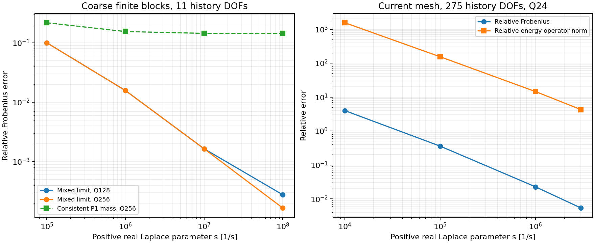

# 瞬時輻射分解的離散高頻檢查

2026-10-26。這是獨立研究工具，**尚未改變正式時間積分器或改善原45ms事件**。
目標是先檢查`Z(s)=s*Cinf+R(s)`中的`Cinf`，再評估能否讓快速接觸與較慢的歷史
卷積使用不同時間解析度。`R`須保留有限block的全部反射；本研究沒有刪掉歷史或加物理阻尼。

動機來自Ciardo、Romanet（2026）的[全動態斷層分解](https://arxiv.org/html/2603.00383v1)，
尤其式(6)的瞬時速度項與完整歷史項。其反平面、無限斷層問題沒有給出本案
平面應變、有限體、混合Galerkin離散的係數；以下是本專案的推導與獨立數值檢查。

## 不能直接換成一致P1質量

對固定的平直面板，令

```text
C = rho * (cp * n*n.T + cs * t*t.T)
```

從沿平面的零切向波數Green response出發，提出正實`s -> infinity`的主導項：

```text
s * V -> blockdiag(L/2 * inverse(C)) = Vinf
H     -> M01/2 = Hinf
D / s -> M11(C)/2 = Dinf
K / s -> Hinf.T * inverse(Vinf) * Hinf + Dinf.
```

`M01`是P0/P1 cross mass，`M11(C)`是一致P1輻射矩陣。
對單面板的兩端點，最後一式給出

```text
Kinf_face = L/24 * [[7, 5], [5, 7]] tensor C
```

即半份一致P1 mass，加半份其P0投影。常數速度的輻射功率與平面波相同；
P0投影為零的交錯P1速度則只保留半份一致mass。
工具也使用原supports與rigid platen，再以原contact jumps對這個正定矩陣做能量消去。
單元測試以獨立平面波功率、交錯trace及約束最小能量核對這些性質。
這些代數測試不能替代原BEM算子極限的數值檢查，也不是有限多邊形的嚴格漸近誤差定理。

## 原事件空間網格的結果

137個contact nodes、275個history DOFs保持不變；Q12/Q24重新組裝原V、H、D與Z。
Q24對推導主導項的比較如下：

|s [1/s]|相對Frobenius差|相對輻射能量operator norm差|
|---:|---:|---:|
|1e4|3.981|1547.5|
|1e5|0.3572|153.86|
|1e6|0.02263|14.52|
|3e6|0.005377|4.273|

後一欄計算`norm(Cinf^(-1/2)*(Z(s)/s-Cinf)*Cinf^(-1/2), 2)`，
保留最差方向，避免大型platen座標在普通Frobenius norm裡遮住小contact座標。
因此**不能把最後一列的0.54%當成所有方向已接近極限**，更不能直接捨掉`R`。
Q12/Q24在最高點的完整Z相對差為1.76e−5；該積分差無法解釋這裡仍然很大的能量norm差。
四個點只在正實軸上，未提供完整複數CQ contour的界。
最後以batch8／四frequency workers重跑132.58s、峰值RSS2080MiB；
保存的全部算子與先前逐頻率控制逐位元相同。

## 小型有限block的高頻控制

保留兩個finite blocks、chamfer、supports及platen，明確改用150mm面板上限，
清除contact/end/corner/seed grading。此控制只有13+11面板、11個history DOFs，
不是原事件的空間離散或非線性模擬。
提高至Q128/Q256，將正實s推到1e8；Q256的輻射能量norm差依序為
0.2322、0.03691、0.003874、0.0003954，趨向推導的離散係數。
同一最高點，換用一致P1 mass的相對Frobenius差仍為14.34%，不隨s一起消失。
這支持混合P1/P0主導項的推導，但不是原137節點模型的全頻段驗證。

高階積分需要按`batch_pairs * Q² * concurrent_workers`計入暫存。
初次batch32四worker控制的RSS達8749MiB，保留為數值／資源研究紀錄；
新預設改為batch8，preflight也加入隨Q²成長的worker scratch。
相同四worker控制重跑37.58s、峰值RSS5044MiB，保存的全部算子與batch32逐位元相同。
這是同一小型診斷的暫存改善，不是完整事件的效能比較。
`--max-memory-mb`檢查估計陣列量，並非作業系統RSS硬上限；每次仍另存實際RSS。
完整路徑、SHA256、積分／operator差及資源數字見
[機讀紀錄](radiation_limit_results.json)。



## 接回非線性之前的條件

1. 驗證所選分解在完整有限體的複數頻率與解析波／反射控制中成立。
2. 若沿用相同CQ符號，分出`s*Cinf`只會代數等價地重寫舊方法，不會自動提高精度。
   新的多速率耦合需對照同一完整算子、獨立縮小macro與micro步長。
3. 原slip-weakening與接觸狀態傳遞、coverage停止政策皆需保留；
   需核對動態選到的分支，不能只靠最後的Newton residual。
4. 接回JAX時保留局部接觸JVP/VJP、隱式根微分及完整轉置歷史；
   材料／幾何導數也須包含`Cinf`與`R`兩部分，不能只對解析瞬時項求導。

第2點的離散等價性亦可對照Egger、Schmidt、Shashkov的
[coupled dynamical systems / CQ預印本](https://arxiv.org/pdf/1811.09817)，尤其§2–3。
該文用相容的CQ重現耦合系統的原時間積分性質，並未保證任意multirate替換保持同樣精度。

```sh
FDBEM_CORES=4 bem/run.sh radiation-limit KERNEL --real-s 1e4 1e5 1e6 3e6 \
  --quadratures 12 24 --workers 4 --batch-pairs 8 --output NEW_CURRENT_MESH_DIAGNOSTIC
FDBEM_CORES=4 bem/run.sh radiation-limit KERNEL --uniform-panel-length 150 \
  --real-s 1e5 1e6 1e7 1e8 --quadratures 128 256 --workers 4 --batch-pairs 8 \
  --max-memory-mb 8192 --output NEW_COARSE_HIGH_FREQUENCY_DIAGNOSTIC
```
