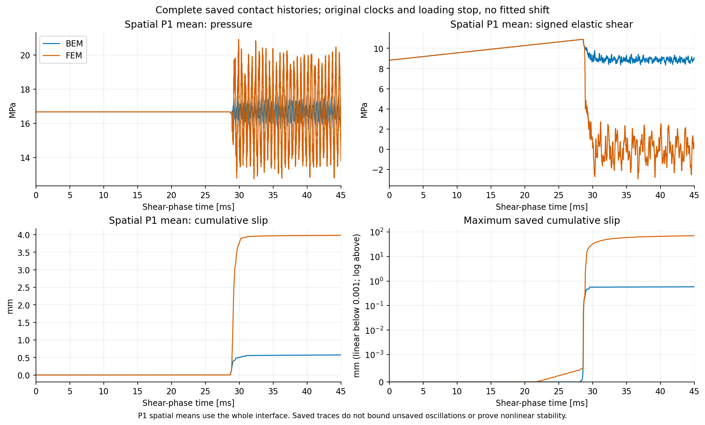
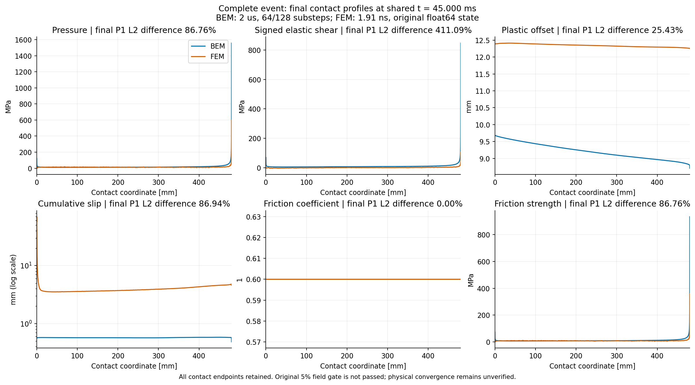

# 原細網格首組 45 ms：完成推進，FEM 場比較未通過

2026-11-04 更新。`local-mus08-muk06-gap0-v2-ev16` 的第一組原細網格
Radau 計算已完成 **22500 步／45 ms**，保留有限雙 block、原載入停止規則、
float64 restart、healed 初始化及全部因果歷史。**目前仍未重現 FEM，不能宣稱
同精度的速度或穩定性優勢。** 原 `/Volumes/Gauss-T7/tatva` 保持只讀。
[數據、來源與資源紀錄](recovered_full_event_results.json)保存本頁依據。

## 完整接觸場比較

此處 FEM 是同一 authored case 的端點加密重播：h=2 mm、端點 0.015625 mm、
157506 個 DOF、實際 dt 約 1.91258 ns；不是直接把原 run 的 float32 輸出當標準。
BEM 使用 bulk h=10 mm、接觸 h=2 mm、端點／角落 0.015625 mm。
兩側空間離散不同，其影響仍須由獨立加密確認。

兩側均使用真正 float64 接觸觀測，以整數步數乘實際 dt 重建時間。
在完整共同接觸區間 `[0,480] mm` 與共同時間區間
`[1.9125812604139645e-9,0.045] s`，對全部保存的 P1 插值場精確積分平方誤差。
共有 31499 個時間聯集節點、547 個空間聯集節點；所有端點均保留，
沒有擬合時間位移、平滑或排除尖峰。末端比較使用同一個 **45 ms**，
而非直接混用 FEM 最後一筆略晚的觀測。

| 欄位 | 相對時空 P1 L2 差 | 45 ms 相對空間 P1 L2 差 | 原 5% 門檻 |
|---|---:|---:|---|
| 壓力 | 29.77% | 86.76% | 未通過 |
| 帶符號彈性剪力 | 69.36% | 411.09% | 未通過 |
| 塑性滑移 offset | 18.43% | 25.43% | 未通過 |
| 累積塑性滑移 | 86.81% | 86.94% | 未通過 |
| 摩擦係數 | 0.4724% | 約 0 | 通過 |
| 正的摩擦強度界限 | 23.61% | 86.76% | 未通過 |

摩擦係數相同不表示摩擦力相同：正的強度界限與實際帶符號剪力分開比較。
約 29 ms 後，兩側的面積平均剪力與累積滑移也分離，差異不限於單一端點。
最後保存的累積滑移空間平均約為 BEM **0.5734 mm**、FEM **3.9823 mm**；
最大值分別為 **0.58145 mm／69.87235 mm**。
FEM 參考解本身仍[未通過時間收斂](fem_dt16_window.md)，
這不會使上述 BEM 一致性門檻自動通過，也不能據此指定唯一誤差來源。





圖表由 `tools/plot_float64_contact_fields.py` 直接讀取已通過來源核對的比較，
沒有改寫原誤差計算。[繪圖數據](diagnostics/recovered_full_event/plot_data.npz)
與[來源 manifest](diagnostics/recovered_full_event/figure_manifest.json)一併保存。

## 方程驗證與較細接觸積分

首組使用兩段線性位移路徑、`(64,128)` 個接觸子步、macro dt=2 µs、Q12、
531 個 history DOF／265 個接觸節點。原完整平衡 residual 最大
`6.957875995745072e-8 MPa`，低於原 `1e-7 MPa` 接受門檻。
所有保存場有限、累積滑移不減、接觸壓力皆正，保存的 strength violation 為零。
微步摩擦功為正，但這些檢查仍不是完整能量平衡或非線性穩定性證明。
**獨立重建原始 RK 算子的完整歷史稽核正在進行；此頁尚未將它列為通過。**

第二組 `(128,256)` 從相同初始狀態重算，在 **第 14450 步／28.900 ms**
因 residual **6.42319 MPa** 停止，已接受前綴與失敗方程完整保留。
擴大固定 seed 的局部 multistart 後，在第 72 個隨機起始猜測找到根：

- 原 JAX 完整 residual：`1.9918949744160978e-11 MPa`。
- 獨立 NumPy 重播：`1.9937291318511034e-11 MPa`。
- 五個接觸欄位最大差：`7.951972413877684e-15`；原 custom root 未改動候選。

這說明原求根失敗不是「沒有根」的證明；仍不能證明根唯一、分支正確或軌跡穩定。
這一組自己的[14450 筆前綴與完整未來歷史驗證](fine128_prefix_preparation_results.json)已通過：
重播與恢復的全部未來項、失敗 forcing 均逐位相同；最大前綴 residual
`7.451527304046901e-8 MPa`。目前尚未提交新時間步。
不能使用第一組的前綴代替接觸子步 refinement。

可獨立重播的小型方程與根放在
`docs/diagnostics/radau_step14450_substeps128_256/`：

```bash
PYTHONPATH=bem/src JAX_ENABLE_X64=true OPENBLAS_NUM_THREADS=1 \
python -B bem/tools/audit_captured_stage_candidate.py \
  bem/docs/diagnostics/radau_step14450_substeps128_256/equation.npz \
  bem/docs/diagnostics/radau_step14450_substeps128_256/candidate_roots.npz \
  --output bem/outputs/recheck-step14450-candidate
```

小型方程不包含 560 MB 的已接受前綴，不能直接當作 CQ checkpoint。
局部控制不會提交接觸狀態或推進完整歷史。
後續[兩個實際失敗方程的備援控制](extended_actual_recovery_controls_results.json)也通過：
直接呼叫原 `recover_original_stage`，較細版本允許最多 512 個隨機起始猜測。
目前 factory／CLI 仍使用既有的 32 個預設值；尚未更換執行中工作的來源。

## 耗時與下一步

第一組**續跑階段** wall time 為 **9067.326 s**，實際 CPU **1623.712 s**，
平均約 **0.179 核心**；原四核心平均預算的等待額度已完整結清。
這包含續跑載入與輸出，但不包含先前建核、初始化、前綴驗證、失敗嘗試與局部根搜尋。
原版核建構另記錄 **263442.010 s**，其中含暫停及序列控制。
FEM 的 **109028.208 s** 也不是隔離 benchmark。
因此不能把 `109028 / 9067` 當作 BEM 的整體加速倍數。

續跑實際建立 **66766** 次 kernel FFT，與[歷史存取成本預測](history_access_cost.md)
完全相符。較大可重用 FFT cache 已有保持原解的控制，可用於下一組資源配置；
呼叫數改善本身不保證總耗時改善，更不代表同精度的 FEM 優勢。

低頻剛體平移的獨立質量控制，兩方向的有效質量與幾何質量約差 **0.02%**，
未見整體質量縮放錯誤的跡象。這是有限 Laplace 頻率的控制，
不涵蓋所有 bulk 模態、自由滑動響應或完整事件的能量。

接下來先完成原因果方程稽核、第二組接觸積分與時間／空間／參考解收斂，
再追查破裂後平均響應差異並比較同精度成本。
[完整粗網格的 initialized JAX JVP／VJP 控制](identity_radau_ad_check.md)已通過；
目前尚未對未通過物理場門檻的完整細網格事件宣稱梯度收斂。

新增[接觸張開、彈簧分離與塑性路徑診斷](contact_state_divergence.md)：
FEM 在已保存的破裂後歷程出現張開及彈簧分離，首組 BEM 全程維持閉合；
這是需要追查的動態分歧，尚未證明其唯一原因。
