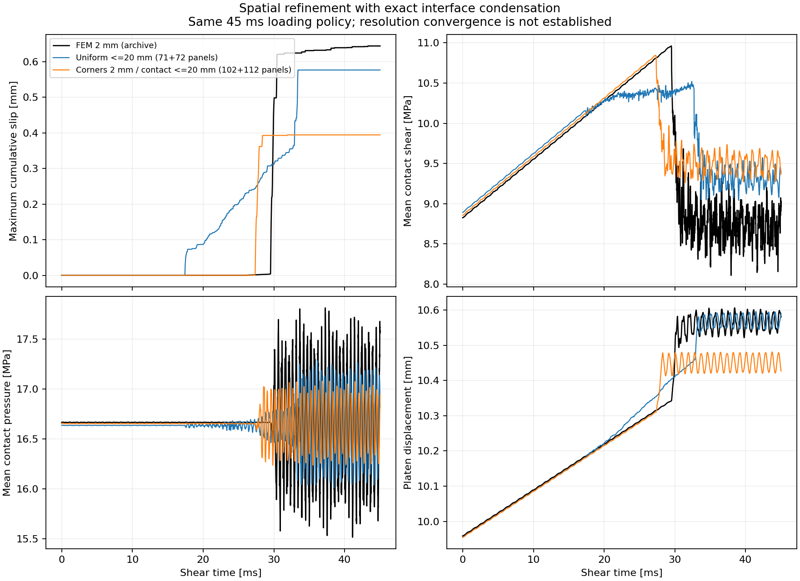
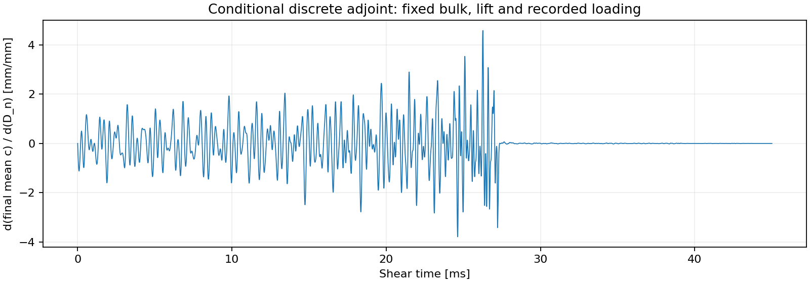

# Event 16：空間加密、效率與完整歷史梯度

2026-10-23。本輪完成接觸座標的頻率域凝縮、角落加密、近接積分與完整
reverse-CQ adjoint。兩個 45 ms 案例均完成，但**尚未重現原 FEM 破裂解，
也尚未建立空間／時間收斂**。以下比較使用相同材料、幾何、摩擦參數及載入停止準則；
BEM 以界面快照建立 static lift，沒有直接匯入 FEM 的完整初始內部場。

完整量測、程式與輸入指紋見 [refinement_results.json](refinement_results.json)。
前一輪粗網格結果保留在 [event16_comparison.md](event16_comparison.md)。

## 解的穩定性

兩個案例使用 BDF2 convolution quadrature、dt=8 µs，保留全部 5625 步歷史。
全程最大縮放邊界／接觸殘差小於 1.5e-11 MPa，接觸剪力沒有超出採用的摩擦強度。
初始化均未新增塑性或累積滑移，也未開啟 restart relaxation。

角落加密案例原先在 28.432 ms 的接觸分支切換處失敗。現在當單步 line search
找不到下降方向時，先試探第二個 Newton 修正，再以兩步合成方向做相同 merit 的
line search。只有通過殘差檢查的結果會提交接觸狀態；沒有新增阻尼或放寬容許誤差。
失敗步保存為小型 regression fixture，NumPy 與 JAX 後端皆通過。

這證明這兩次離散求解收斂，尚不構成非線性 P0 collocation 的能量／passivity
證明。8 µs 也不足以解析 2 mm 面板的波傳時間；implicit CQ 可完成求解，
仍須另做時間精度檢查。

## 模擬花費時間與記憶體

本機設定 `FDBEM_CORES=4`，以 4 個頻率 workers 建立核心，並在 import 前將
BLAS／OpenMP 的每 worker 執行緒設為 1。macOS 未強制 CPU affinity；
Accelerate 也未被 threadpoolctl 偵測，因此這是 4-worker 設定的量測，
不是作業系統保證的硬性 4-core 隔離。

|項目|均勻上限 20 mm|角落 2 mm、接觸上限 20 mm|
|---|---:|---:|
|兩個 block 的邊界面板數|71 + 72|102 + 112|
|保留的接觸／platen 座標數|49|69|
|完整邊界 CQ 權重的對應大小|1.841 GB|4.131 GB|
|實際凝縮 CQ 權重|108 MB|214 MB|
|權重儲存縮減倍數|17.0×|19.3×|
|核心首次建立|396.78 s|773.29 s¹|
|5625 步前向推進，含 Newton JIT|2.66 s|2.69 s|
|程序 peak RSS（快取重跑）|857 MiB|1400 MiB|

GB／MB 採十進位，MiB 採二進位。時間推進不含 static lift、核心建立及輸出。
角落案例最終重跑使用快取，載入約 0.008 s，simulate 呼叫約 3.03 s，
仍不含 static lift 與輸出。不能把這個快取時間當作從零開始的總時間。

兩個最終 run 均使用已建立的快取。修改固定 lift traction 的處理後，
經逐位元核對 transfer 程式及全部 bulk 依賴未變，再沿用相同權重；
JSON 保留快取 key 調整的記錄。

¹ 角落冷核心時間來自開發途中同一 transfer 的建立；當次前向尚未完成，
且是在 helper 改為 import 前 BLAS=1 以前量測。修正 Newton 後的最終完整 run
沿用該快取。JSON 分別保留這兩次量測的環境與狀態。

頻率域凝縮保留反射與記憶，不會截短時間歷史。頻率核心仍需組裝完整邊界，
因此冷啟動仍佔主要成本；目前最適合固定材料／幾何下反覆評估摩擦參數。
尚未達到 production 級 fine-mesh FEM 的公平速度比較條件。
原 FEM 的歷史總時間約 6969 s，其 core 設定未記錄；此前本機粗 FEM 45 ms
約 28.9 s，但網格、時間步與解均不同，不能據此宣稱已驗證加速倍數。

## 解與 FEM 的差異

FEM 參考是 `local-mus08-muk06-gap0-v2-ev16` 的原 2 mm 模型。
時間從剪切階段開始計算，首次滑動以最大累積滑移超過 1e-7 mm 定義。

|指標|原 FEM|均勻上限 20 mm BEM|角落加密 BEM|
|---|---:|---:|---:|
|首次滑動時間|25.733 ms|17.352 ms|26.584 ms|
|首次滑動位置 y|0 mm 節點|10 mm 面板中心|18.050 mm 面板中心|
|actuator 停止增加時間|29.788 ms|32.712 ms|27.792 ms|
|全歷程最大累積滑移|0.644123 mm|0.576585 mm|0.394418 mm|
|最大滑移相對 FEM 偏差|—|−10.5%|−38.8%|



角落加密改善成核時間，但滑移與載入停止時間仍有明顯差異。
最大累積滑移歷史的相對 L2 差由 34.0% 增為 43.2%；平均剪力歷史約 5.4%，
平均壓力約 1.6%。不能只用平均 traction 或成核時間宣告驗證成功。
FEM 節點與 BEM 面板中心也有不同的空間取樣方式。

凍結塑性狀態的獨立靜態屈服預估為 26.595 ms，接近角落動態 run 的
26.584 ms；12／20 點 Gauss 的此項靜態預估一致。但這不驗證後續破裂波。
只加密接觸端點、未加密相鄰外邊界的版本曾無法通過初始摩擦界限，已保留為失敗資料。
目前接觸中段仍接近 20 mm，大於約 13.9 mm 的 process-zone 估計，
需要一致解析整條接觸界面及角落，再做較小 dt 的比較。

## JAX 自動微分

新的 adjoint 對所有 5625 步使用 JAX VJP、每步平衡根的隱式微分與反向
CQ 轉置卷積。它不儲存 Newton 的試探路徑，也沒有短 scan 的 256 步限制。
局部接觸函式、NumPy 解析切線與短程 scan AD 繼續作為交叉檢查。

角落案例的目標為末面板加權**平均**累積滑移 0.380606 mm。
完整反向含 JIT 的本機量測約 2–4 s；詳細當次時間由 JSON 記錄。

|參數|條件式梯度|中央差分步長|相對差|
|---|---:|---:|---:|
|mu_s|48.2713145|1e-7|3.6e-8|
|mu_k|−7.34349946|1e-7|1.9e-6|
|Dc|19.8917745|1e-8|9.6e-6|

梯度固定 bulk 權重、static lift 與保存的 actuator 歷程，沒有對
「全界面滑移後自動停止載入」的事件時間求導。材料、幾何與初始化對參數的
導數也尚未包含。mu_s 差分步長放大到 1e-6 後會改變 5／7 個滑動時空分支，
相對差升至 2.55%；因此目前適用於分支內的局部敏感度，不能保證較大更新仍準確。
前向解仍未收斂，也不能直接用這些梯度校準原 FEM 的物理參數。



另一個 32 步滑動診斷中，full/interface 的接觸響應最大差為 4.4e-9，
梯度最大差 1.5e-10。暖機 loss 加梯度約由 8.22 ms 減為 1.21 ms，
這是小型驗證案例的量測，並非 fine-mesh 事件的預測時間。
推導與後續 AD 工作見 [autodiff.md](autodiff.md)。

## 重跑與檢查

在 repository 根目錄，先依 [README](../README.md) 安裝依賴：

```sh
FDBEM_CORES=4 bem/run.sh event16 --formulation interface --h 20 \
  --dt 8e-6 --duration .045 --backend jax --max-memory-mb 2048 \
  --cache bem/outputs/interface-cache --name interface-h20-dt8-final
FDBEM_CORES=4 bem/run.sh event16 --formulation interface --h 40 \
  --contact-h 20 --contact-end-h 2 --corner-h 2 --quadrature 12 \
  --dt 8e-6 --duration .045 --backend jax --max-memory-mb 4096 \
  --cache bem/outputs/interface-cache --name interface-corners-dt8-final
FDBEM_CORES=4 bem/run.sh adjoint bem/outputs/interface-corners-dt8-final \
  --finite-difference --fd-scale .1
FDBEM_CORES=4 bem/run.sh condensation-benchmark
bem/run.sh test -q
```

本輪 44 個 BEM tests、Ruff 與 formatting 檢查通過。這不代表 inherited FEM
suite 已被重新認證。大型快取與軌跡只留在本機 outputs；倉庫包含程式、
小型必要快照、regression fixtures、圖及量測 JSON。
`/Volumes/Gauss-T7/tatva` 全程只讀。
