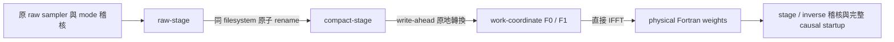

# 整合式 durable Radau producer

2026-10-29 新增 [`prepare_storage_radau.py`](../tools/prepare_storage_radau.py)。
它從原 case／mesh 設定重新建核，串接原 raw sampler、獨立算子稽核、
可接續的所有權交接、原地 compact 轉換，以及直接 physical Fortran 權重。
不讀取其他 run 的頻譜，也不消耗目前保留的 256 個頻點。
原 `/Volumes/Gauss-T7/tatva` 維持只讀。



## 原數值流程與儲存交接

[`raw_radau_stage.py`](../tools/raw_radau_stage.py) 使用 AST adapter：
只改原 producer 的 disk preflight，並將 combination 之後的儲存 tail 換成 raw-stage receipt。
adapter 將兩個改動區域還原後，核對整份 `_main` AST；其餘原始 statements 完全相同。
原取樣接受條件、branch 順序、checkpoint sampler 與 fresh mode／impedance 稽核都保留。
原 source 檔與原 module bindings 不改；adapter 本身也加入 frozen source receipts。
完整 stage 稽核所需的原 fresh matrices 與初始 impedance 另行保存。
fresh 算子稽核仍是原來的抽樣稽核，不是每個頻點重新組裝或誤差定理。

[`radau_stage_handoff.py`](../tools/radau_stage_handoff.py) 在移動任何檔案前，
核對兩個 raw branches 的完整 SHA256、headers、role、單一 hardlink 與 inode。
取得 source／target 兩個 exclusive leases，先提交交接 journal，
再以同 filesystem 的 atomic rename 移動兩檔；不複製大型頻譜。
中斷於第一次 rename 後，依實際檔案位置與原 inode 接續。
交接完成後，原 raw-stage 保留歷史 receipts／audit artifacts，但不再擁有頻譜。
舊 raw sampler 不可在已交出的路徑接續。

後續使用[原地轉換](inplace_radau_compaction.md)與
[直接 Fortran IFFT](direct_fortran_radau.md)各自的 verified resume journal。
[`finish_storage_radau.py`](../tools/finish_storage_radau.py) 保留原完整 stage algebra check、
lag-zero inverse composition 與全部 causal actuator startup。
數值 tolerance、全部 requested lags、wrap、work normalization 與操作次序保留。
相容的 kernel summary 可由現有 `simulate_compact_radau.py` 讀取。

外層 `storage-pipeline.json` 固定參數、case／seed／package、runtime 與 tool hashes。
若前一個 raw 子程序仍存活，拒絕啟動第二份。
source、所有權或已提交資料改變時拒絕接續；不把另一份核心拿來補缺頻點。
preflight-only output 不能當成未完成核心接續，正式建核須使用另一個 fresh folder。

## 已完成的核對

[原始紀錄、指紋與所有嘗試成本](storage_radau_pipeline_results.json)。

- **47 項測試通過**，其中 11 項為新 stage／整合控制。
  pytest 會實際執行原 producer 與新 producer，再核對全部 frequency／weight bytes 與 startup。
  也實際中斷新 producer 的 IFFT，再以正式 `--resume` 接續。
- Q12、11 retained unknowns、dt 2 µs、16 步、FFT 64 的完整小型 BEM 核心：
  兩個 raw branch receipts、全部 compact 檔、兩組 physical Fortran weights、
  initial impedance、wrap 與全部 causal startup 欄位均逐位元相同。
- 整合流程另外在第一個 raw 檔 rename 後，以及 F1 第一個 IFFT column 寫入後，
  以 `os._exit(81)` 結束 parent，跳過 Python 清理。
  正式接續後的上述完整核對均通過；原 inode 與各自的 journal 保留。
- 同一 float64 f09 seed、`fem-body-active-set` 初始化、2／4 contact substeps，
  兩個核心均完成 16 步；全部 **18 個 trajectory arrays 逐位元相同**。
  此短程最大 cumulative slip 為零，只涵蓋 sticking 的接觸 solver 相容性，
  未作 slip-weakening 分支或完整事件驗收。
- 小型控制保留測試 fixture 的參數轉送失敗，以及原 nonlinear runner 的
  1024 MiB 預檢拒絕；後者估算需 1024.2 MiB，將控制預算改為 2048 MiB 後通過。
  失敗嘗試與成本沒有刪除。

以上全部本機 numerical controls 一核心依序執行，期間暫停並恢復同一份長程 FEM／quota。
它們的等待已包含在 FEM wall interval，不可再加一次。
目前長程 FEM 含這些等待，不可直接拿它的 wall time 宣稱 isolated speed advantage。

## 1 µs／45 ms 預檢

已用實際 h10／contact2／end .015625 mm、Q12、531 unknowns、45000 步、
FFT 131072、workers 2 做**預檢**，沒有頻率取樣或大型數值配置：

| 項目 | 新 producer 預估 |
| --- | ---: |
| 主要頻譜＋時間權重 data | 739.787 GiB |
| disk preflight，含已列的 backup／startup／reserve | 741.668 GiB |
| construction array peak | 18051.5 MiB |
| 直接 IFFT array workspace | 約 7173.9 MiB |

這是 array／邏輯空間預估，不是 RSS 上限或大型實測峰值。
`CQPlan.estimated_peak_bytes` 仍是一般 dense history 的估計；
新 producer 的 construction guard 使用另一份分階段估計。
預檢不保留磁碟配額；未來啟動仍須重檢 free space、其他核心與完整因果稽核空間。
現有 2 µs durable 核心與後續 audit 完成後會占用大量空間，
不能假設兩組全部頻譜／weights／audit 可同時容納。
目前沒有刪除現有資料，也沒有變更等待中的 2 µs 排程或啟動 1 µs 大型計算。

## 使用方式與計時

從 repository root 執行小型 example：

```sh
PYTHONPATH=bem/src OPENBLAS_NUM_THREADS=1 OMP_NUM_THREADS=1 \
python -B bem/tools/prepare_storage_radau.py \
  bem/src/finiteblock_bem/resources/cases/pmma_event16.toml \
  --output bem/outputs/new-storage-example \
  --h 160 --contact-h 160 --contact-end-h 160 --corner-h 160 \
  --dt 2e-6 --duration 3.2e-5 --quadrature 12 --workers 1 \
  --fft-rows 2 --combine-matrices 3 --startup-rows 1 \
  --max-workspace-mb 512 --max-memory-mb 1024
```

中斷後加入 `--resume`，其餘設定與 source 必須相同。
完整 geometry 的資源檢查可使用 `--dt 1e-6 --duration .045 --workers 2 --preflight-only`，
output 放在有足夠空間的獨立磁碟目錄。它只做預檢。
[`compare_storage_radau_kernels.py`](../tools/compare_storage_radau_kernels.py)
提供相同計畫的新舊核心完整位元核對。

main timer 在 imports／argument parsing 之後開始；完整 command 成本應由外層 invocation 計錄。
如果強制結束造成舊 attempt 缺少結束時間，`all_attempt_timings_accounted=false`，
`total_before_reporting=null`；僅另外保留 `known_main_interval_seconds`。
下游 runner 的 `kernel_build` 因此也會是 null，避免把僅有的接續時間誤當總成本。
內層 sampling／IFFT 與外層 command intervals 互相包含，不能全部相加。

完整 event-16 的 FEM 場量／前緣／波與能量、macro time／contact／space 收斂、
initialized AD 收斂及同精度穩定性或總時間優勢，仍未完成。
