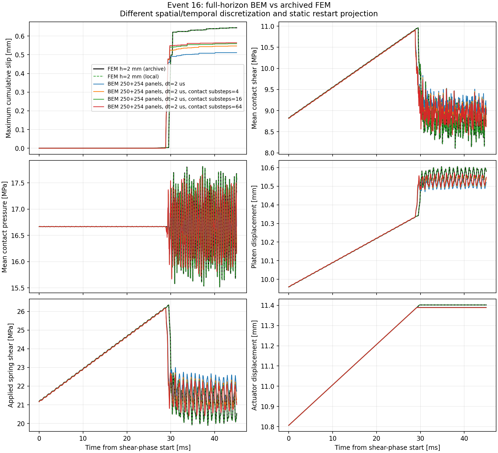
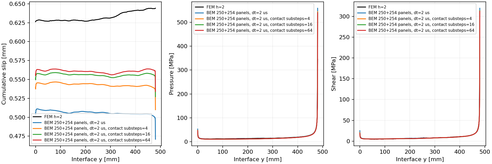
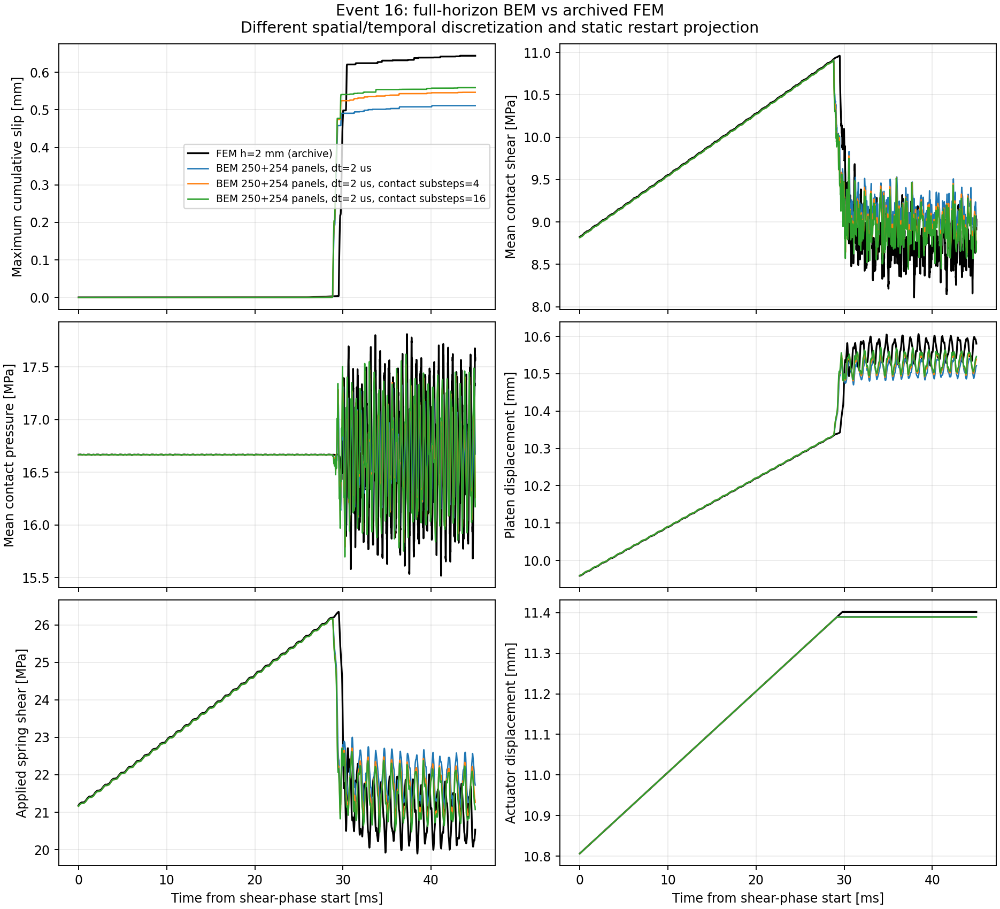
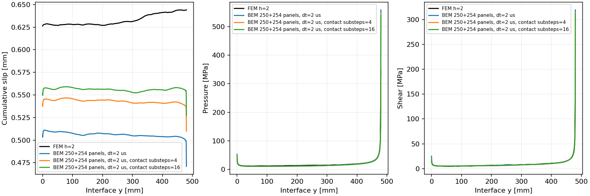

# 接觸子步與完整條件式 adjoint

2026-10-24；更新2026-10-25。這是實驗選項，精度與收斂驗收仍未完成。
2026-10-25：完整一子步的七個場已與原BEM逐位相同。
原Newton四子步在29.144ms失敗；加入殘差檢查的信賴域／延續備援後，
四與十六子步均完成45ms。最大滑移差降至約15.1%／13.2%，仍未達成FEM驗收。
失敗與[FEM參考精度修正](reference_precision.md)分開保留。
動機是[2 us完整事件](fine2_event.md)仍可在一步內跨過84%的弱化區間。
這項改進保留 bulk CQ 時間網格、參數及原 `contact_point` 更新公式，
在前後兩個已接受 jump 間取線性路徑，以較小局部步更新塑性／累積滑移。
微步內的中間波動仍由此線性路徑近似，不能當作細化 bulk 時間步的替代證明。

`tools/substepped_contact_experiment.py` 以 `jax.lax.scan` 更新局部狀態，
`jacfwd` 組裝端點切線；外層平衡根沿用原 Newton／line search 與 implicit root AD。
子步數為1時，直接委派原求解器；單點回傳值與完整小型CQ軌跡的七個場皆逐位核對。
定壓正向滑移的測試另與連續弱化解析解比較，子步加密使誤差下降。

子步使當步接觸除了依賴舊塑性／累積滑移，也依賴舊位移。
反向計算因此增加一個位移 cotangent carry，並將 reverse 起點往前一個平衡根，
再接上原 closed/sticking prefix 的完整轉置歷史。
程式會檢查該前綴確實不再收到額外位移 cotangent；不足的 correction horizon 直接報錯。
`tools/adjoint_resolvent.py` 已加入這條路徑，沒有把 Newton 迭代保存到反向圖中。

小型20步、8子步案例以獨立的原始 Z 完整歷史 JAX scan 核對 forward，
並逐項比較五參數、初始 z/c、全部 actuator 載入 cotangent。
此驗證與本機完整事件分開看待；完整事件梯度尚須另有獨立參考，
單獨算出 adjoint 不會將 `all_compared_cotangents_passed` 設成true。
材料、幾何、靜態lift和停止載入事件時間仍固定。

建立完成的 kernel 可直接重用，例如：

```sh
FDBEM_CORES=4 bem/run.sh resolvent-simulate bem/outputs/direct-resolvent-fine2-q12 \
  --constitutive-substeps 8 --fft-cache-mb 8 --max-memory-mb 8192 \
  --contact-root-recovery \
  --output bem/outputs/fine2-q12-contact8
FDBEM_CORES=4 bem/run.sh resolvent-adjoint bem/outputs/fine2-q12-contact8 \
  --fft-cache-mb 8 --max-memory-mb 8192 --forward-parameter-check
```

輸出保留子步原始碼指紋及微步摩擦功；固定各微步端點壓力的積分功差只作診斷，
不當作總能量或滑移誤差上界。比較器會使用真實微步功，並另外保存宏步端點估計。
目前只允許子步案例的 standalone adjoint；跨run完整微步分支比較仍未實作。
接觸子步將原一步約20.7%的最大滑移差降到13.2%，頻率插值本身並不保證精度改善。

## 完整事件的備援求解結果

`robust_contact_experiment.py`只在原Newton失敗時啟用Powell hybrid信賴域法；
仍不通過時，從previous-state contact root以接觸方程延續到完整子步方程。
所有trial都不commit狀態；只有最後原始子步residual低於1e-7MPa時，
重新進入既有implicit-root API接受q/z/c。SciPy的success旗標不能取代殘差檢查。
沒有加入阻尼或改變最後的接觸平衡式。

|量|原一步|4子步＋備援|16子步＋備援|原FEM存檔|
|---|---:|---:|---:|---:|
|最大累積滑移 [mm]|0.511082|0.546689|0.559055|0.644123|
|最大滑移相對差|20.65%|15.13%|13.21%|—|
|末滑移分布相對L2差|20.03%|14.20%|12.13%|—|
|停止載入 [ms]|29.200|29.154|29.138|29.788|
|推進 [s]|73.81|92.30|91.74|不同演算法與設定，尚不作同精度比|
|成功恢復的step數|—|2|3|—|
|微步固定壓力積分功差 [MPa mm²]|6.31|1.95|0.516|未量測|

保存場皆有限、壓力為正、累積滑移非遞減，彈簧在已保存路徑中維持壓縮。
兩組最大殘差約7.80e-8與7.46e-8MPa，均低於原門檻，並未放寬容差。
首次保存滑移仍為26.390ms，與原FEM25.733ms的差距沒有消失；
壓力／剪力末分布L2差仍約20%。因此這不是已收斂或與FEM一致的解。

真正失敗step的275座標矩陣／狀態已保存為小型測試fixture，
核對備援恢復、trial不commit，以及恢復根的mu_k隱式梯度與獨立差分。
這些測試也不代表完整45ms梯度已有獨立驗證。

新增可選的`--forward-parameter-check`，以完整正向JVP傳遞五個參數方向，
核對反向adjoint，並保留原rtol=1e-5／atol=1e-12門檻。
正向與反向的歷史遞推分開實作；正向closed prefix保留kn／kt非零source，
只使用DFT乘積在最後prefix source之後的輸出，避免future-input circular wrap。
五個post-source串流共用同一kernel FFT，子步亦傳遞前一位移的tangent。
小型測試另用原始Z完整scan核對原一步與八子步參數導數。
完整45ms、22500步、16子步的五參數核對現已通過，
反向與獨立正向遞推的最大絕對差4.88e-12，最大相對差4.85e-12，
保留原rtol=1e-5／atol=1e-12。
反向包含JIT耗時177.247s，驗證用的五方向正向JVP280.483s；
後者是獨立驗證的成本，不是每次求梯度都需再做的步驟。
此核對固定bulk、lift、已記錄的載入及分支，只檢查五參數，
不會把未核對的初始狀態／actuator cotangent算成通過；
完整外部cotangent guard仍為null，event-time/material/geometry導數仍未涵蓋。

完整數據與來源指紋見[substepped_contact_results.json](substepped_contact_results.json)。

## 原始float64 seed控制

正式FEM參考已[完成完整場核對](fem_verified_reference_results.json)。
從它實際使用的event-15 HDF5匯出原float64塑性seed，保持相同seed節點、
137個BEM接觸節點、Q12、2us、16子步及bulk kernel，重新計算靜態lift後完成45ms。
對照舊packaged seed，插值後塑性seed的最大改變4.49e-7mm；
最大累積滑移由0.55905503變為0.55907686mm，差2.18e-5mm，約0.0039%。
首次保存滑移提前一個bulk步至26.388ms，停止載入仍29.138ms；
與FEM的最大滑移差仍約13.20%，因此此精度差異不是主要來源。

新控制保存場皆有限、累積滑移非遞減、壓力為正、已保存狀態的彈簧保持壓縮。
最大接觸殘差9.93e-8MPa，兩次備援恢復；
載入／靜態初始化21.388s、推進89.394s、總計110.834s（不含最後輸出），
冷kernel成本仍另計，不能直接與8032.347s FEM比較後宣稱同精度速度優勢。
此控制的完整事件梯度尚未獨立核對。

後補同一原float64 seed的64子步完整控制：最大c=0.563086281mm，
對原FEM差12.58%；比stock seed／64子步少0.000837460mm，約0.149%。
停止時間29.134ms，最大殘差9.49e−8MPa，推進97.789s，含載核／lift117.298s
（不含最後輸出與另計建核）。這也未移除主要FEM差距；
此原seed控制的gradient尚未獨立核對，前面的64子步AD證據屬stock seed軌跡。

64子步沿用同一2us/Q12核心與原packaged seed，於step14566、29.132ms失敗，
原Newton殘差1.431MPa；Powell hybrid最低仍約0.661MPa。
原接觸方程continuation在contact fraction約0.013附近停滯，沒有到達完整方程。
因此此組不構成子步收斂證據，也沒有放寬1e-7MPa的接受門檻。
失敗JSON、局部方程與已接受前綴均保留，與完整16子步結果分開；
後續需檢查求根路徑及bulk時間解析度，不能由本次失敗斷言無解或已證明不穩定。

## 失敗根的可選kinetic seed

新增`--kinetic-root-seed`，必須搭配`--contact-root-recovery`，且只在既有備援也失敗後使用。
它以mu_s=mu_k的輔助問題產生trial displacement，再恢復原參數、原舊狀態與完整子步方程。
僅原始residual低於1e-7MPa才可接受，最後仍由既有implicit-root API更新q/z/c與摩擦功。
輔助問題不會改寫state、kernel或最終摩擦律，預設關閉。

step14566的64子步捕捉方程中，原Newton殘差1.431MPa；一般hybrid、
Levenberg–Marquardt及forcing continuation皆未達原門檻。
kinetic seed讓原方程的hybrid與LM都找到殘差2.49e-13MPa的相同根，
該根的最小壓力10.18MPa、累積滑移增量非負。
這證明該局部方程存在可接受根，沒有證明根唯一、完整軌跡或時間收斂。
實驗工具`diagnose_contact_root.py`保留各方法失敗與成功結果，從不commit trial state。

真實275座標失敗fixture已加入回歸測試，核對恢復、參數／舊狀態不變、
只commit一次，以及恢復根的mu_k implicit AD對獨立差分。
完整45ms/64子步與此選項現已完成：最大滑移0.563923742mm，
相對FEM差12.45%，末滑移分布L2差11.39%，壓力／剪力分布仍差19.94%／20.40%。
三次備援恢復中，只有step14566使用kinetic seed；最大接觸殘差2.20e-8MPa。
保存場皆有限、壓力為正、累積滑移非遞減，已保存彈簧狀態維持壓縮。
推進100.064s、初始化及載核20.280s、總計120.377s（不含最後輸出），
冷建核另計。這完成了原失敗的離散問題，仍未達成與FEM一致或同精度速度驗收。
64子步的22500步完整五參數reverse／獨立forward JVP現已通過，最大絕對差7.40e−12，
最大相對差7.32e−12，保留原rtol=1e−5／atol=1e−12。
目標最後加權平均c為0.560796398mm，gradient依kn、kt、mu_s、mu_k、Dc順序為
`[2.82234e-7, 7.83772e-6, 16.4240, -9.66804, -0.933496]`。
反向含JIT189.394s，獨立五方向JVP核對另外276.726s。
仍固定bulk、lift、已記錄載入與選定分支，沒有核對所有初始狀態／actuator cotangent。
16子步與64子步的forward平均c只差約0.00469mm，但部分gradient符號仍相反；
因此本結果是各離散方程的微分一致性，不是子步收斂的物理敏感度或可靠反演證明。





```sh
FDBEM_CORES=4 bem/run.sh resolvent-simulate bem/outputs/direct-resolvent-fine2-q12 \
  --constitutive-substeps 64 --contact-root-recovery --kinetic-root-seed \
  --fft-cache-mb 8 --max-memory-mb 8192 --output NEW_CONTACT64_RUN
```




