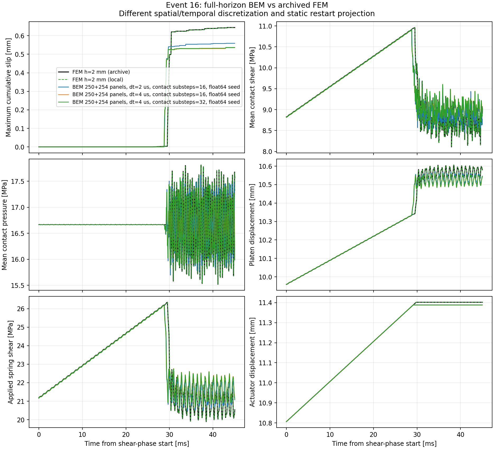

# 相同Q12的完整事件時間網格控制

2026-10-25。已完成45ms原載入、相同250+254 boundary panels、137個接觸節點的
2us與4us BDF2-CQ比較。所有歷史皆保留。**時間收斂與同精度FEM速度優勢仍未證明。**

## Forward結果

下列三組使用同一份原始float64 event-15界面seed；初始bulk場仍是各自重新計算的
靜態lift。局部摩擦子步數N不會改變bulk的CQ時間符號。

|Bulk dt／N|局部子步 [us]|最大累積滑移 [mm]|與原FEM差|載入停止 [ms]|最大殘差 [MPa]|載入核心＋lift＋推進 [s]|
|---|---:|---:|---:|---:|---:|---:|
|2us／16|0.125|0.559077|−13.20%|29.138|9.93e−8|110.83|
|4us／16|0.250|0.535049|−16.93%|29.092|9.66e−8|67.44|
|4us／32|0.125|0.536574|−16.70%|29.088|1.41e−8|68.00|

原FEM最大滑移0.644123mm、停止時間29.7883ms。保持局部子步0.125us時，
兩組BEM仍相差0.022503mm，因此增加摩擦子步不能替代bulk時間加密。
只有兩個bulk網格，不推算收斂階或外推成FEM一致性。
4us／32的最終P1滑移、壓力、剪力L2差分別為16.15%、20.16%、20.83%。

4us的原求根備援在16／32子步皆失敗，失敗方程與軌跡保留。
可選`--kinetic-root-seed`提供試算初值，再以原參數、原狀態及完整原殘差接受解；
三組補跑均完成，未放寬1e−7MPa門檻。這不是唯一根或非線性穩定性的證明。

## AD一致性與時間敏感度

另一對stock seed／N16完整事件，各自通過反向adjoint與獨立五參數forward JVP。
固定bulk、lift、已記錄載入及所選分支時，結果如下：

|參數|2us／N16 gradient|4us／N16 gradient|
|---|---:|---:|
|kn|−2.58077e−7|4.72907e−6|
|kt|−9.55859e−6|8.13057e−5|
|mu_s|−21.1325|330.553|
|mu_k|−11.5161|−2.12255|
|Dc|−18.1350|94.8940|

目標是最後的contact-weighted mean cumulative slip；兩組value分別0.556104與
0.528767mm。每組內reverse／forward最大絕對差4.88e−12與4.54e−11，
通過既有rtol=1e−5／atol=1e−12。反向含JIT耗時177.25與97.54s，
獨立五參數JVP核對另外花280.48與144.94s。

跨網格的梯度差異很大，部分符號相反。這兩組固定的是不同的已記錄停止歷程與
不同離散分支，不能視為同一個平滑物理目標的收斂梯度。
JAX微分的一致性已通過，物理敏感度的時間收斂、停止事件導數、材料／幾何／lift
導數仍需另外驗證。現在不應直接用這些條件式梯度宣稱可靠的物理反演。

## 完整成本

4us新核心重用現有2us頻譜，完整實測4100.89s，峰值RSS6686MiB；
包含全頻譜、IFFT、完整elastic startup與指紋，不是單row外推。
它依賴先前耗時73048.67s、且當時有其他工作競爭的來源核心。
上表rollout不含這些建核成本，不能拿它直接對比原FEM的8032.35s含輸出模擬。
目前仍有13–20%以上的物理差距，沒有同精度的速度優勢結論。

[完整小型結果與來源指紋](time_grid_results.json)、
[頻譜重用方法與成本](cauchy_reuse.md)、[原FEM驗證](fem_verified_reference_results.json)。
