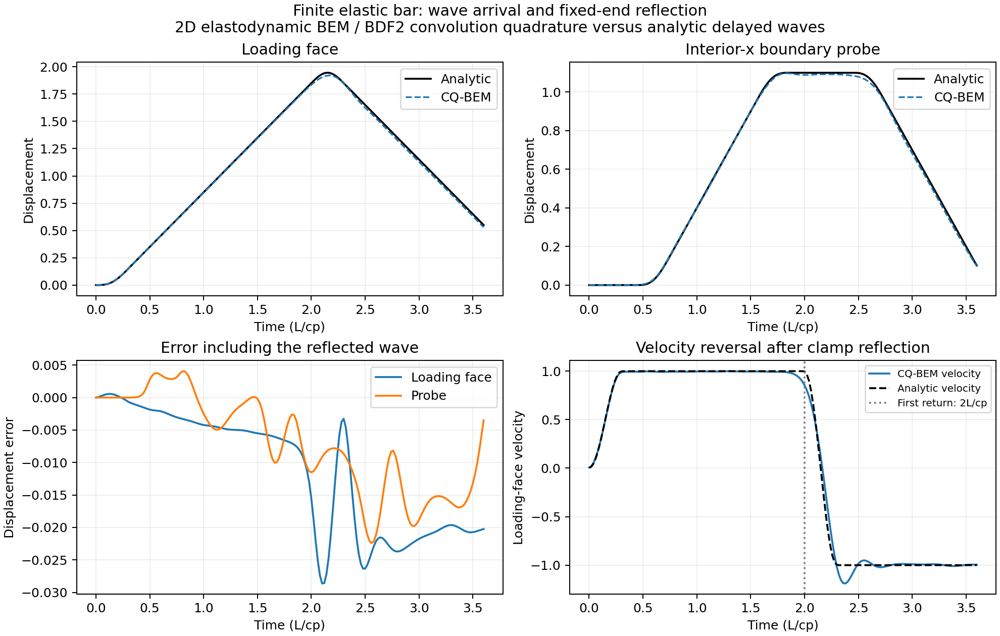
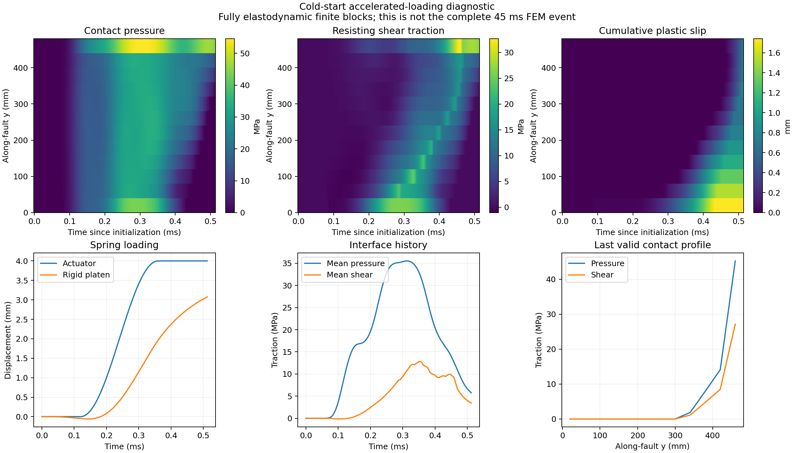

# Verification status

Updated local verification on 2026-10-23, using Python 3.12, NumPy 2.4.4 and SciPy
1.17.1. Full per-run method, input and source fingerprints are in
`validation_results.json`. These are diagnostic results, not certification
of the complete original event.

## Automated checks

**44 BEM tests passed.** Ruff check and formatting checks passed. The package
wheel built successfully; an installed-wheel CLI preflight found its bundled
case and restart data without a source-checkout import path.

The tests cover Green-tensor symmetry/gradients, the Laplace Navier PDE,
P/S manufactured boundary fields, point-force normalization, rigid modes,
density dependence, CQ timing and rational recurrence, full history,
resource guards, friction return maps/tangents, supports/platen, a static
lift, a short two-domain transient, analytic wave arrival/reflection and
paired spatial/temporal refinement.

New checks also cover exact online FFT vs dense history, a sliding trajectory
with both history methods, the long-run contact-switch line-search regression,
custom JAX contact tangents and implicit/trajectory gradients. Full-horizon
coarse runs, 4-core measurements and the remaining differences are documented
in [event16_comparison.md](event16_comparison.md); AD scope is in
[autodiff.md](autodiff.md). The older `validation_results.json` records the
initial reference diagnostics; `event16_results.json` records the later runs.

The new [refinement and adjoint report](refinement.md) covers exact frequency-domain
condensation, graded corners, adaptive near-panel quadrature, streamed static
initialization and a complete reverse-CQ adjoint. New tests compare full and
condensed trajectories/gradients, check the reverse adjoint against scan AD and
an independent actuator perturbation, and reproduce a graded contact-switch
Newton failure. These additions do not establish spatial convergence of event 16.

The earlier static Julia experiment also passed its 238 checks after moving
to the self-contained vendored environment. This does not establish dynamic
equivalence; it verifies the archived experiment remains executable.

## Analytic finite-bar benchmark

| Metric | Result |
|---|---:|
| Loading-face displacement relative L2 error | 1.2056% |
| Probe displacement relative L2 error | 1.3835% |
| Pre-arrival numerical signal / probe peak | 0.00639% |
| Maximum mixed-boundary traction residual | 8.53e-14 |

The simulation includes a fixed-end reflection and loading-face velocity
reversal. The analytic solution is independent of the BEM implementation.

## Nonlinear two-block diagnostic

Both use h=40 mm and the same accelerated cold-start loading, over 0.512 ms.
The physical parameters and finite geometry match the PMMA case, but the
loading schedule is deliberately different from event 16.

| dt | Steps | Maximum cumulative slip | Maximum applied-strength ratio | Maximum residual |
|---|---:|---:|---:|---:|
| 4 µs | 128 | 1.740197 mm | 1.0 | 1.23e-11 MPa |
| 2 µs | 256 | 1.767688 mm | 1.0 | 7.45e-8 MPa |

This is a first time-step sensitivity check, not spatial convergence or a
certified stable-resolution range. In particular, h=40 mm does not resolve
the original approximately 13.9 mm process-zone estimate.

## Original-rate event-16 short transient

The archived plastic slip is transferred into a BEM static lift. At h=40 mm,
the lift satisfies the friction bound without introducing plastic slip.
With the original 20 mm/s actuator rate, the solver completed 128 steps of
4 µs, reaching 0.512 ms. No additional plastic slip occurred; the maximum
boundary/contact residual was approximately 1.36e-11 MPa.

This short interval precedes the original FEM's first sliding. It does not
verify rupture nucleation, rupture speed, stress drop, subsequent reflections,
or the complete 45 ms history. The initial BEM static field is also not an
exact import of the FEM interior displacement/velocity field.

## Explicit remaining limitations

- Dense CQ weights remain a scaling limit. Exact online FFT and interface
  condensation reduce work/storage; oblivious history compression remains open.
- Nonlinear P0-collocation energy/passivity and independent spatial
  convergence at contact ends remain unverified.
- The default uses Tatva's previous-cumulative-slip strength update. The
  global BDF2-CQ integration differs from Tatva leapfrog and needs refinement.
- The optional updated-state softening return can become nonunique; failed
  diagnostic runs are not treated as successful event trajectories.
- The inherited Tatva/FEM test suite has not been recertified by the BEM CI.

See [roadmap.md](roadmap.md) for the acceptance gates before claiming a
reproduction of the complete event.
